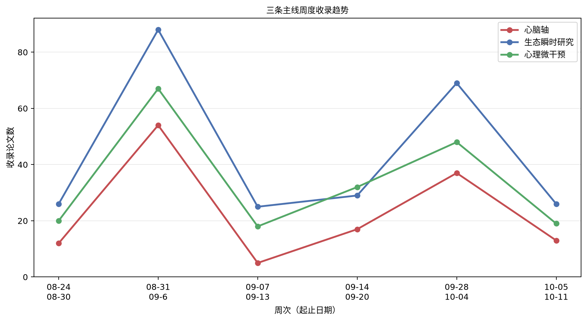

# 心脑、生态瞬时研究与心理微干预文献周报（2026-10-05 至 2026-10-11）

本期收录 43 篇文献。

## 重点推荐
收录 14 篇文献。

### 1. 使用心率变异性与前额脑电图进行心理健康风险分层：基于极端梯度提升分类器与潜在类别分析亚型划分

- 原文标题：Mental health risk stratification using heart rate variability and prefrontal electroencephalography: eXtreme gradient boosting-based classifier and latent class analysis-based subtyping.
- 作者：Je-Yeon Yun, Goomin Kwon, Miseon Shim, Seon-Min Kim, Seung-Hwan Lee, Sangshin Park
- 期刊：Journal of affective disorders，JCR Q1，IF 5.7（2025）
- 发表时间：2026-10-05
- 主题标签：心脑轴
- 关键词：心率变异性；前额脑电图；机器学习；潜在类别分析；心理健康风险分层

**摘要**：心率变异性（HRV）与脑电图（EEG）分别反映心脏自主调节/情绪调节与皮层脑活动/精神病理。本研究旨在确定区分健康对照（HC）与精神障碍患者（PT）的关键HRV/前额EEG分类特征，并识别这些特征的亚型。对147名HC与123名PT（重性抑郁障碍MDD，N=107；惊恐障碍，N=16）同步采集5分钟耳垂光电容积脉搏波与静息态前额EEG信号。基于9个HRV相关特征、11个前额EEG相关特征、抑郁症状与焦虑以及精神科医师诊断构建混合图模型（MGM）。以介数中心性或期望影响排名前12%的节点定义为枢纽，用于极端梯度提升（XGBoost）分类器模型与潜在剖面分析（LPA）：2个HRV相关特征（总功率TP、低频段绝对功率LF）、4个前额EEG相关特征（theta、低alpha、低beta、中beta频段相对功率）以及焦虑。XGBoost模型准确率为74.9±5.6%。SHapley加性解释值显示，较低的焦虑与中beta提示更高的HC概率；较低的LF提示更高的PT可能性。LPA识别出3个PT亚组：（1）高唤醒型（重度抑郁与中度焦虑；较高的中beta与降低的HRV），（2）相对稳定型（极轻微抑郁症状与焦虑；无明显额叶EEG偏离与降低的HRV），（3）额叶EEG减慢型（中度抑郁与轻度焦虑；较高的theta以及TP与LF显著降低的HRV）。未来有必要在多样化人群中，采用基于网络的特征选择、机器学习分类器与潜在类别亚型划分联合使用HRV与前额EEG特征，以确定精神障碍患者风险指标的结果。试验注册：不适用。

**原文链接**：[PubMed](https://doi.org/10.1016/j.jad.2026.122590)

### 2. 基于处方的移动数字疗法作为药物治疗辅助手段治疗惊恐障碍急性期的疗效：多中心随机对照试验

- 原文标题：Efficacy of a Prescription-Based Mobile Digital Therapeutic as an Adjunct to Pharmacotherapy for the Acute Phase of Panic Disorder: Multicenter Randomized Controlled Trial.
- 作者：Yujin Ko, Junhyung Kim, Sunyoung Park, Hyunkyu Kim, June-Ho Seo, Il Ho Park, Jeemin Lee, Jae-Jin Kim
- 期刊：Journal of medical Internet research，JCR Q1，IF 8.2（2025）
- 发表时间：2026-10-05
- 主题标签：生态瞬时研究；心理微干预
- 关键词：数字疗法；惊恐障碍；认知行为治疗；即时适应干预；生态瞬时评估；移动健康

**摘要**：背景：尽管药物治疗是惊恐障碍急性期患者的主要治疗方式，但其疗效不完全，导致患者在相当长的时间内频繁经历惊恐发作和严重的预期性焦虑。一种基于处方的移动数字疗法，整合了自我引导的认知行为治疗、实时症状管理和生活方式追踪，可作为此类患者药物治疗的辅助手段，帮助其实现快速症状缓解。目的：本研究旨在评估该辅助数字疗法在缓解惊恐障碍急性期患者症状方面的疗效。方法：共从6家机构招募66名频繁惊恐发作的急性期患者，随机分为药物治疗联合数字疗法组或单纯药物治疗组，参与为期8周的多中心单盲试验。该数字疗法应用包括三大服务：由结构化认知行为治疗模块组成的训练服务、用于应对惊恐发作的即时模块陪伴服务，以及提供每日自我管理追踪工具的护理服务。作为疗效指标的自评量表在基线、第2周、第4周和第8周共4次访视时通过纸质问卷施测。比较两组的主要终点即惊恐障碍严重程度量表自评版评分变化，以及次要终点如整体焦虑、抑郁、惊恐相关灾难化认知和对身体感觉的恐惧等变化。通过设备使用指标客观评估数字疗法依从性。结果：由于5名入组患者因安全性分析或疗效评估不足被排除，最终分析纳入数字疗法组32人和对照组29人。与对照组相比，数字疗法组在第8周时惊恐障碍严重程度量表自评版评分降低显著更大（平均40.29%，标准差26.68% vs 平均17.61%，标准差30.37%；P=.007）。这一治疗获益在第2周即迅速显现（平均26.66%，标准差22.03% vs 平均11.05%，标准差21.73%；P=.02）。数字疗法组的应答率（惊恐障碍严重程度量表自评版降低≥40%）也显著更高（17/32，53.12% vs 5/29，17.24%；P=.007）。虽然抑郁和躯体恐惧的变化在两组间为暂时性或相似，但数字疗法组在整体焦虑和灾难化认知方面显示出显著更大的持续改善。总体平均依从率为78.12%，应答者与非应答者之间无显著差异。结论：辅助使用基于处方的数字疗法可在惊恐严重程度、整体焦虑和灾难化认知方面带来早期且持续的症状减轻，提示这种包含即时管理和生活方式追踪的多功能自我引导数字疗法可作为频繁惊恐发作急性期患者常规精神科治疗的实际补充。该应用有望通过将患者日常生活中的各种症状方面纳入临床评估和指导，为惊恐障碍急性期治疗提供新框架。

**原文链接**：[PubMed](https://doi.org/10.2196/101125)

### 3. 提醒策略提升餐食记录依从性：一项微随机试验的研究方案

- 原文标题：Reminder Strategies to Improve Meal-Logging Adherence: Protocol for a Microrandomized Trial.
- 作者：Magdalena Fuchs, Victoria Brügger, Qiuhan Jin, Benjamin Wirth, Stefan Bilz, Florian von Wangenheim, Michael Brändle, Tobias Kowatsch, Mia Jovanova
- 期刊：JMIR research protocols，JCR Q3，IF 1.6（2025）
- 发表时间：2026-10-05
- 主题标签：生态瞬时研究；心理微干预
- 关键词：微随机试验；生态瞬时评估；饮食记录依从性

**摘要**：背景：准确测量生活方式因素对于理解日常行为如何作为非传染性疾病的风险因素或保护性缓冲因素至关重要。虽然可穿戴设备能够被动监测身体活动或睡眠，但营养摄入仍依赖参与者的主动输入，例如手动饮食记录或基于图像的记录。此类记录任务的依从性往往迅速下降，影响数据完整性和临床实用性。基于理论的提醒策略，如损失框架或记录一致性反馈（即连续记录天数），可以提高生活方式数据采集的依从性，但这些策略对重复性饮食记录的效果仍不明确。目的：本研究旨在检验两种理论驱动的提醒策略——损失框架和记录一致性——对重复性、基于图像的餐食记录依从性的影响。方法：我们在瑞士一项为期4周的观察性生活方式表型研究中嵌入了一项微随机试验（N=200，年龄≥45岁，BMI≥25 kg/m²）。参与者在28天内使用移动应用程序在每餐（早餐、午餐和晚餐）拍摄其餐食。在参与者自定义的习惯性用餐时间之前设置决策点。参与者被等概率随机分配到以下三组之一：（1）强调未记录将损失每日经济奖励的提醒（损失框架），（2）提供近期记录一致性反馈的提醒（记录一致性），或（3）中性提醒（主动对照）。近端结局是参与者在收到提醒后2小时内是否记录了一餐。参与者根据餐食记录完成情况获得每日经济奖励。为估计干预效果，我们将使用二分类结局的边际偏移效应模型，并调整时变协变量（如研究天数）和基线协变量（如年龄和性别）。本研究已获得瑞士东部州伦理委员会批准（BASEC ID 2025-00972）。结果：招募于2025年11月开始，研究于2025年12月8日启动。截至2026年8月，已招募130名参与者，入组120名，76名参与者已完成研究，预计完成日期为2027年1月。数据分析尚未开始，研究结果预计于2027年第二季度发表。结论：通过阐明损失框架提醒和一致性提醒的近端效应，研究结果将为未来数字健康研究的设计提供信息，以改善日常生活中的餐食记录依从性。这项工作有助于开发可扩展的、理论驱动的提醒策略，以提高观察性和干预性研究中的饮食数据质量。

**原文链接**：[PubMed](https://doi.org/10.2196/100239)

### 4. 校准后的光电容积脉搏波衍生心率变异性在压力状态分类中接近心电图金标准性能：面向可扩展酒精使用障碍复发监测的概念验证

- 原文标题：Calibrated photoplethysmography-derived heart rate variability approximates electrocardiographic gold-standard performance for stress-state classification: a proof-of-concept for scalable alcohol use disorder relapse monitoring
- 作者：Om Chhaya, Viswanath Ananth
- 期刊：未提供，JCR 待 JCR 数据核验，IF 待 JCR 数据核验
- 发表时间：2026-10-05
- 主题标签：心脑轴；生态瞬时研究
- 关键词：心率变异性；光电容积脉搏波；压力状态分类；酒精使用障碍；可穿戴设备

**摘要**：心率变异性（HRV）是自主神经失调的一种经过验证的非侵入性标志物，与酒精使用障碍（AUD）中的压力反应性和复发风险相关。虽然心电图（ECG）仍是HRV评估的金标准，但其在门诊康复中的可扩展性有限。使用光电容积脉搏波（PPG）的消费级可穿戴设备提供了实用替代方案，但将PPG衍生的HRV与ECG标准进行系统校准一直缺乏。我们评估了使用校准后的PPG衍生HRV进行压力状态分类的可行性，作为复发相关自主神经特征的代理指标。使用WESAD公开数据集（15名受试者，ECG+PPG），我们提取了时域（RMSSD、SDNN、pNN50）、频域（LF、HF、LF/HF）和非线性（样本熵、DFA）HRV特征。经典机器学习模型在使用ECG衍生特征进行二分类压力分类时达到80%准确率和0.85的ROC AUC。将PPG特征线性校准映射到ECG空间后，基于PPG的ROC AUC从0.79提升至0.85，与ECG性能相当。深度序列模型（LSTM、CNN）在该数据集中未优于基于特征的方法，可能由于样本量有限。我们另外收集了一名研究参与者佩戴Empatica EmbracePlus（FDA认证）和Fitbit（消费级）可穿戴设备连续七天的PPG记录，以表征动态环境下跨设备一致性。这些结果证明，来自消费级可穿戴设备的校准PPG衍生HRV可以在压力状态分类中接近ECG级别的判别性能，支持在AUD康复中可扩展的基于HRV的复发监测的可行性。

**原文链接**：[Crossref](https://doi.org/10.21203/rs.3.rs-11204325/v1)

### 5. 受控呼吸期间心脏—面部肌肉耦合的复杂性分析

- 原文标题：COMPLEXITY-BASED ANALYSIS OF CARDIAC-FACIAL MUSCLE COUPLING DURING CONTROLLED RESPIRATION
- 作者：ANUPAM BALIYAN, NAJMEH PAKNIYAT, RIYA CHAUHAN, ONDREJ KREJCAR, VLADIMIR KASIK, PENHAKER MAREK, HAMIDREZA NAMAZI
- 期刊：Fractals，JCR Q1，IF 2.9（2025）
- 发表时间：2026-10-05
- 主题标签：心脑轴；心理微干预
- 关键词：受控呼吸；心率变异性；肌电图；心脏—面部肌肉耦合；非线性复杂性

**摘要**：本研究通过分析肌电图（EMG）与心电图（ECG）信号，探讨不同受控呼吸模式如何影响面部肌肉活动与心脏功能的协调动态。26名健康参与者完成四种不同受控呼吸条件的呼吸任务，同时连续记录面部EMG与ECG信号。为刻画这些生理信号的时间结构，研究者从EMG信号以及由ECG推导出的心率变异性（HRV）中计算了三种非线性复杂性指标——分形维数（FD）、样本熵（SampEn）和近似熵（ApEn）。结果显示，随着呼吸任务难度增加，EMG与HRV信号的复杂性均上升，表明在更高要求的呼吸模式下生理动态更为不规则且信息更丰富。此外，在不同呼吸条件下，面部EMG与HRV的复杂性变化之间观察到强正相关，提示受控呼吸期间躯体与自主神经系统之间存在协调适应。这些发现表明，非线性复杂性测量可作为呼吸调节下心脏—躯体反应的敏感指标，并凸显了EMG—ECG联合复杂性分析在理解呼吸任务及相关心理生理状态中的生理调节方面的潜力。

**原文链接**：[Crossref](https://doi.org/10.1142/s0218348x26501550)

### 6. 基于即时文本干预减少酒精使用与亲密伴侣攻击行为的初步测试（预印本）

- 原文标题：A Pilot Test of a Just-In-Time Text-Based Intervention to Reduce Alcohol Use and Intimate Partner Aggression Perpetration (Preprint)
- 作者：Cynthia A. Stappenbeck, Julia F. Hammett, Brennah V. Ross, Zoe Y. Zong, Emily E. Patton, Dominic J. Parrott
- 期刊：未提供，JCR 待 JCR 数据核验，IF 待 JCR 数据核验
- 发表时间：2026-10-05
- 主题标签：生态瞬时研究；心理微干预
- 关键词：即时干预；生态瞬时干预；文本干预；酒精使用；亲密伴侣攻击行为

**摘要**：背景：急性酒精中毒是亲密伴侣攻击行为（IPA）实施的一个公认诱因，这凸显了在饮酒事件临近时进行干预以降低酒精促发IPA风险的重要性。即时（JIT）干预旨在在需要时提供支持。目的：本初步研究评估了一项基于文本的JIT干预在减少酒精使用和IPA实施方面的可行性、可接受性及前后变化。方法：作为一项更大规模研究的一部分，121名报告过去一个月重度饮酒和IPA实施的高风险个体被随机分配到JIT干预组（n=63）或等待名单对照组（n=58）。本分析仅聚焦于接受JIT干预的个体，该干预包括减少酒精使用的策略以及改编自一项网络干预的情绪调节和痛苦耐受技能，该网络干预在减少重度饮酒和IPA实施方面显示出初步前景。参与者在2周内平均收到10条JIT消息。干预期后，54%（n=34）的干预参与者完成了随访调查。结果：定性和定量数据均支持该干预的可行性和可接受性。此外，饮酒减少观察到较大的干预效应（d=0.80-0.81；p<0.001），IPA结果减少观察到非显著的小到中等效应（d=0.19-0.34；p=0.07-0.31）。结论：这项有前景且低资源的干预通过基于文本的JIT方法满足减少酒精促发IPA的关键需求，该方法可广泛传播，在高风险期临近时提供技能。

**原文链接**：[Crossref](https://doi.org/10.2196/preprints.113703)

### 7. 人类NREM睡眠期间脑-心协同动态

- 原文标题：Coordinated Brain-Heart Dynamics During Human NREM Sleep
- 作者：Christian A. Mikutta, Miriam Planta, Thomas Koenig, Kristoffer D. Fehér, Pauline Henckaerts, Marie Angelillo, Elisabeth Hertenstein, Carlotta L. Schneider, Marzia De Lucia, Dieter Riemann, Bernd Feige, Vladyslav V. Vyazovskiy, Christoph Nissen
- 期刊：未提供，JCR 待 JCR 数据核验，IF 待 JCR 数据核验
- 发表时间：2026-10-06
- 主题标签：心脑轴
- 关键词：脑-心耦合；神经内脏整合；NREM睡眠；心率变异性；慢振荡

**摘要**：大脑与心血管系统之间的交流日益被视为健康的基本决定因素，但协调神经与心脏节律的机制仍知之甚少。睡眠为研究神经内脏整合提供了独特的生理状态，因为在非快速眼动（NREM）睡眠期间，皮层慢振荡（SO）、丘脑皮层睡眠纺锤波和自主神经活动会发生深刻重组。我们分析了30名健康成年人整夜的高密度脑电图和心电图记录，并量化了SO、睡眠纺锤波、心脏R波峰、心率变异性（HRV）、频谱斜率和Lempel-Ziv复杂度之间的相互作用。为评估整合性的脑-心协调，我们开发了一种联合相位-振幅耦合（JPAC）指标，用于量化SO相位依赖的纺锤波振幅调制与心脏时序之间的相关性。SO-纺锤波耦合表现出预期的额中央分布，但与自主神经或皮层状态标志物无显著相关。相比之下，SO-R波峰耦合和JPAC系统性地追踪生理状态。更强的JPAC与更高的高频HRV、更陡的频谱斜率和更低的神经复杂度相关，表明在同步、副交感神经主导的NREM睡眠期间耦合增强。这些发现表明皮层、丘脑皮层和心脏节律在一个共同的振荡框架内协调组织，并确定NREM睡眠是大规模神经内脏整合的一种状态和潜在治疗靶点。

**原文链接**：[Crossref](https://doi.org/10.64898/2026.09.29.755384)

### 8. 你每一次（缓慢的）呼吸，你每一个选择

- 原文标题：Every (slow) breath you take, every choice you make.
- 作者：Seh-Joo Kwon, Nicholas J Dennis, Mauricio R Delgado
- 期刊：Trends in cognitive sciences，JCR Q1，IF 20.3（2025）
- 发表时间：2026-10-07
- 主题标签：心脑轴
- 关键词：缓慢呼吸；神经内脏通路；风险决策

**摘要**：Huang及其同事研究了缓慢呼吸如何在风险下的金融决策过程中塑造生理与脑相关信号。他们的发现阐明了将延长呼气与风险偏好增加联系起来的神经内脏通路，其中增强的心脏副交感调节提高了奖赏敏感性，以及参与价值评估和内感受的脑区神经活动。

**原文链接**：[PubMed](https://doi.org/10.1016/j.tics.2026.09.006)

### 9. 慢呼吸影响器官间动态，调节脑功能与风险行为

- 原文标题：Slow breathing impacts inter-organ dynamics modulating brain function and risk behavior.
- 作者：Wenhao Huang, Mine Schmidt, Ignacio Rebollo, Felix Molter, Min Pu, Beatrix Keweloh, Lok Yan Lam, Peter N C Mohr, Gabriele Bellucci, Stefan Röttger, Soyoung Q Park
- 期刊：Neuron，JCR Q1，IF 16.9（2025）
- 发表时间：2026-05-28
- 主题标签：心脑轴；心理微干预
- 关键词：慢呼吸；自主神经调节；风险决策；心脑交互；副交感神经活动

**摘要**：成功的决策需要将外部信息置于身体状态的背景中进行解读。在身体—脑交互的框架下，刻意改变自身的自主神经状态可以塑造我们评估世界的方式，并最终影响选择。然而，有意识的自主神经调节是否以及如何影响人类决策仍不清楚。本研究测试了指导性的延长呼气——一种旨在增强副交感神经活动的慢呼吸技术——在风险决策过程中的作用。参与者在进行风险选择时遵循不同的呼吸方案，同时使用功能磁共振成像（fMRI）和多通道监测测量神经与生理活动。延长呼气通过增强奖赏敏感性和提高心脏副交感神经活动，增加了风险选择。重要的是，副交感神经上调程度更高的个体，其腹内侧前额叶皮层和楔前叶也表现出更强的奖赏相关反应。我们的工作揭示了基于呼吸的干预所具有的转化作用，表明通过呼吸进行的自主神经调节能够经由神经—心脏通路塑造基于价值的决策。

**原文链接**：[PubMed](https://doi.org/10.1016/j.neuron.2026.04.044)

### 10. 简短共振频率呼吸干预对研究生心率变异性与知觉压力的影响：一项先导性与可行性研究

- 原文标题：Effects of a brief resonance frequency breathing intervention on heart rate variability and perceived stress in postgraduate students: a pilot and feasibility study
- 作者：Alessandro Spizzirri, Neil Buchanan
- 期刊：Frontiers in Psychology，JCR Q1，IF 3.8（2025）
- 发表时间：2026-10-07
- 主题标签：心脑轴；心理微干预
- 关键词：共振频率呼吸；心率变异性；知觉压力；简短干预；可行性研究

**摘要**：研究生教育期间的压力可能损害幸福感、学业表现与生理调节。共振频率呼吸是一种缓慢节奏呼吸技术，与以心率变异性为指标的自主体调节增强相关。然而，经过验证的方案通常耗时较长，限制了其在现实世界中的实施。本先导研究评估了一种简短、应用程序引导的共振频率呼吸干预在学业高要求期间的初步效果、可行性与可接受性。十二名研究生被随机分配到共振频率呼吸干预组（n=6）或无干预对照组（n=6）。干预参与者在其个体化确定的共振频率下，连续三周每天完成10分钟练习。每周评估正常窦性心搏间期标准差、相邻心搏间期差值的均方根以及知觉压力（采用改编为一周回忆期的PSS-10）。干预后对五名干预参与者进行定性访谈，探讨可行性、感知影响、参与度与未来应用。组间变化分数比较显示，正常窦性心搏间期标准差在第2周（p=0.004，r=0.94）和第3周（p=0.026，r=0.78）存在显著差异，相邻心搏间期差值的均方根在第3周（p=0.026，r=0.78）存在显著差异，共振频率呼吸组数值上升而对照组下降。未观察到知觉压力的显著组间差异。然而到第3周时，干预组较基线平均下降6.00分，而对照组上升4.50分（r=−0.47，p=0.199）。受访参与者普遍认为该方案可管理，报告了对压力应对的感知益处，并表示有兴趣继续共振频率呼吸。在该先导样本中，简短共振频率呼吸方案可行且可接受，并与学业需求增高期间相对于对照组的静息心率变异性提升相关。研究未证明知觉压力存在显著组间差异。鉴于样本量小、持续时间短且缺乏主动对照，这些发现具有初步性。需要更大规模的对照试验并进行随访评估，以评价疗效、持久性与现实世界实施效果。

**原文链接**：[Crossref](https://doi.org/10.3389/fpsyg.2026.1787922)

### 11. 整合生态瞬时评估与干预及可穿戴设备数字表型治疗青年焦虑：混合方法实验研究

- 原文标题：Integration of Ecological Momentary Assessment and Intervention With Wearable-Based Digital Phenotypes to Treat Anxiety in Young Adults: Mixed Methods Experimental Study.
- 作者：Hyunsil Song, Yoobin Choi, Jinho Park, Hyunchan Hwang, Jinwoo Kim, Chanmi Park
- 期刊：JMIR mHealth and uHealth，JCR Q1，IF 6.3（2025）
- 发表时间：2026-10-08
- 主题标签：生态瞬时研究；心理微干预
- 关键词：生态瞬时评估与干预；数字表型；可穿戴设备；焦虑；青年

**摘要**：背景：青年焦虑水平较高，但及时获得治疗的机会仍然有限。基于移动设备的数字疗法，尤其是生态瞬时评估与干预，为提供情境响应式照护提供了有前景的途径。将可穿戴设备衍生的数字表型与数字疗法整合，可能增强此类干预中反馈的个性化，但来自真实世界环境的实证证据仍然稀缺。目的：本研究考察基于生态瞬时评估与干预的数字疗法ANZEILAX-Green在青年焦虑减轻中的真实世界适用性与有效性，并探究将生态瞬时评估与干预数据与可穿戴设备数字表型结合所生成的个性化反馈如何改善症状并促进自我管理与用户参与。方法：对19至39岁青年开展为期8周的探索性实验研究。参与者使用一款智能手机应用，其中生态瞬时评估与干预模块已与持续采集数字表型数据（包括心率、睡眠和活动）的智能手表整合。心理结局采用广泛性焦虑障碍7项量表（GAD-7）和患者健康问卷9项（PHQ-9）在基线及第2、4、6、8周评估，罗森伯格自尊量表（RSES）在基线及第8周评估。定量变化采用配对样本t检验和重复测量方差分析，定性访谈采用主题分析以识别用户体验机制和设计启示。结果：最终分析纳入29名参与者。其GAD-7（平均差-4.79，95% CI -6.56至-3.02；Cohen d=1.03；P<.001）、PHQ-9（平均差-3.86，95% CI -5.79至-1.93；Cohen d=0.76；P<.001）和RSES评分（平均差+5.21，95% CI 3.47至6.95；Cohen d=1.14；P<.001）均观察到显著改善。GAD-7评分在各评估点呈持续改善，自第4周起出现统计学显著下降。参与者表现出高依从性，完成80%的生态瞬时评估与干预提示。数字表型显示深睡眠增加和活动性降低的趋势，睡眠指标与抑郁症状显著相关。访谈结果分析揭示5种机制：自我觉察增强、数据驱动反思、行为改变、内在动机以及治疗延伸至日常生活。结论：基于生态瞬时评估与干预并整合可穿戴设备数字表型的数字疗法对青年可行且可接受，并与组内焦虑减轻相关，提示具有可接受的疗效，但仍需对照试验确认。实时自我报告的情绪状态评估与被动生理监测相结合，能够实现适合用户情绪和生理状态的个性化反馈。这些发现为自动化、个性化心理健康干预系统提供了实证和设计启示。

**原文链接**：[PubMed + Crossref](https://doi.org/10.2196/88919)

### 12. 认知行为疗法（CBT）对抑郁和/或焦虑障碍患者心率变异性（HRV）的影响：系统综述与元分析

- 原文标题：The effects of cognitive-behavioural therapy (CBT) on heart rate variability (HRV) in people with depression and/or anxiety disorders: A systematic review and meta-analysis.
- 作者：Ahmad Alkout, Amirun Haqqim Bin Eldeen Husaini, Anoop Kadan, Valeria Parlatini, Samuele Cortese, Alessio Bellato
- 期刊：International journal of psychophysiology : official journal of the International Organization of Psychophysiology，JCR Q1，IF 3.3（2025）
- 发表时间：2026-10-09
- 主题标签：心脑轴；心理微干预
- 关键词：认知行为疗法；心率变异性；抑郁；焦虑；元分析

**摘要**：引言：认知行为疗法（CBT）是抑郁和焦虑的常用干预方法。然而，其疗效通常通过主观自评症状量表评估，易受偏差影响。研究假设CBT后临床症状的改善可能伴随生理调节的改善，中心率变异性（HRV）被认为是情绪调节的标志物。我们开展了系统综述与元分析，考察CBT对成人抑郁和/或焦虑障碍患者HRV的影响。方法：遵循预注册方案（PROSPERO: CRD420251040957），检索Embase、PsycINFO、PubMed和Web of Science，纳入涉及成人抑郁和/或焦虑患者接受CBT并报告干预前后HRV的随机对照试验（RCT）和非随机干预研究。在R中采用随机效应元分析估计合并效应量（Hedges' g）。结果：筛选9713条记录后，纳入12项研究；5项RCT进入元分析，其余7项因无法提供可计算效应量而进入叙述性综述。元分析结果显示，随机分配至CBT的成人在干预前后HF-HRV、LF-HRV和SDNN-HRV的增幅显著更大。LF/HF比值、RMSSD-HRV和HRV三角指数未见显著变化。结论：本元分析提供了初步证据表明CBT可能显著提高部分HRV指标，提示心理症状改善可能伴随生理变化。然而，仍需进一步高质量研究以确定HRV作为治疗反应预测因子和治疗效果生物标志物的临床效用。

**原文链接**：[PubMed](https://doi.org/10.1016/j.ijpsycho.2026.113495)

### 13. 生态瞬时评估与干预用于非自杀性自伤的主观效用与范围：基于需求的动态风险视角

- 原文标题：The Perceived Utility and Scope of Ecological Momentary Assessment and Interventions for Non-Suicidal Self-Injury: A Needs-Based Dynamic Risk Perspective
- 作者：Mirthe Luijsmans, Laurence Claes, Ruth Tatnell, Marlies Houben, Thomas Vaessen, Tom Smeets, Inez Myin-Germeys, Glenn Kiekens
- 期刊：未提供，JCR 待 JCR 数据核验，IF 待 JCR 数据核验
- 发表时间：2026-10-10
- 主题标签：生态瞬时研究；心理微干预
- 关键词：生态瞬时评估；生态瞬时干预；非自杀性自伤

**摘要**：背景：非自杀性自伤是一种严重的心理健康问题，其特征是 thoughts 和 urges 在个体内部快速波动。然而，治疗在评估和干预方面仍依赖回顾性和静态方法。生态瞬时评估和生态瞬时干预可能实现更动态的实时支持。本研究从寻求治疗的个体和心理健康专业人员的视角，考察这些新型数字模式的主观效用与范围。方法：对30名正在从事非自杀性自伤的寻求治疗个体在完成四周生态瞬时评估期后进行半结构化访谈，并对14名在治疗中使用生态瞬时评估的专业人员进行访谈。访谈探讨了生态瞬时评估体验以及对生态瞬时干预的看法，并采用反思性主题分析进行分析。结果：识别出三个主题。第一，生态瞬时评估和生态瞬时干预被认为通过增强日常生活中的觉察、反思和技能使用来扩展治疗支持。第二，参与者强调生态瞬时干预必须根据风险变化所导致的需求变化进行定制。这促成了一个针对非自杀性自伤的基于需求的动态风险与干预模型的开发，该模型通过交通灯类比区分低风险状态（即心理健康促进）、中等风险状态（即脆弱性调节）和高风险状态（即行为中断）下的需求与干预。第三，生态瞬时干预在被嵌入混合照护并通过共享决策实施、平衡系统发起与用户发起的支持时被认为有价值。结论：将生态瞬时评估和生态瞬时干预整合进治疗，有可能为自伤个体提供按需求定制的支持。未来工作应聚焦于对所提出的动态模型进行实证验证，并共同设计能够应对日常生活中波动需求的生态瞬时干预组件。

**原文链接**：[Crossref](https://doi.org/10.31234/osf.io/68t5f_v2)

### 14. 从冲动到目标一致行动：检验一种针对自身行为预测的干预

- 原文标题：From Impulse to Goal-Consistent Action: Testing an Intervention Targeting Predictions About One’s Own Behavior
- 作者：Tilia Linthout, Pieter Van Dessel, Marie Vandenbogaerde, Yannick Boddez
- 期刊：未提供，JCR 待 JCR 数据核验，IF 待 JCR 数据核验
- 发表时间：2026-10-10
- 主题标签：生态瞬时研究；心理微干预
- 关键词：冲动控制；冲动行为；目标导向预测加工；推理理论；自我调节；行为改变

**摘要**：冲动行为，如无计划吃零食、无目的刷屏或愤怒反应，尽管人们有意改变，仍常常持续存在。通过两项预注册研究，我们检验了一种新颖干预，旨在增强人们在诱惑情境中会按目标行动的预测。研究1中，在线招募的自报冲动控制困难成年人（N=68）完成了这种基于预测的干预或包含go/no-go训练的对照干预。基于预测的干预产生了更强的冲动控制改善预期。研究2使用为期三周的每日智能手机评估（N=30；每名参与者21次重复测量）。接受基于预测干预的参与者报告，在干预期间及干预后，其冲动行为减少幅度大于接受go/no-go训练或等待名单控制的参与者。局限包括依赖自报和短期随访。这些发现提供了初步证据，表明针对个体对未来行动预测的干预可能支持日常生活中的冲动控制行为改变。

**原文链接**：[Crossref](https://doi.org/10.31234/osf.io/dv5kq_v1)

## 心脑轴
收录 5 篇文献。

### 1. 心跳感知训练对高症状报告者与低症状报告者内感受准确性的差异化效应

- 原文标题：Differential effects of heartbeat perception training on interoceptive accuracy in high vs. low symptom reporters.
- 作者：R Müller, C Vögele, I Van Diest, A Schulz
- 期刊：International journal of psychophysiology : official journal of the International Organization of Psychophysiology，JCR Q1，IF 3.3（2025）
- 发表时间：2026-10-05
- 主题标签：心脑轴；心理微干预
- 关键词：内感受准确性；心跳感知训练；医学无法解释的症状；应激；心脑轴

**摘要**：医学无法解释的症状（MUS）可能以异常内感受为标志，但其潜在机制仍不清楚。本研究考察MUS是否与增强的内感受学习有关，并可能由学习后应激促进。从177名提供MUS自评的志愿者中，分别从最高四分位和最低四分位招募22人和26人（高症状报告者/HSR与低症状报告者/LSR），并随机分配到应激或控制条件（LSR-应激/n=12；LSR+应激/n=14；HSR-应激/n=11；HSR+应激/n=11）。参与者接受心跳感知训练作为内感受知觉学习任务，随后接受社会评价冷加压应激或控制干预。在基线（T1）、应激/控制干预后30分钟（T2）和24小时（T3）使用心跳计数和辨别任务测量内感受准确性。通过心率、血压（SBP/DBP）和唾液皮质醇反应性测量交感-肾上腺髓质（SAM）和下丘脑-垂体-肾上腺（HPA）轴。应激测试在两组应激组中均引起SBP/DBP显著升高，仅在LSR+应激组引起皮质醇升高。学习后应激仅在HSR+应激组引起内感受准确性（心跳辨别）提高。相关/回归分析显示，内感受准确性（心跳辨别）从T1到T2的变化与MUS呈正相关，从T2到T3的变化与SAM和HPA轴反应性相关。学习后应激可能增强MUS中的内感受学习，这可能解释为何良性身体感觉被感知为症状。MUS特异性的身体感觉注意增强可能负责早期效应，而生理应激轴可能解释内感受学习的晚期效应，包括过夜巩固。

**原文链接**：[PubMed](https://doi.org/10.1016/j.ijpsycho.2026.113485)

### 2. 两种慢节奏呼吸方案（含与不含吸气屏气）对心率变异性的急性效应：一项随机对照试验

- 原文标题：Acute Effects of Two Slow-Paced Breathing Protocols With and Without Inspiratory Breath-Holding on Heart Rate Variability: A Randomized Controlled Trial
- 作者：Ana Sedeño-Vidal, Raúl San-Segundo-Riesco, Rafael Lomas-Vega, Alfonso Javier Ibáñez-Vera, Felipe León-Morillas
- 期刊：Medical Sciences，JCR Q1，IF 5.9（2025）
- 发表时间：2026-10-06
- 主题标签：心脑轴；心理微干预
- 关键词：慢节奏呼吸；心率变异性；吸气屏气；自主神经系统；随机对照试验

**摘要**：背景/目的：慢节奏呼吸（SPB）与心率变异性变化相关，但这些反应受呼吸模式的强烈影响；在SPB方案中加入吸气屏气的影响尚未得到充分描述。本研究评估了两种SPB方案对心率变异性（HRV）和颈椎压痛阈值（PPT）的即时效应。方法：采用单盲随机对照试验，纳入60名健康成人（年龄18–65岁），按年龄和性别分层，并等量分配（每组n=20）至：方案1（吸气6秒、屏气6秒、呼气6秒）、方案2（吸气6秒、呼气6秒）或假对照（一般呼吸教育）。干预持续5分钟。主要结局为时域HRV指标，即相邻正常心动周期差值的均方根（RMSSD）和正常心动周期标准差（SDNN），使用Polar H10胸带记录。次要结局为通过数字痛觉计测量的第四颈椎（C4）PPT。结果：重复测量方差分析显示，心率、RMSSD和SDNN存在显著的时间×组别交互作用。与对照相比，两种主动呼吸方案均显著提高RMSSD和SDNN，效应量大（η2）。值得注意的是，方案1（含吸气屏气）在HRV、RMSSD和SDNN方面产生最大变化。相反，颈椎PPT的变化较小，仅达到临界显著性，效应量小。结论：两种SPB方案均与时域HRV指标的急性升高相关。方案1（结合吸气屏气和较低呼吸频率）产生更大的急性自主神经反应，提示其可能用于自主神经失调的非药物干预。然而，屏气的独立贡献无法与该方案固有的较低呼吸频率分离。

**原文链接**：[Crossref](https://doi.org/10.3390/medsci14060643)

### 3. 整合心率变异性与临床特征的两阶段诊断分类框架用于识别精神科住院患者近期自杀相关状态

- 原文标题：A two-stage diagnostic classification framework integrating heart rate variability and clinical features to identify recent suicide-related status in psychiatric inpatients.
- 作者：Yi Wang, Shanshan Shi, Yang Lu, Hao Yu, Baoyi Zhong, Lanyang Gao, Bo Xiang, Tingting Wang, Kezhi Liu
- 期刊：Journal of affective disorders，JCR Q1，IF 5.7（2025）
- 发表时间：2026-10-07
- 主题标签：心脑轴
- 关键词：心率变异性；自杀风险识别；机器学习

**摘要**：背景：在精神科临床环境中，准确识别近期自杀相关风险仍具挑战性。尽管临床评估至关重要，但心率变异性（HRV）等客观生理指标可能提供补充信息。本研究开发了一个两阶段机器学习框架，整合临床特征与HRV，以识别精神科住院患者近期自杀相关状态。方法：本回顾性研究纳入619名精神科住院患者，均接受标准化临床评估和5分钟静息HRV记录。根据入院前一个月内的自杀相关信息，患者被分为无自杀意念或行为组（no SI/SB；n=416）、有自杀意念但无自杀行为组（SI；n=137）和自杀行为组（SB；n=66）。第一阶段区分存在任何近期SI/SB与无SI/SB的患者，第二阶段进一步在存在自杀相关风险的患者中区分近期SB与SI。采用多种机器学习算法结合重复嵌套交叉验证，评估人口学-临床、人口学-HRV及联合特征集。结果：联合特征集取得最佳整体表现。第一阶段最佳联合模型显示出良好区分度（AUC=0.894；AUPRC=0.831）。第二阶段最佳联合模型表现中等（AUC=0.778；AUPRC=0.686）。抑郁症状严重程度、自伤、既往自杀尝试、较年轻年龄、诊断及迷走神经介导HRV降低有助于识别任何SI/SB，而既往自杀尝试是SB的首要预测因子。结论：整合临床与HRV特征可能有助于识别和分层精神科住院患者近期自杀相关状态。HRV提供了适度的补充信息，尤其在广泛SI/SB识别方面，但仍需外部前瞻性验证。

**原文链接**：[PubMed](https://doi.org/10.1016/j.jad.2026.122594)

### 4. 探索舞蹈运动疗法作为改善健康老年人心率变异性的一种新方法

- 原文标题：Exploring dance movement therapy as a novel approach to improving heart rate variability in healthy older people
- 作者：Laura Sebastiani, Said Daoudagh, Giacomo Ignesti, Marina Raglianti, Paolo Paradisi
- 期刊：Frontiers in Psychology，JCR Q1，IF 3.8（2025）
- 发表时间：2026-10-07
- 主题标签：心脑轴；心理微干预
- 关键词：舞蹈运动疗法；心率变异性；迷走神经；老年人；身心干预

**摘要**：以心率变异性（HRV）评估的心脏自主控制能力下降被视为衰老的自然组成部分。然而，包括舞蹈类活动在内的体育锻炼可有效预防或逆转这一下降。本研究旨在验证舞蹈运动疗法（DMT）——一种运用舞蹈、动作、身体觉察与具身人际沟通来促进健康的干预方式——能否改善65岁以上人群的迷走神经介导HRV，而后者已被证实与身心健康相关。研究通过重复测量方差分析，比较了8周DMT活动前后两次静息状态下由心电图信号获得的HRV迷走与交感指标，以及作为交感张力活动标志的紧张性皮肤电导水平。结果显示，DMT后在时域、频域与非线性域均出现HRV迷走参数的变化，具体表现为RMSSD、高频功率（HF）与RR间期逐拍变化标准差（SD1）在DMT后高于DMT前。相反，HRV交感指标与皮肤电导水平均未发生变化。健康老年人DMT后迷走神经介导HRV的改善是一项新发现，我们认为这一有益效应可能源于DMT增强社会互动与促进健康的能力。

**原文链接**：[Crossref](https://doi.org/10.3389/fpsyg.2026.1810072)

### 5. 共情压力反应中的唾液催产素与睾酮：一项先导研究

- 原文标题：Salivary oxytocin and testosterone in empathic stress responding: a pilot study.
- 作者：Katja Heilmann, Martin Walter, Veronika Engert
- 期刊：Stress (Amsterdam, Netherlands)，JCR Q1，IF 3.7（2025）
- 发表时间：2026-10-09
- 主题标签：心脑轴
- 关键词：共情压力；催产素；睾酮；压力共振；HF-HRV

**摘要**：承受他人的压力（称为共情压力或压力传染）可能影响个体的健康与福祉。为理解共情压力背后的激素过程，本研究测试了N=108对异性双人组，其中一方被动观察另一方接受标准化心理社会实验室压力源。研究假设催产素释放与共情压力反应呈正相关，而睾酮释放则预期呈负相关。研究考察了观察者催产素与睾酮水平与共情压力两个成分的关联：压力共振（即观察者与目标反应的同步化）和替代性压力（观察者独立于目标压力的反应）。在被动观察处于压力下的目标时，唾液催产素和睾酮水平分别上升了16.64%和23.00%，随后回落至基线水平。结果支持研究假设：观察者催产素反应性增强与HF-HRV反应性中更强的压力共振相关。这一关联在低催产素反应者中则相反。此外，睾酮反应性与心率活动中的压力共振呈负相关。然而，睾酮也与替代性皮质醇活动呈正相关，这类似于第一手压力暴露中所见的反应模式。我们得出结论：压力共振可能是共情压力构念中更依赖共情的成分，这与先前关于催产素和睾酮参与共情的研究一致。若要进一步得出关于催产素和睾酮在共情压力反应中作用的结论，未来研究需要纳入对照组和激素刺激。

**原文链接**：[PubMed](https://doi.org/10.1080/10253890.2026.2720481)

## 生态瞬时研究
收录 19 篇文献。

### 1. 神经性厌食症谱系障碍中睡眠障碍、进食障碍行为与自杀意念的瞬时时间关联

- 原文标题：Momentary Temporal Associations Among Sleep Disturbances, Eating Disorder Behaviors, and Suicidal Ideation in Anorexia Nervosa Spectrum Disorders.
- 作者：Sara I Buseman, Elizabeth D Cash, April R Smith, Cheri A Levinson
- 期刊：The International journal of eating disorders，JCR Q1，IF 4.7（2025）
- 发表时间：2026-10-05
- 主题标签：生态瞬时研究
- 关键词：生态瞬时评估；睡眠障碍；神经性厌食症；自杀意念；时间关联

**摘要**：目的：神经性厌食症谱系障碍（ANSD）具有高慢性化与高死亡率特征，自杀性是该群体最常见且临床意义重大的共病之一。睡眠障碍在ANSD个体中普遍存在，并分别与进食障碍（ED）症状严重度和自杀意念（SI）相关，但其在维持ANSD症状与SI中的时间性作用仍知之甚少。本研究考察睡眠障碍作为潜在的共享、跨诊断机制，是否促成ANSD症状与SI的日常波动。方法：符合ANSD诊断标准且当前或既往存在SI的参与者（n=128）完成每日生态瞬时评估（EMA）调查，评估睡眠障碍、ED症状与SI。分析与假设均已预注册。结果：多层模型检验了睡眠障碍、ANSD症状与SI在个体内与个体间、时间滞后、双向关联。更严重的睡眠障碍预测次日限制进食、暴食、补偿行为、身体检查与SI的增加。同时也观察到双向效应，即限制进食、暴食、补偿行为、身体检查与SI的升高预测次夜更严重的睡眠障碍。讨论：这些发现提示睡眠障碍动态嵌入于核心ANSD症状与SI的日常维持之中。睡眠可能代表一个共享的、可改变的脆弱性过程，促成ANSD严重度与SI，凸显其作为进食障碍治疗与自杀预防中跨诊断干预靶点的潜力。

**原文链接**：[PubMed](https://doi.org/10.1002/eat.70234)

### 2. 在寻求治疗的青少年样本中考察情绪调节灵活性与进食障碍的关系：一项日记法研究

- 原文标题：Examining the Relationship Between Emotion Regulation Flexibility and Disordered Eating Among a Treatment-Seeking Sample of Adolescents: A Daily Diary Study.
- 作者：Christina X Korth, Benjamin J Mitchell, Elise K Weber, Krista L Caldwell, Karin G Coifman, Amy F Sato
- 期刊：The International journal of eating disorders，JCR Q1，IF 4.7（2025）
- 发表时间：2026-10-05
- 主题标签：生态瞬时研究
- 关键词：情绪调节灵活性；进食障碍行为；日记法

**摘要**：目的：进食障碍行为常在青春期出现，并与不良健康结局相关。虽然负性情绪和情绪调节障碍被认为与进食障碍行为有关，但有限的研究考察了情绪调节灵活性（使用多种调节策略的能力）作为青少年进食障碍行为风险因素的作用。方法：正在接受进食障碍治疗的青少年（N=39；平均年龄=15.4±1.6岁；13-18岁；97.4%为白人）完成了为期14天的日记法方案，评估负性情绪、三个情绪调节灵活性指标（情绪调节策略数量、策略变异性[策略数量指数的标准差]、策略有效性）以及进食障碍行为。通过多层模型考察调节灵活性与每日进食障碍行为之间的个体内和个体间关系。调节分析考察情绪调节指标是否调节平均负性情绪与每日进食障碍行为之间的关系。结果：在个体内和个体间水平上，认可更多情绪调节策略与更多进食障碍行为相关。相反，在个体内和个体间水平上，更高的策略有效性与更少的进食障碍行为相关。策略变异性调节了平均负性情绪与每日进食障碍行为之间的关系。讨论：在一个寻求治疗的青少年进食障碍样本中，本研究强调，总体上更多使用情绪调节策略与更多进食障碍行为相关，而有效使用情绪调节策略则具有保护作用。旨在帮助青少年掌握有效调节策略的干预应优先于教授广泛的策略。关键词：情绪调节灵活性；进食障碍行为；日记法

**原文链接**：[PubMed](https://doi.org/10.1002/eat.70225)

### 3. 情绪惯性具有状态依赖性：捕捉抵抗变化中的不对称性

- 原文标题：Emotional inertia is state-dependent: Capturing asymmetry in resistance to change.
- 作者：Stefan Schneider, Doerte U Junghaenel, Raymond Hernandez, Arthur A Stone
- 期刊：Emotion (Washington, D.C.)，JCR Q1，IF 3.8（2025）
- 发表时间：2026-10-05
- 主题标签：生态瞬时研究
- 关键词：情绪惯性；状态依赖性；每日日记；生态瞬时评估；神经质

**摘要**：情绪惯性，即感受抵抗变化的特性，是情绪动力学的核心构念。然而，标准惯性模型依赖一个简化的对称性假设：它们假定无论个体感觉比平时更好还是更差，情感的时间延续性都是相同的。这掩盖了可能至关重要的个体差异，因为适应性情感功能理论提出，从恶化情感状态中快速恢复以及对理想情感状态的持续保持，是健康情绪调节的标志。为捕捉这种不对称性中的个体差异，我们引入Tilt，一个曲线自回归参数，它将惯性建模为并非固定常数，而是随个体瞬时偏离基线的程度而变化的斜率。我们将贝叶斯多层模型应用于2018至2019年收集的每日日记数据（N=485；25天），考察积极情感中的Tilt，并以神经质为例探索其关联。重复既有发现，神经质预测积极情感的平均水平更低且变异性更大。神经质与标准线性惯性无关，但与Tilt显著相关。虽然平均参与者表现出凸形Tilt（高峰时高持续性，低谷时快速恢复），但高神经质个体表现出凹形Tilt，即一种“衰减”模式，其中积极偏离迅速消退，而低于基线的下降则变得根深蒂固。这些发现表明，对情感持续性的状态依赖性进行建模，可揭示线性模型所遗漏的不对称情感动力学中的个体差异。

**原文链接**：[PubMed](https://doi.org/10.1037/emo0001749)

### 4. 青少年与母亲对日常母亲监控报告的一致性与分歧：与青少年情绪功能的关系

- 原文标题：Adolescent-Mother Agreements and Discrepancies in Reports of Daily Maternal Monitoring: Associations With Adolescents' Emotional Functioning.
- 作者：Yueqi Wang, Shisang Peng, Skyler T Hawk
- 期刊：Journal of adolescence，JCR Q1，IF 3.2（2025）
- 发表时间：2026-10-05
- 主题标签：生态瞬时研究
- 关键词：每日日记；母亲监控；情绪失调；青少年；报告一致性

**摘要**：引言：青少年与父母对父母监控报告的一致或不一致可能与青少年的情绪功能相关。本每日日记研究考察了青少年与母亲在显性监控（即询问和行为控制）与隐性监控报告上的一致或分歧如何与青少年每日情绪失调和情感幸福感相关。方法：参与者为中国大陆208名青少年（基线平均年龄15.0岁；56.7%为女性）及其母亲（基线平均年龄42.63岁）。他们完成了基线调查（2023年12月7日至10日），随后进行了21天的每日调查（2023年12月11日至31日）。结果：在双方一致认为显性监控高于平常的日子里，青少年的情绪失调和积极情感均有所增加。此外，在双方一致认为隐性监控高于平常的日子里，青少年的情绪失调和消极情感均有所升高。关于报告者分歧，在青少年报告的显性和隐性监控超过母亲报告的日子里，青少年经历了更强的情绪失调。研究还观察到一种不稳健的曲线模式，即当双方一致认为行为控制和隐性监控处于中等水平时，青少年情绪失调最高，其次是高水平时。结论：结果支持显性监控对青少年情绪功能可能是一把双刃剑，而隐性监控则是持续的情绪风险因素。研究结果还表明，青少年对隐性监控的主观感知，而非此类策略未被察觉的存在，是其情绪失调的风险因素。

**原文链接**：[PubMed](https://doi.org/10.1002/jad.70282)

### 5. 被感受到但未被检测到：动态评估中情感变化的显著性与可检测性

- 原文标题：Felt but Not Detected:  Salience Versus Detectability of Affective Change in Ambulatory Assessment
- 作者：Aleksandra Kaurin, Mario Wenzel, Paula Philippi, Jonas Dora
- 期刊：未提供，JCR 待 JCR 数据核验，IF 待 JCR 数据核验
- 发表时间：2026-10-05
- 主题标签：生态瞬时研究
- 关键词：动态评估；生态瞬时评估；最小重要变化；最小可检测变化；密集纵向研究

**摘要**：动态评估（AA）能够捕捉日常生活中个体内部的波动，但并非所有观察到的变化都超过测量误差，也并非所有可靠的变化都被主观体验到。我们提出一个预注册的双阈值框架，区分统计可检测性（最小可检测变化，SDC）与体验显著性（最小重要变化，MIC）。成年人（N=250）完成了为期14天的AA方案，包括每日两次和事件触发的评估（5982次观测），对瞬时压力、正性情感和负性情感（0-4）以及自上次评估以来感知到的变化进行评分。SDC₉₅估计范围为1.56至1.92个量表点，因此大约四分之三的连续变化低于可靠检测阈值。相比之下，基于锚点的MIC在所有构念上均为1分。可检测变化与感知变化之间的对应关系是不对称的：敏感性较高（.77-.87），但特异度（.46-.56）和阳性预测值（.24-.31）较低，因为参与者经常报告变化但并无可靠变化；方向反转很少见。可靠变化强烈预测感知变化（OR为4.6-12.5）。事件触发评估、较高的先前状态以及个体层面特征（如冲动性、情绪调节）增加了报告变化的一般倾向，但并未调节这一联系。因此，被感受到的变化先于可测量的变化：可检测性与显著性是不同的阈值，密集纵向研究必须分别评估二者。

**原文链接**：[Crossref](https://doi.org/10.31234/osf.io/36zwq_v1)

### 6. 实时腹痛与日常生活触发因素的关联：一项多中心经验取样法研究

- 原文标题：Real-time abdominal pain - daily life trigger associations in IBS: a multicenter Experience Sampling Method Study.
- 作者：Michelle Bosman, Lisa Vork, Maaike Van Den Houte, Lukas van Oudenhove, Irina Midenfjord, Magnus Simren, Amanda Rodríguez-Urrutia, Javier Santos, Maria Raffaella Barbaro, Giovanni Barbara, Andrei Pop, Dan Dumitrascu, Rabia Topan, Qasim Aziz, Daisy Jonkers, Daniel Keszthelyi, ESM study group
- 期刊：Clinical gastroenterology and hepatology : the official clinical practice journal of the American Gastroenterological Association，JCR Q1，IF 16.2（2025）
- 发表时间：2026-10-06
- 主题标签：生态瞬时研究
- 关键词：肠易激综合征；经验取样法；生态瞬时评估；腹痛；日常生活触发因素

**摘要**：背景与目的：肠易激综合征（IBS）的胃肠道症状受日常生活触发因素影响。本研究利用基于经验取样法（ESM）的患者报告结局测量（PROM），考察腹痛与心理社会及环境触发因素的实时关联，同时考虑IBS严重程度与共病情况的调节效应。方法：这项前瞻性多中心研究纳入来自七个欧洲国家的360名罗马IV标准IBS患者（81%为女性；平均年龄40.5岁）。参与者完成为期七天、每天十次随机问卷的ESM，评估腹痛及潜在触发因素。采用线性混合效应模型分析腹痛与触发因素之间的同期及预测性（时间滞后）单变量和多变量关联，并控制严重程度（IBS-SSS）、心理（PHQ-9、GAD-7）及躯体（MFI、PHQ-15）评分。结果：腹痛与日常生活触发因素之间存在显著的双向关联。较高的积极情感和环境舒适度与较低的疼痛相关（b=-0.23，p<0.001；b=-0.18，p<0.01），而消极情感和进食与较高的疼痛相关（b=0.34和b=0.13；均p<0.001）。这些关联在患者间具有一致性，部分关联受IBS和/或共病症状严重程度的调节（p<0.05）。预测性关联较少且较弱（b=-0.03至0.07；p<0.05）。多变量分析中仅少数显著关联持续存在。结论：这项国际ESM研究提供了IBS中腹痛与日常生活触发因素之间动态相互作用的实时洞察。同期关联及较弱的预测性关联凸显了症状—触发因素动态的时间复杂性，而多变量结果表明日常生活因素相互关联而非孤立触发。IBS及共病症状严重程度带来的差异强调了症状模式的个体化特征，并支持IBS的个性化照护。

**原文链接**：[PubMed](https://doi.org/10.1016/j.cgh.2026.09.042)

### 7. 面向老龄化人群个性化身体活动处方的AI驱动框架：提出PEPHA，一种用于老龄化个性化表型分析的框架

- 原文标题：AI-Powered Framework for Personalized Prescription of Physical Activity in Aging: Proposing PEPHA, a framework for Personalized Phenotyping for Aging.
- 作者：Igor Matias, Melanie Mack, Matthias Kliegel, Katarzyna Wac
- 期刊：JMIR AI，JCR Q1，IF 6.1（2025）
- 发表时间：2026-10-06
- 主题标签：生态瞬时研究
- 关键词：生态瞬时研究；可穿戴被动感知；密集纵向测量

**摘要**：背景：为老年人个性化身体活动建议，不仅需要理解身体活动和久坐行为（24小时运动行为）的哪些维度影响健康结局，还需要理解这些维度在个体日常生活中何时最为相关。当前观察性和干预性研究很少捕捉将日常24小时运动行为模式与认知和心理健康轨迹联系起来的时间动态，而这两者是健康老龄化的两个关键决定因素。目的：本研究介绍并评估PEPHA（老龄化个性化表型分析），这是一个可解释的人工智能框架，旨在识别在观察窗口内哪些行为维度以及何时与老年人的认知功能和抑郁症状密切相关。方法：我们提出PEPHA，一个可解释的AI框架，将被动、高频可穿戴数据（身体活动和睡眠）与周期性、主动、经过验证的认知和情感评估（波次）相结合。使用Providemus alz队列的纵向数据（n=67，每人最多6个波次和528天可穿戴数据），我们考察了代表认知功能和心理健康的两个关键结局（加工速度和抑郁症状）。PEPHA将每日身体活动和久坐模式总结为基于斜率的时间特征，通过贝叶斯优化优化支持向量回归参数，并应用个体化分析，包括时间顺序交换检验和变化点检测，以识别潜在时间关联窗口，即观察窗口内结局似乎对行为模式变化更敏感的时期。结果：个性化分析显示，约40%的个体在结局中表现出24小时运动行为的中等或较大时间顺序效应。对于一名示例参与者（男性，年龄高于样本均值），我们定位了两个潜在时间关联窗口，分别大约在其加工速度评估前60天和30天，提示该个体在这些时期可能对有利或不利的行为组合更为敏感。在参与者中，PEPHA揭示了与认知功能和心理健康相关的不同24小时运动行为模式。加工速度最好由运动活动解释，而抑郁症状最好由久坐行为解释。五个控制变量（教育、认知储备、饮食、性别和主观年龄差异）无信息量，而实际年龄对抑郁症状具有预测力。结论：PEPHA表明，连续被动可穿戴数据可以揭示与认知功能和心理健康相关的个体化、时间特异性行为模式。尽管仍属探索性研究，该框架将观察性数据转化为可解释、具有时间意识的洞见，有助于识别行为敏感性或关联增强的时期，从而为未来老龄化中个性化、AI支持的身体活动干预提供信息。

**原文链接**：[PubMed](https://doi.org/10.2196/95123)

### 8. 远程纵向追踪早期青春期的睡眠、抑郁与认知：一项纵向观察性研究的方案

- 原文标题：Remote Longitudinal Tracking of Sleep, Depression, and Cognition Across Early Adolescence: Protocol for a Longitudinal Observational Study.
- 作者：Katharine C Simon, Lia Galut, Spencer Polk, Shun Iwata, Weining Shen, Mahyar Abbasian, Amir Rahmani, Uma Rao, Jessica L Borelli, Sara C Mednick
- 期刊：JMIR research protocols，JCR Q3，IF 1.6（2025）
- 发表时间：2026-10-06
- 主题标签：生态瞬时研究
- 关键词：生态瞬时评估；纵向测量爆发设计；移动健康

**摘要**：背景：青少年抑郁日益成为公共卫生问题，美国每年有350万青少年经历抑郁发作。当症状在青春期早期出现时，可能带来持久的心理、身体和认知后果，凸显了主动干预的紧迫需求。睡眠不足——以时长偏短、时间不规律和质量差为特征——与抑郁存在双向联系，并与认知表现受损相关。目的：本方案为一项研究提供路线图，追踪睡眠模式与神经生理，以及一系列抑郁症状，并考察它们在塑造纵向认知轨迹中的动态交互。方法：共纳入56名9至13岁（均值11.01，标准差1.39）青少年，采用纵向测量爆发设计，包含基线、4、8和12个月共4个评估波次。我们招募了抑郁症状严重程度范围较广的青少年样本。每个波次包括连续7天监测，参与者使用研究团队开发的个性化移动健康平台HowRU应用报告每日睡眠模式，每日三次完成生态瞬时评估，并完成一系列认知任务。青少年和家长还完成经过验证的心理社会问卷，以评估情绪、行为问题、心理健康和睡眠。睡眠和身体活动通过Garmin VivoSmart 5手表和Interaxon Muse S头带远程监测。睡眠依赖的认知表现通过2项陈述性记忆任务（词对联想任务WPA和Minecraft记忆与导航任务MMN）、1项程序性记忆任务（运动序列任务）以及2项执行功能任务（操作广度任务OSpan和规则切换任务RST）评估。对于记忆任务，参与者在晚间完成训练和即时测试，次日早晨进行保持测试。OSpan任务和规则切换任务每日两次（早晨和晚间）施测。所有任务的刺激均在参与者和测试场次间随机化和平衡。结果：研究获得Eunice Kennedy Shriver国家儿童健康与人类发展研究所资助（项目号K08 HD107161），预算期为2022年8月1日至2027年7月31日。参与者入组于2023年5月至2024年10月进行。数据收集于2023年7月开始，2025年10月完成。研究参与者在睡眠日记、认知任务和问卷方面的保留率和依从率较高。主要结局预计于2026年秋季发表。结论：本方案提供了一个稳健且可重复的框架，利用移动健康平台和可穿戴技术，在真实世界中纵向追踪具有不同抑郁症状范围的青少年。潜在发现可支持识别青少年脆弱性和韧性的关键发展期，为未来促进心理健康的睡眠干预提供信息，并优化整个青春期早期的认知结局。

**原文链接**：[PubMed](https://doi.org/10.2196/86345)

### 9. 人格特质与状态同中老年人认知功能及变异性的关联

- 原文标题：Personality trait and state associations with cognitive functioning and variability in middle-aged and older adults.
- 作者：Winkie Ma, Adam T Nissen, Zoe W Hawks, Daniel K Mroczek, Eileen K Graham, Emorie D Beck
- 期刊：The journals of gerontology. Series B, Psychological sciences and social sciences，JCR Q1，IF 3.6（2025）
- 发表时间：2026-10-07
- 主题标签：生态瞬时研究
- 关键词：生态瞬时评估；人格状态；认知功能；变异性；中老年人

**摘要**：目的：人格特征被认为是后期认知功能的早期指标，但现有研究主要聚焦于特质层面的趋势。这些人际间差异在多大程度上能揭示日常认知功能过程仍不清楚。解决这一问题需要考察瞬时人格状态，其可能随时间累积并影响长期认知结果。因此，本研究探讨人格特质与状态同瞬时认知功能及变异性的关联。方法：我们对中老年人（N=183）开展了为期三周的生态瞬时评估研究。我们使用贝叶斯混合效应位置尺度模型捕捉人格与瞬时认知功能/变异性之间的关联。此外，我们使用机器学习（弹性网络回归）识别人格状态—认知关联的剖面以及表现出更强关联的个体。结果：在特质层面，较高的尽责性与较差的工作记忆和处理速度相关。较高的开放性与更好的认知功能以及情景记忆和处理速度更低的变异性相关。在状态层面，尽责性与更好的工作记忆表现相关，而神经质与情景记忆功能的变异性相关。外向性与工作记忆和情景记忆的功能/变异性相关。最后，社会人口学、健康和人格特质变量成为个体内关联个体差异的首要预测因素。讨论：通过考察人格与认知能力之间的个体内关联，我们证明特质层面的关联不一定能推广到状态层面。状态层面关联个体差异的首要预测因素剖面可能是很有前景的干预靶点，但干预应考虑到人际间和个体内差异。

**原文链接**：[PubMed](https://doi.org/10.1093/geronb/gbag179)

### 10. 社会情境与身体活动的生态瞬时评估：一项系统综述

- 原文标题：Ecological momentary assessment of social context and physical activity: a systematic review
- 作者：Tyler Prochnow, Yunlin Zhou, Parinika Joshi, Veronika Croan
- 期刊：International Journal of Behavioral Nutrition and Physical Activity，JCR Q1，IF 7.1（2025）
- 发表时间：2026-10-07
- 主题标签：生态瞬时研究
- 关键词：生态瞬时评估；社会情境；身体活动

**摘要**：背景：身体活动受社会情境影响，但多数研究依赖回顾性、横断面测量，无法捕捉日常生活中的即时社会动态。生态瞬时评估（EMA）提供了一种方法学上独特的研究路径，能够在自然情境中实时、重复地测量社会情境与身体活动。本系统综述综合了考察社会情境与身体活动关联的EMA研究，并涵盖不同的操作化定义。方法：系统检索四个数据库（PubMed、PsycINFO、Web of Science、SPORTDiscus/CINAHL），共获得3731条记录。经去重和标题摘要筛选后，审阅76篇全文，最终纳入29项符合全部纳入标准的研究。纳入研究需包含对社会情境的实时或近实时重复测量、身体活动结局，以及对二者关联的分析。提取的数据包括研究设计、人群特征、身体活动与社会情境测量、EMA方案及主要发现。方法学质量采用NHLBI观察性队列与横断面研究质量评估工具进行评价。结果：纳入研究对社会情境采用了不同的操作化定义：同伴在场、同伴身份、社会支持、互动频率与质量、社会关系多样性以及感知到的社会障碍。样本涵盖儿童至老年人，并包括临床与社区人群。社会支持与身体活动呈正相关。在整个生命周期中，同伴和朋友在场与活动的关联比家人在场更为一致。个体内效应与个体间效应常出现分离；在某些样本中，个体在独处时更为活跃，但总体上独处时间更多的人平均活动水平更低。关联还随行为改变阶段、关系类型和情感反应而变化。社会关系多样性和积极互动质量与活动呈现出有前景的关联，而社会障碍和以体重管理为重点的支持则未显示关联。结论：社会情境与身体活动之间的关联似乎是动态且情境依赖的，而非一种稳定的促进性资源。这些发现凸显了EMA设计在识别横断面方法所掩盖的个体内过程方面的价值，并支持开发时间特异、社会信息化的干预措施，尤其是微随机化和即时适应性干预方法，这些方法需考虑关系类型、支持维度和行为改变阶段。

**原文链接**：[Crossref](https://doi.org/10.1186/s12966-026-01988-9)

### 11. STAR_T伴侣干预阶段研究方案：关系过渡期压力与韧性的多学科整群随机对照试验

- 原文标题：Research Protocol for the STAR_T Couples Intervention Phase: A Multidisciplinary Cluster Randomized Controlled Trial on Stress and Resilience During Relationship Transitions
- 作者：Celine Schnellbacher, Levin Friedemann, Felicitas Baumann, Andrea Mayer, Ingmar Rapp, Johannes Stauder, Martin Bujard, Beate Ditzen, Katajun Lindenberg
- 期刊：未提供，JCR 待 JCR 数据核验，IF 待 JCR 数据核验
- 发表时间：2026-10-07
- 主题标签：生态瞬时研究；心理微干预
- 关键词：整群随机对照试验；在线干预；生态瞬时评估；心理生物学压力；伴侣关系

**摘要**：背景：关系压力影响伴侣及其子女的心理健康。有效的行为干预旨在减少家庭系统内的压力并改善心理健康。本研究旨在评估德国PAIRwise在线干预对家庭自评心理健康结局和心理生物学压力指标的有效性。设计与设置及参与者：STAR_T是一项整群随机对照试验，于2024年9月至2027年5月在德国开展。纳入经历父母关系冲突且有11至17岁子女的家庭，并在2、6和12个月进行随访。目标招募180人（60个家庭三元组），整群随机分配至自我引导版或eCoach支持版PAIRwise训练。干预：基于伴侣治疗的在线训练PAIRwise包含七个核心模块和七个可选模块，在11周内完成，每次约30至40分钟。向父母提供两个版本的项目。在自我引导条件下，参与者完全自主完成模块。在eCoach支持条件下，参与者接受由经过培训并受督导的eCoach针对模块反思任务提供的个性化反馈。主要结局与测量：主要结局是6个月内心理健康负担的减轻，使用父母版抑郁焦虑压力量表和子女版长处与困难问卷进行评估。次要结局包括心理生物学压力指标（唾液皮质醇）、伴侣满意度、生活质量、父母冲突频率和伴侣沟通的变化。此外，使用心理生物学生态瞬时评估考察父母与子女之间的溢出效应。评估干预效果在12个月内的稳定性。预期结果：研究结果预期将（a）确定PAIRwise是否减少伴侣的压力和心理健康负担并提高关系满意度，评估方式包括自评和皮质醇测量；（b）检验干预是否对子女的压力和心理健康产生溢出效应；（c）评估eCoach支持对干预依从性和有效性的增量效果。

**原文链接**：[Crossref](https://doi.org/10.21203/rs.3.rs-9760962/v1)

### 12. 日常生活中情感与认知过程的方差特征：人与人之间、跨天与天内的差异

- 原文标题：Variance profiles of affective and cognitive processes in daily life: Differences between people, across days, and within days.
- 作者：Marcos Ross-Adelman, Fridtjof Petersen, George Aalbers, Bertus F Jeronimus, Peter de Jonge, Femke Lamers, Brenda W J H Penninx
- 期刊：British journal of psychology (London, England : 1953)，JCR Q1，IF 3.6（2025）
- 发表时间：2026-10-08
- 主题标签：生态瞬时研究
- 关键词：生态瞬时评估；方差分解；情感动态；认知过程；密集纵向

**摘要**：对心理构念的生态瞬时评估（EMA）使得能够在不同时间尺度上考察人与人之间的差异以及个体内的波动：跨天与天内。以往研究多聚焦于人与人/个体内水平以及情感动态，而个体内时间尺度上的潜在区分与自我报告的认知过程仍研究不足。我们对来自HowNutsAreTheDutch研究的EMA条目（30天；每天三次提示/评估；N=1299；t=60189；84%为女性；平均年龄=39；范围=16-86）应用多层方差分解，将其方差划分为：人与人之间、个体内/跨天、个体内/天内（由提示结构化）以及残差/未解释的个体内/天内方差。我们分析了积极情感（PA）、消极情感（NA）以及跨三个领域的自我报告认知过程：评价性、反复性与专注性。认知条目显示出比NA和PA更高的平均人与人之间方差（分别为61.8%、53.1%、34.5%）。个体内/跨天方差为中等（7%-15.9%），而结构化的个体内/天内方差极小（0.3%-2.8%）。残差方差对PA最大，其次为NA，对认知最小（平均分别为47%、33.4%、26.9%）。对大多数条目而言，总个体内方差（跨天、天内与残差）与人与人之间方差相当，而对PA则超过后者，表明心理变量在不同程度上同时包含状态与特质成分。总体而言，结果揭示了异质的方差特征，其取决于构念类型、观察水平和时间尺度。

**原文链接**：[PubMed](https://doi.org/10.1111/bjop.70114)

### 13. 感知与敏感性：青少年物质使用风险预测中被动感知数据的合理质量控制与数据决策

- 原文标题：Sense and Sensibility: Sensible Quality Control and Data Decision-Making in Passive Sensing Data for Adolescent Substance Use Risk Prediction
- 作者：Anni Hong, Jihui L Diaz, Traci M Kennedy, Frances L Wang
- 期刊：未提供，JCR 待 JCR 数据核验，IF 待 JCR 数据核验
- 发表时间：2026-10-08
- 主题标签：生态瞬时研究
- 关键词：被动感知；数据质量控制；生态瞬时评估；可穿戴设备；青少年物质使用风险预测

**摘要**：背景：被动采集的智能手机与可穿戴设备数据，结合基因组信息，可能有助于对物质使用障碍风险青少年进行可扩展的早期识别。然而，自然情境中采集的异质性数据限制了研究者对数据质量的控制，需要大量预处理。数据清洗与特征工程决策可能实质性影响分析结果，但在已发表研究中往往描述极少或被省略。目标：我们针对被动感知研究中常见的预处理挑战提供依据与建议，包括在“离群值”可能反映真实行为变异时如何确立纳入标准、分析不同智能手机操作系统之间的差异、处理在方案时间窗之外采集的观测，以及为机器学习应用进行特征工程。方法：我们使用青少年大脑认知发展研究（ABCD）中的智能手机与Fitbit数据来说明应对这些挑战的原则性方法。样本取自第4年随访可用的一半数据（数据发布5.1；N = 4,754；年龄13-14岁）。结果：极端离群观测集中在参与度低、可观测天数少的参与者中。与自我报告测量相比，Apple用户的智能手机使用似乎相对Android用户被低估。Fitbit衍生的行为在方案时间窗内与时间窗外采集的观测之间存在系统性差异。我们还识别出该研究默认预处理流程中的潜在错误。结论：我们建议优先采用能够保留有意义行为变异的个体层面纳入标准，考察时间分布而非假设观测可交换，并彻底调查和报告数据质量问题。尽管以ABCD研究为例说明，这些原则广泛适用于使用智能手机、可穿戴设备及其他数字数据来源的研究。

**原文链接**：[Crossref](https://doi.org/10.64898/2026.10.06.26364884)

### 14. 探索大学生在60天酒精相关生态瞬时评估中基于位置和时间问题的依从性：前瞻性观察研究

- 原文标题：Exploring College Students' Compliance During a 60-Day Alcohol-Related Ecological Momentary Assessment Using Location- and Time-Based Questions: Prospective Observational Study.
- 作者：Lucy E Napper, Bilal Khan, Gavin Q Fox, Mohamed K Saad, Laura C Wolter, Dennis E McChargue
- 期刊：JMIR mHealth and uHealth，JCR Q1，IF 6.3（2025）
- 发表时间：2026-10-09
- 主题标签：生态瞬时研究
- 关键词：生态瞬时评估；依从性；酒精使用；被动感知；大学生

**摘要**：背景：生态瞬时评估（EMA）方法可在自然环境中评估酒精相关信念与行为。越来越多EMA研究采用被动传感器（如持续共享蓝牙和GPS手机数据）收集丰富数据并在特定情境触发酒精评估。尽管实时评估有助于探索影响饮酒的情境因素，但针对超过两周、使用每日问题的酒精相关EMA依从率研究仍不足。较长时间的EMA有助于评估有意义的时间变化并采样低基础率事件。此外，关于个体层面因素（如隐私顾虑和饮酒行为）如何影响EMA依从性的研究有限。识别与依从性相关的因素有助于优化EMA方案设计。目的：本研究有两个主要目标。第一，通过考察使用手机被动传感器的60天大学生酒精EMA的可行性与可接受性，补充现有文献。第二，考察依从性是否与事件层面饮酒、隐私顾虑以及问题类型（即由时间或GPS位置触发的问题）相关。方法：报告规律饮酒的大学生（N=68）完成了为期60天的EMA研究。基线时，参与者完成包含隐私顾虑评估的在线问卷。研究期间，参与者每天完成最多15个问题，包括晚间和早晨的饮酒自我报告。可行性基于入组率、保留率和依从率评估。可接受性在研究结束时通过开放式和封闭式问题考察参与者对EMA体验的感知。结果：结果支持60天EMA的可行性，入组率超过基准，整个研究期间依从性高（平均依从率=90%）。总体而言，学生认为方案可接受，88%（58/66）表示愿意再次完成EMA研究。参与者依从性与事件层面饮酒（OR 0.94，95% CI 0.80-1.10）或特质层面饮酒（OR 0.92，95% CI 0.73-1.17）均无关联。时间触发评估的依从性高于GPS触发问题（P<.001）。隐私顾虑与应答减少无关。结论：本研究对设计涉及被动传感器的大学生酒精EMA具有启示，包括平衡问题时间可预测性与问题内容变异性的建议。

**原文链接**：[PubMed + Crossref](https://doi.org/10.2196/81713)

### 15. 有自杀意念大学生的心理状态与情境之间的实时关联：一项生态瞬时评估研究

- 原文标题：Real-time Associations Between Psychological States and Context in University Students with Suicidal Ideation: An Ecological Momentary Assessment Study
- 作者：Ana Portillo-Van Diest, Gemma Vilagut, Laura Ballester, Johan Bjureberg, Paula Carrasco, Raquel Falcó, Margalida Gili, Mathilde Husky, Glenn Kiekens, Francisco H. Machancoses, Jose A. Piqueras, Miquel Roca, Tíscar Rodríguez, Jordi Alonso, Philippe Mortier
- 期刊：未提供，JCR 待 JCR 数据核验，IF 待 JCR 数据核验
- 发表时间：2026-10-09
- 主题标签：生态瞬时研究
- 关键词：生态瞬时评估；自杀意念；情绪动态；多层网络分析；大学生

**摘要**：自杀意念具有动态性，并与情绪调节困难相关，这种困难可能反映在瞬时心理状态与情境之间的关联中。在一项为期两周的生态瞬时评估研究中，476名学生每天报告四次被动自杀意念、瞬时心理状态（情感、压力、疲劳、注意力困难）和情境。多层网络分析比较了三组之间的同时性网络、时间性网络和人际间网络：一组无自杀意念或精神病理症状（No-MD/SI），以及两组分别具有低和高14天被动自杀意念（Low-SI和High-SI）。Low-SI和High-SI组表现出更强的时间性自我强化负性情感以及更弱的情感—情境连接。No-MD/SI学生在负性情感之后表现出更强的正性情感恢复。High-SI学生与亲人共处的时间更少，并且在压力之后比在正性情绪之后更可能进行交谈。研究结果表明，被动自杀意念与更强的负性情绪僵化以及社会连接从愉悦转向痛苦驱动应对的转变有关。

**原文链接**：[Crossref](https://doi.org/10.31234/osf.io/x9s6e_v2)

### 16. 生态瞬时评估可预测卒中后3个月临床焦虑与抑郁状态

- 原文标题：Ecological momentary assessments predict clinical anxiety and depression status at 3 months post-stroke
- 作者：Suhrit Duttagupta, Sylvie Berthoz, Igor Sibon
- 期刊：未提供，JCR 待 JCR 数据核验，IF 待 JCR 数据核验
- 发表时间：2026-10-09
- 主题标签：生态瞬时研究
- 关键词：生态瞬时评估；卒中后抑郁；卒中后焦虑；数字监测；纵向预测

**摘要**：背景：卒中幸存者常出现卒中后抑郁和卒中后焦虑，若出院至随访期间患者情绪状态未知，临床医生可能对其评估不足。数字监测有助于早期识别情绪障碍。生态瞬时评估已被用于捕捉患者在日常环境中的情绪波动，但目前尚无标准化的卒中后焦虑或卒中后抑郁监测方案。目的：确定生态瞬时评估用于评估非重症卒中患者亚急性期卒中后焦虑和卒中后抑郁的可行性与效度。方法：非重症卒中出院回家的患者连续十二周每日通过智能手机回答有关情绪和活动的生态瞬时评估问题，直至随访。基于焦虑和抑郁症状的问题用于生成生态瞬时评估焦虑指数和生态瞬时评估抑郁指数，按五个15天区间计算。采用随访时广泛性焦虑障碍量表-7和流行病学研究中心抑郁量表评分评估聚合效度。使用逻辑回归模型预测随访时的卒中后焦虑和卒中后抑郁状态，基线模型包括卒中严重程度、年龄、性别和情绪状态，并在此基础上加入生态瞬时评估焦虑或抑郁指数。结果：共分析118例患者数据。生态瞬时评估依从性为中等，89例患者（75.4%）在75天及以上作答。生态瞬时评估焦虑指数与广泛性焦虑障碍量表-7、生态瞬时评估抑郁指数与流行病学研究中心抑郁量表之间的相关性在较晚区间总体增强，平均情绪指数通常关联最强。加入第三个时间区间（31至45天）的生态瞬时评估数据后，模型拟合显著优于基线模型（焦虑：卡方=7.08，p=0.008，δR方=0.060；抑郁：卡方=28.0，p<0.001，δR方=0.256）。讨论：生态瞬时评估在轻至中度卒中患者中可行，可能有助于早期识别卒中后情绪障碍。仍需在更多样化人群中进一步分析以验证这些发现。

**原文链接**：[Crossref](https://doi.org/10.64898/2026.10.07.26362727)

### 17. 使用生态瞬时评估与网络分析对聚焦于身体的重复行为进行的个体化考察

- 原文标题：An Idiographic Examination of Body-Focused Repetitive Behaviors Using Ecological Momentary Assessment and Network Analysis
- 作者：Hannah M Johnson, Eric Lee
- 期刊：未提供，JCR 待 JCR 数据核验，IF 待 JCR 数据核验
- 发表时间：2026-10-10
- 主题标签：生态瞬时研究
- 关键词：生态瞬时评估；网络分析；聚焦于身体的重复行为

**摘要**：聚焦于身体的重复行为是一类包括病理性拔毛（即拔毛癖）和抠皮（即抓痕障碍）的行为。少有研究考察聚焦于身体的重复行为在个体层面如何表现，以及个体可能如何偏离群体平均值。本研究采用个体化观察方法，考察具有聚焦于身体的重复行为的个体的内部认知与情绪过程及其功能运作。四名严重程度各异的聚焦于身体的重复行为女性参与者参与了研究。在两周内每天收集五次EMA数据。研究进行了个体同期网络分析，考察拔毛/抠皮对功能运作和内部状态的作用。参与者之间的网络结构差异显著。每名参与者表现出不同的核心过程，包括认知焦虑、躯体焦虑、羞耻和痛苦耐受不良。研究结果支持对聚焦于身体的重复行为进行个体化评估和个案概念化。

**原文链接**：[Crossref](https://doi.org/10.31234/osf.io/2yz6v_v1)

### 18. 生态瞬时评估中李克特量表与视觉模拟量表的比较：李克特量表维持注意力的能力降低的初步证据

- 原文标题：Likert Versus Visual Analogue Scales in Ecological Momentary Assessment: Initial Evidence That Likert Scales Come With Reduced Capacity to Sustain Attentiveness
- 作者：Esther Ulitzsch, Dominik Vollbracht, Lijin Zhang, Alberto Jover Martínez, Benjamin Domingue, Jonas M B Haslbeck, Tanja Lischetzke, Leonie V. D. E. Vogelsmeier
- 期刊：未提供，JCR 待 JCR 数据核验，IF 待 JCR 数据核验
- 发表时间：2026-10-11
- 主题标签：生态瞬时研究
- 关键词：生态瞬时评估；视觉模拟量表；粗心作答

**摘要**：生态瞬时评估（EMA）要求参与者在数天内每天多次报告当前的情绪、认知或行为，从而产生丰富的高频数据。然而，高频率测量会给参与者带来负担，导致其以不依从或粗心/努力不足作答（C/IER）的形式脱离研究，从而损害EMA数据结论的效度。为尽量减少这些影响，理解EMA设计因素如何影响受访者脱离至关重要。本研究考察作答格式这一相对微妙的设计选择如何影响C/IER这一重要但难以检测的脱离方面。我们重新分析了两个实验性EMA研究的数据，其中调查问卷以李克特量表或视觉模拟量表（VAS）格式在受试者间设计中施测。每个数据集均采用两种最先进的验证性混合建模方法之一进行分析，以检验作答格式是否影响（a）C/IER的总体水平以及（b）其与两个疲劳和注意力相关情境因素的关联：EMA研究天数的累积和时间。跨数据集和分析方法，我们发现迹象表明李克特量表产生的C/IER率比VAS高出多达3个百分点，尽管时间模式在不同研究间有所差异。在研究一中，观察到总体C/IER水平的差异，且随EMA天数平行增加。在研究二中，两种格式的初始C/IER相当，但李克特量表随时间推移显示出更陡峭的增长。本文讨论了其对EMA设计的启示。

**原文链接**：[Crossref](https://doi.org/10.31234/osf.io/p8fg6_v2)

### 19. GPS移动性与次日创伤后应激、抑郁及焦虑症状：一项密集纵向研究

- 原文标题：GPS Mobility and Next-Day Posttraumatic Stress, Depression, and Anxiety Symptoms: An Intensive Longitudinal Study (Preprint)
- 作者：Katherine Wislocki, Alyson Zalta
- 期刊：未提供，JCR 待 JCR 数据核验，IF 待 JCR 数据核验
- 发表时间：2026-10-11
- 主题标签：生态瞬时研究
- 关键词：GPS移动性；生态瞬时评估；密集纵向研究；被动感知；创伤后应激障碍

**摘要**：背景：既往研究表明，与GPS移动性相关的被动感知数字生物标志物与创伤后应激障碍、抑郁和焦虑症状存在关联。现有工作主要关注GPS移动性与心理健康症状之间的个体间关联，掩盖了GPS移动性的个体内变化如何与心理健康症状相关联。此外，鉴于心理健康症状之间存在显著重叠，需要在症状更为复杂的样本中阐明GPS移动性如何预测心理健康。目的：本研究在具有临床显著创伤后应激障碍症状的成年人样本中，评估滞后GPS移动性与次日创伤后应激障碍、抑郁和焦虑症状之间的关系。方法：具有临床显著创伤后应激障碍症状的成年人样本（DSM-5创伤后应激障碍检查表评分≥31；N=72）参与了一项为期21天的密集纵向研究。参与者每日完成四次EMA调查，捕捉其创伤后应激障碍、焦虑和抑郁症状。此外，参与者提供对其智能手机GPS被动感知数据的持续访问。计算了既往研究中识别的GPS移动性特征，包括每日总移动距离、距家最大距离、归一化熵、熵、居家时间、位置方差和到访不同地点数量。采用线性混合效应模型检验滞后每日GPS特征与次日创伤后应激障碍、抑郁和焦虑症状之间的关系。结果：滞后熵与次日抑郁症状、前一日归一化熵与次日抑郁症状、以及前一日到访不同地点数量与次日抑郁症状之间均存在显著负相关。滞后GPS移动性变量与次日创伤后应激障碍症状之间、以及滞后GPS移动性变量与次日焦虑症状之间均无显著关联。结论：证据反映，与创伤后应激障碍或焦虑症状相比，GPS移动性的个体内变化与随后的抑郁症状关联更强。几乎没有迹象表明，在具有临床显著创伤后应激障碍症状的成年人中，GPS移动性的每日变化能够可靠预测随后的创伤后应激障碍或焦虑症状。需要进一步研究以识别与创伤后应激障碍和焦虑症状可靠相关的被动感知数字生物标志物。

**原文链接**：[Crossref](https://doi.org/10.2196/preprints.114145)

## 心理微干预
收录 9 篇文献。

### 1. Music-STAR试验：一项评估现场与录制音乐干预对神经外科患者术前应激、情绪、疼痛及生物标志物影响的随机对照试验研究方案

- 原文标题：Music-STAR trial: study protocol for a randomised controlled trial to assess the impact of live and recorded music-based interventions on preoperative stress, mood, pain and biomarkers in neurosurgical patients.
- 作者：Amara Anyanwu, Dima Suki, Annelise Huynh, Giulio Draetta, Kyle Noll, J Jack Lee, Frederick F Lang, Mei Rui
- 期刊：BMJ open，JCR Q2，IF 2.5（2025）
- 发表时间：2026-10-05
- 主题标签：心理微干预
- 关键词：音乐干预；术前焦虑；随机对照试验；生物标志物；神经外科患者

**摘要**：引言：神经外科患者常经历显著的术前焦虑，这可能对手术结局和康复轨迹产生负面影响。音乐作为人类应激反应的一种强效神经生理调节手段，通过稳定下丘脑-垂体-肾上腺轴和自主神经系统，提供了一种非药物、非侵入且成本效益高的抗焦虑方法。本研究旨在评估现场与录制音乐对神经外科癌症患者术前应激、血清和血浆生物标志物、感知疼痛、焦虑及情绪状态的影响。方法与分析：入组的神经外科患者（n=132）将被等量随机分配至三组之一：（1）使用施坦威Spirio M录音/演奏钢琴进行的模拟现场音乐干预，（2）通过环境扬声器播放的录制音乐，或（3）对照（无音乐）。音乐选段均纳入16项经过验证的放松构成要素。干预持续30分钟。终点将采用干预前后经过验证的问卷进行评估，包括状态-特质焦虑量表状态分量表、简式情绪状态量表及疼痛视觉模拟量表，以及通过广谱蛋白质组学和代谢组学方法分析的血清生物标志物（如白细胞介素-6、皮质醇和肾上腺素）。研究将于2025年1月至2028年1月进行。伦理与传播：本研究方案已于2025年5月12日获MD安德森癌症中心审查委员会批准。研究结果将通过同行评审期刊传播并在相关科学会议上展示。试验注册号：NCT06536504。

**原文链接**：[PubMed](https://doi.org/10.1136/bmjopen-2025-110925)

### 2. 心跳感知训练对高症状报告者与低症状报告者内感受准确性的差异化效应

- 原文标题：Differential effects of heartbeat perception training on interoceptive accuracy in high vs. low symptom reporters.
- 作者：R Müller, C Vögele, I Van Diest, A Schulz
- 期刊：International journal of psychophysiology : official journal of the International Organization of Psychophysiology，JCR Q1，IF 3.3（2025）
- 发表时间：2026-10-05
- 主题标签：心脑轴；心理微干预
- 关键词：内感受准确性；心跳感知训练；医学无法解释的症状；应激；心脑轴

**摘要**：医学无法解释的症状（MUS）可能以异常内感受为标志，但其潜在机制仍不清楚。本研究考察MUS是否与增强的内感受学习有关，并可能由学习后应激促进。从177名提供MUS自评的志愿者中，分别从最高四分位和最低四分位招募22人和26人（高症状报告者/HSR与低症状报告者/LSR），并随机分配到应激或控制条件（LSR-应激/n=12；LSR+应激/n=14；HSR-应激/n=11；HSR+应激/n=11）。参与者接受心跳感知训练作为内感受知觉学习任务，随后接受社会评价冷加压应激或控制干预。在基线（T1）、应激/控制干预后30分钟（T2）和24小时（T3）使用心跳计数和辨别任务测量内感受准确性。通过心率、血压（SBP/DBP）和唾液皮质醇反应性测量交感-肾上腺髓质（SAM）和下丘脑-垂体-肾上腺（HPA）轴。应激测试在两组应激组中均引起SBP/DBP显著升高，仅在LSR+应激组引起皮质醇升高。学习后应激仅在HSR+应激组引起内感受准确性（心跳辨别）提高。相关/回归分析显示，内感受准确性（心跳辨别）从T1到T2的变化与MUS呈正相关，从T2到T3的变化与SAM和HPA轴反应性相关。学习后应激可能增强MUS中的内感受学习，这可能解释为何良性身体感觉被感知为症状。MUS特异性的身体感觉注意增强可能负责早期效应，而生理应激轴可能解释内感受学习的晚期效应，包括过夜巩固。

**原文链接**：[PubMed](https://doi.org/10.1016/j.ijpsycho.2026.113485)

### 3. 澳大利亚儿童青少年焦虑BRAVE自助服务十年实施成效：一项开放性效果-实施试验

- 原文标题：10 Years of BRAVE Self-Help Service Delivery for Child and Adolescent Anxiety in Australia: Open Effectiveness-Implementation Trial.
- 作者：Sonja March, Alimila Hayixibayi, Arlen Kate Rowe, Jay Michel Stevens, Kirsty Zieschank, Caroline Leanne Donovan, Susan H Spence
- 期刊：Journal of medical Internet research，JCR Q1，IF 8.2（2025）
- 发表时间：2026-10-05
- 主题标签：心理微干预
- 关键词：儿童焦虑；数字心理健康；自助干预；实施科学；效果-实施试验

**摘要**：背景：自助式数字心理健康项目可提高儿童焦虑循证干预的可及性，但对其真实世界推广，尤其是采用实施科学方法进行的全面考察仍较缺乏。目的：本研究旨在描述并全面评估澳大利亚儿童青少年焦虑BRAVE自助项目十年间的实施情况，包括建立阶段与可持续阶段的实施策略及实施-效果结局。方法：本研究为一项大型开放性实施-效果试验，纳入2015年1月1日至2024年12月31日期间参与BRAVE自助项目的澳大利亚儿童青少年。实施策略按项目建立阶段与可持续阶段进行描述性报告。实施与效果结局按十年期报告，依据实施结局框架及数字干预实施结局分类体系，指标包括采纳、渗透、适宜性、保真度、可行性、可接受性与有效性。结果：十年间BRAVE自助项目共有53726名使用者，包括28700名儿童（平均年龄9.36岁，SD 1.40）和25026名青少年（平均年龄14.15岁，SD 1.62）。数据揭示了使用者在年龄、性别、地理位置、基线严重程度及转介来源（社区、卫生与教育机构）方面的广泛差异。总体上，参与者从首次到末次使用项目时焦虑症状有所改善，尤其在注册时焦虑水平较高者中更为明显（P<.001；Cohen d=0.54）。在所有完成注册评估的使用者中，38.72%（20026/51721）完成了10次会话中的3次及以上，各会话满意度始终处于中高水平。结论：本研究表明，针对儿童青少年焦虑的自助数字项目可成功实现全国推广，且对许多年轻人而言具有可行性、可接受性与有效性。在十年间，BRAVE儿童青少年焦虑自助项目为超过5万个家庭提供了循证支持。值得注意的是，尽管部分年轻人会话推进程度较低，但仅3次会话即可产生显著改善，且停止治疗的原因多样，包括治疗成功。

**原文链接**：[PubMed](https://doi.org/10.2196/97810)

### 4. 拟议的简短在线正念认知疗法干预在军人中的前瞻性可接受性与实施考量

- 原文标题：Prospective Acceptability and Implementation Considerations of a Proposed Brief Online Mindfulness-Based Cognitive Therapy Intervention Among Military Personnel
- 作者：Marcelo Alexandre Cabaça Matias, Pedro Joel Rosa
- 期刊：Behavioral Sciences，JCR Q1，IF 3.2（2025）
- 发表时间：2026-10-05
- 主题标签：心理微干预
- 关键词：正念认知疗法；简短在线干预；军事人员；可接受性；实施考量

**摘要**：职业倦怠是军事环境中一项关键的心理与作战挑战，可能对幸福感和职业功能产生影响。正念认知疗法在不同人群中已显示出对压力和倦怠的有益效果；然而，对于简短在线改编版本在实施前如何被现役军人感知，目前知之甚少。本定性研究探讨了一项拟议的简短在线正念认知疗法项目的前瞻性可接受性，并识别了在葡萄牙陆军中感知到的实施考量。十五名参与者（11名男性，4名女性）参加了半结构化访谈，访谈在建构主义框架内采用反思性主题分析进行分析。共识别出五个主题：既往心理服务经历、对拟议项目的前瞻性可接受性、实际与文化障碍、实施条件，以及对形式和引导方式的偏好。参与者总体上对该拟议项目持肯定态度，并指出简短性、保密性、日程灵活性、数字可及性、领导支持和引导者可信度可能是未来实施的重要因素，而污名和工作负荷则被视为相关障碍。这些发现反映的是前瞻性感知，而非实际干预的可行性或有效性。公共意义声明：本研究识别了影响现役军人在实施前如何看待一项拟议的简短在线正念干预的关键因素。

**原文链接**：[Crossref](https://doi.org/10.3390/bs16101821)

### 5. 术前简短心理支持与活体肾捐献者术后疼痛和焦虑：一项随机对照试验

- 原文标题：Brief preoperative psychological support and postoperative pain and anxiety in living kidney donors: A randomized controlled trial.
- 作者：Ali Demirtaş, Bora Dinç, Ali Erdoğan, İlker Öngüç Aycan, Necmiye Hadimioğlu, Hakan Temel
- 期刊：General hospital psychiatry，JCR Q1，IF 4.4（2025）
- 发表时间：2026-10-06
- 主题标签：心理微干预
- 关键词：简短心理干预；腹式呼吸；引导想象放松；术后疼痛；焦虑；活体肾捐献者

**摘要**：目的：本随机对照试验评估术前简短结构化心理支持是否与活体肾捐献者术后疼痛轨迹相关。方法：拟接受供肾切除术的成年活体肾捐献者被随机分配至标准护理组或术前约一小时实施的简短心理支持组。干预包括心理教育、腹式呼吸和引导想象放松。主要结局为术后48小时内0-10视觉模拟量表（VAS）疼痛轨迹。次要结局包括贝克焦虑量表（BAI）评分、血氧饱和度、镇痛药消耗量、基于记录的止吐药需求及术后早期临床事件。结果：在评估的130名捐献者中，123人被随机分组并纳入分析（对照组63人，干预组60人）。VAS评分显示显著的组别×时间交互作用（p = .04）。经多重比较校正后，干预组在术后12小时（估计均值差，-1.20；95% CI，-1.74至-0.66）和24小时（-1.17；95% CI，-1.71至-0.63）的VAS评分较低。BAI评分也显示显著的组别×时间交互作用（p < .001），尽管两组基线BAI评分均较低。干预组对乙酰氨基酚总消耗量和基于记录的止吐药需求较低。曲马多消耗量、血氧饱和度、呕吐、去饱和或低血压未观察到一致的干预效应。结论：在基线焦虑水平较低的样本中，术前简短结构化心理支持与更有利的术后疼痛轨迹和较低的术后焦虑评分相关。这些发现提示，可行的心理教育和放松取向干预可能有助于该人群的早期围手术期症状管理。临床试验注册：ClinicalTrials.gov，NCT07261917。

**原文链接**：[PubMed](https://doi.org/10.1016/j.genhosppsych.2026.10.001)

### 6. 面向慢性健康状况儿童家庭照护者的对话式问题解决疗法代理的开发与初步评估：多阶段混合方法研究

- 原文标题：Development and Preliminary Evaluation of a Conversational Agent Delivering Problem-Solving Therapy for Family Caregivers of Children With a Chronic Health Condition: Multiphase Mixed Methods Study.
- 作者：Weichao Yuwen, Liying Wang, Serena Jinchen Xie, Myra Divina, Xuehong Fan, William Kearns, Teresa M Ward
- 期刊：Journal of medical Internet research，JCR Q1，IF 8.2（2025）
- 发表时间：2026-10-06
- 主题标签：心理微干预
- 关键词：对话式代理；问题解决疗法；家庭照护者；数字心理健康干预；大语言模型

**摘要**：背景：慢性健康状况儿童的家庭照护者承受着沉重的身心健康负担，包括倦怠、焦虑、抑郁、疲劳和睡眠障碍。尽管存在这一需求，针对家庭照护者量身定制的经过验证的数字心理健康工具仍然有限。人工智能驱动的对话式代理为提供按需、个性化的心理健康支持提供了一种有前景的途径，但针对该人群的开发和评估框架仍然缺乏。目的：本文描述了COCO（Caring of Caregivers Online）的迭代开发和形成性评估，COCO是一款专为慢性健康状况儿童家庭照护者设计的对话式代理。COCO在人机协同开发框架内整合了问题解决疗法（PST）和动机性访谈（MI），从基于规则的交互逐步发展到由大语言模型（LLM）驱动的对话式代理。方法：COCO的开发历经四个阶段：（1）基于PST和MI的照护者人物角色和对话开发；（2）在单次PST会话中与标准化患者进行低保真原型可用性测试；（3）在单次PST会话中与照护者进行高保真原型可用性测试（n=38）；（4）将LLM整合到COCO中。在第2和第3阶段使用绿野仙踪方法收集自然对话并优化COCO的对话设计。在第3阶段，使用系统可用性量表（SUS）评估COCO的可用性。在会话前后使用PANAS-X的6个分量表测量照护者情绪。在第4阶段，将GPT-4通过少样本学习整合到COCO中，并由研究团队成员使用照护者人物角色进行评估。使用描述性统计对定量测量进行总结。使用动机性访谈治疗完整性编码手册对COCO在4个阶段中使用的MI原则和技术进行编码。结果：在第1阶段，使用照护者人物角色开发了4个黄金标准对话。在第2阶段，标准化患者将COCO描述为具有确认感，并认为其问题解决和按需支持对照护者有帮助。在第3阶段，COCO-绿野仙踪的平均SUS得分为75.6%（SD 12.9%），反映出可接受的可用性。参与者在PST会话后表现出负面情绪、悲伤、内疚和疲劳的显著改善（P<.05）。在第4阶段，开发了由LLM驱动的COCO，并展示了有前景的初步对话能力。在所有阶段中，对话质量逐步提高，LLM驱动的COCO实现了每轮最高的MI技术密度（2.56），并且在MI策略类型之间具有更好的平衡，尤其是在寻求合作和反映方面。结论：COCO作为一款对话式代理，在向慢性病儿童家庭照护者提供方案化治疗支持方面展示了可行性和可用性。迭代的人机协同方法支持了共情性和有治疗依据的回应的发展。更广泛地说，本研究提供了一个结构化框架，用于在LLM部署之前通过迭代测试系统地整合和优化循证治疗方法。

**原文链接**：[PubMed](https://doi.org/10.2196/94175)

### 7. 两种慢节奏呼吸方案（含与不含吸气屏气）对心率变异性的急性效应：一项随机对照试验

- 原文标题：Acute Effects of Two Slow-Paced Breathing Protocols With and Without Inspiratory Breath-Holding on Heart Rate Variability: A Randomized Controlled Trial
- 作者：Ana Sedeño-Vidal, Raúl San-Segundo-Riesco, Rafael Lomas-Vega, Alfonso Javier Ibáñez-Vera, Felipe León-Morillas
- 期刊：Medical Sciences，JCR Q1，IF 5.9（2025）
- 发表时间：2026-10-06
- 主题标签：心脑轴；心理微干预
- 关键词：慢节奏呼吸；心率变异性；吸气屏气；自主神经系统；随机对照试验

**摘要**：背景/目的：慢节奏呼吸（SPB）与心率变异性变化相关，但这些反应受呼吸模式的强烈影响；在SPB方案中加入吸气屏气的影响尚未得到充分描述。本研究评估了两种SPB方案对心率变异性（HRV）和颈椎压痛阈值（PPT）的即时效应。方法：采用单盲随机对照试验，纳入60名健康成人（年龄18–65岁），按年龄和性别分层，并等量分配（每组n=20）至：方案1（吸气6秒、屏气6秒、呼气6秒）、方案2（吸气6秒、呼气6秒）或假对照（一般呼吸教育）。干预持续5分钟。主要结局为时域HRV指标，即相邻正常心动周期差值的均方根（RMSSD）和正常心动周期标准差（SDNN），使用Polar H10胸带记录。次要结局为通过数字痛觉计测量的第四颈椎（C4）PPT。结果：重复测量方差分析显示，心率、RMSSD和SDNN存在显著的时间×组别交互作用。与对照相比，两种主动呼吸方案均显著提高RMSSD和SDNN，效应量大（η2）。值得注意的是，方案1（含吸气屏气）在HRV、RMSSD和SDNN方面产生最大变化。相反，颈椎PPT的变化较小，仅达到临界显著性，效应量小。结论：两种SPB方案均与时域HRV指标的急性升高相关。方案1（结合吸气屏气和较低呼吸频率）产生更大的急性自主神经反应，提示其可能用于自主神经失调的非药物干预。然而，屏气的独立贡献无法与该方案固有的较低呼吸频率分离。

**原文链接**：[Crossref](https://doi.org/10.3390/medsci14060643)

### 8. 探索舞蹈运动疗法作为改善健康老年人心率变异性的一种新方法

- 原文标题：Exploring dance movement therapy as a novel approach to improving heart rate variability in healthy older people
- 作者：Laura Sebastiani, Said Daoudagh, Giacomo Ignesti, Marina Raglianti, Paolo Paradisi
- 期刊：Frontiers in Psychology，JCR Q1，IF 3.8（2025）
- 发表时间：2026-10-07
- 主题标签：心脑轴；心理微干预
- 关键词：舞蹈运动疗法；心率变异性；迷走神经；老年人；身心干预

**摘要**：以心率变异性（HRV）评估的心脏自主控制能力下降被视为衰老的自然组成部分。然而，包括舞蹈类活动在内的体育锻炼可有效预防或逆转这一下降。本研究旨在验证舞蹈运动疗法（DMT）——一种运用舞蹈、动作、身体觉察与具身人际沟通来促进健康的干预方式——能否改善65岁以上人群的迷走神经介导HRV，而后者已被证实与身心健康相关。研究通过重复测量方差分析，比较了8周DMT活动前后两次静息状态下由心电图信号获得的HRV迷走与交感指标，以及作为交感张力活动标志的紧张性皮肤电导水平。结果显示，DMT后在时域、频域与非线性域均出现HRV迷走参数的变化，具体表现为RMSSD、高频功率（HF）与RR间期逐拍变化标准差（SD1）在DMT后高于DMT前。相反，HRV交感指标与皮肤电导水平均未发生变化。健康老年人DMT后迷走神经介导HRV的改善是一项新发现，我们认为这一有益效应可能源于DMT增强社会互动与促进健康的能力。

**原文链接**：[Crossref](https://doi.org/10.3389/fpsyg.2026.1810072)

### 9. STAR_T伴侣干预阶段研究方案：关系过渡期压力与韧性的多学科整群随机对照试验

- 原文标题：Research Protocol for the STAR_T Couples Intervention Phase: A Multidisciplinary Cluster Randomized Controlled Trial on Stress and Resilience During Relationship Transitions
- 作者：Celine Schnellbacher, Levin Friedemann, Felicitas Baumann, Andrea Mayer, Ingmar Rapp, Johannes Stauder, Martin Bujard, Beate Ditzen, Katajun Lindenberg
- 期刊：未提供，JCR 待 JCR 数据核验，IF 待 JCR 数据核验
- 发表时间：2026-10-07
- 主题标签：生态瞬时研究；心理微干预
- 关键词：整群随机对照试验；在线干预；生态瞬时评估；心理生物学压力；伴侣关系

**摘要**：背景：关系压力影响伴侣及其子女的心理健康。有效的行为干预旨在减少家庭系统内的压力并改善心理健康。本研究旨在评估德国PAIRwise在线干预对家庭自评心理健康结局和心理生物学压力指标的有效性。设计与设置及参与者：STAR_T是一项整群随机对照试验，于2024年9月至2027年5月在德国开展。纳入经历父母关系冲突且有11至17岁子女的家庭，并在2、6和12个月进行随访。目标招募180人（60个家庭三元组），整群随机分配至自我引导版或eCoach支持版PAIRwise训练。干预：基于伴侣治疗的在线训练PAIRwise包含七个核心模块和七个可选模块，在11周内完成，每次约30至40分钟。向父母提供两个版本的项目。在自我引导条件下，参与者完全自主完成模块。在eCoach支持条件下，参与者接受由经过培训并受督导的eCoach针对模块反思任务提供的个性化反馈。主要结局与测量：主要结局是6个月内心理健康负担的减轻，使用父母版抑郁焦虑压力量表和子女版长处与困难问卷进行评估。次要结局包括心理生物学压力指标（唾液皮质醇）、伴侣满意度、生活质量、父母冲突频率和伴侣沟通的变化。此外，使用心理生物学生态瞬时评估考察父母与子女之间的溢出效应。评估干预效果在12个月内的稳定性。预期结果：研究结果预期将（a）确定PAIRwise是否减少伴侣的压力和心理健康负担并提高关系满意度，评估方式包括自评和皮质醇测量；（b）检验干预是否对子女的压力和心理健康产生溢出效应；（c）评估eCoach支持对干预依从性和有效性的增量效果。

**原文链接**：[Crossref](https://doi.org/10.21203/rs.3.rs-9760962/v1)

## 数据分析

- 本周唯一收录：43 篇。
- 三条主线：心脑轴 13 篇；生态瞬时研究 26 篇；心理微干预 19 篇。
- 较上一统计周 减少 75 篇。
- 提示：交叉研究可同时计入多条主线，因此三条主线之和可能高于唯一论文数。

### 热门主题

生态瞬时评估（19）；心率变异性（9）；可穿戴设备（3）；焦虑（3）；被动感知（3）；随机对照试验（2）；机器学习（2）；自杀意念（2）；移动健康（2）；每日日记（2）；密集纵向研究（2）；生态瞬时干预（2）

### 关键词云图

### 三主线周度趋势

