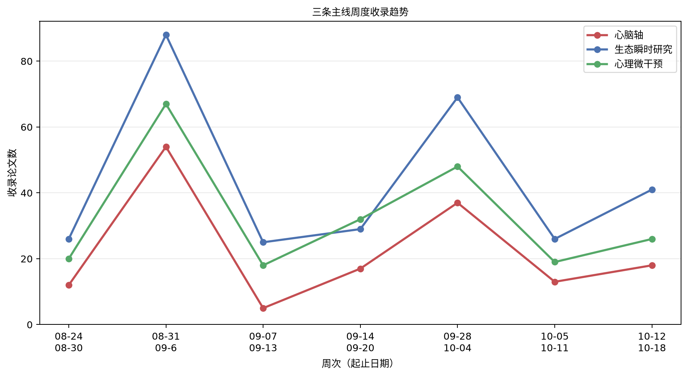

# 心脑、生态瞬时研究与心理微干预文献周报（2026-10-12 至 2026-10-18）

本期收录 66 篇文献。

## 重点推荐
收录 17 篇文献。

### 1. 社交焦虑障碍的神经内脏模型：一项整合性综述

- 原文标题：Neurovisceral model of social anxiety disorder: An integrative review.
- 作者：Mollie J Eriksson, Louis A Schmidt
- 期刊：Neuroscience and biobehavioral reviews，JCR Q1，IF 8.5（2025）
- 发表时间：2026-10-12
- 主题标签：心脑轴
- 关键词：社交焦虑障碍；神经内脏整合；迷走神经调节；心脏灵活性；中枢—外周协调

**摘要**：社交焦虑涉及对负面评价的持续恐惧，在社交情境中引发显著痛苦或回避，当持续至少六个月并在生活各领域造成明显功能损害时，即符合社交焦虑障碍（SAD）的诊断标准。既往多种模型将SAD的起源与维持描述为情绪调节与威胁评估相关中枢与外周网络失调，但整合中枢与外周层面分析的研究仍十分稀少且缺乏整合，致使对SAD神经生物学的理解呈碎片化。本文综述这些模型与现有证据，提出一个整合性神经内脏模型，认为SAD反映了皮层调节、边缘系统威胁信号、岛叶内感受、迷走与自主神经调节、心脏灵活性、HPA轴输出与行为之间情境敏感性的失调。遗传易感性与行为抑制被概念化为对威胁敏感性与调节能力的概率性影响，而环境经验、发育时序、性别相关因素与压力敏化塑造这些系统的校准。该模型预测SAD在激活阈值、反应幅度、恢复与中枢—外周协调上存在异质性，可能形成急性高反应型、持续敏化/僵化型与受损/钝化型三种配置。该模型还生成可供纵向多模态研究检验的预测，并支持面向特征剖面的评估与治疗取向。

**原文链接**：[PubMed](https://doi.org/10.1016/j.neubiorev.2026.107030)

### 2. 急性心理社会应激反应如何终止：糖皮质激素反馈、迷走神经再参与与前额边缘情境更新的应激后转换模型

- 原文标题：How the Acute Psychosocial Stress Response Ends: A Post-Stressor Transition Model of Glucocorticoid Feedback, Vagal Re-Engagement, and Frontolimbic Context Updating
- 作者：Congcong Liu, Ronglian Zheng, Yihan Wu, Meng Zhang
- 期刊：International Journal of Molecular Sciences，JCR Q1，IF 5.6（2025）
- 发表时间：2026-10-12
- 主题标签：心脑轴
- 关键词：心理社会应激；迷走神经再参与；糖皮质激素反馈；心率变异性；应激后恢复

**摘要**：客观应激源的结束并不标志着恢复的共同起点：心血管激活可能正在减弱，而皮质醇仍在上升，威胁相关认知持续存在。本结构化叙述性综述整合了分子、自主神经、神经、认知与免疫证据，聚焦于应激后时段，主要以成人心理社会应激范式为对象。我们提出应激后转换模型（PSTM），作为现有恢复与稳态应变理论的 operational 扩展，而非新发现的生物系统。三个调节功能组织本综述：更新威胁是否仍然当前、改变心脏自主神经影响、调节持续的下丘脑—垂体—肾上腺皮质输出。糖皮质激素受体信号、儿茶酚胺、内源性大麻素、催产素与加压素在这些功能中发挥作用。该框架区分客观结束与系统特异性极值、生理消退与已证实的适应、共享时序与方向性耦合。八项命题明确了结局、时间窗口、竞争性解释与预设效应边界。测量建议涉及皮质醇无反应、呼吸对心率变异性的影响、评估反应性与多速率采样。激素状态与发育调节候选参数而非定义固定反应类型。未声称存在通用恢复阈值或经临床验证的转换剖面。该模型仅在其附加参数可识别、能改善独立预测并经受阶段特异性实验检验时才有用。

**原文链接**：[Crossref](https://doi.org/10.3390/ijms27209047)

### 3. PRECISE个性化与个体化定制辅助干预对青年自杀意念及精神症状的初步效果：开放试验（预印本）

- 原文标题：Preliminary Effects of PRECISE, a Personalized and Idiographically-Tailored Adjunctive Intervention, on Suicidal Ideation and Psychiatric Symptoms in Young Adults: Open Trial (Preprint)
- 作者：Kevin Kuehn, Raeanne Moore, Katherine Foster, Colin Depp
- 期刊：未提供，JCR 待 JCR 数据核验，IF 待 JCR 数据核验
- 发表时间：2026-10-12
- 主题标签：生态瞬时研究；心理微干预
- 关键词：生态瞬时评估；个体化干预；辩证行为疗法；自杀意念；简短干预

**摘要**：背景：自杀高风险个体在现象学上具有异质性，但多数循证干预对所有人提供相同内容。辩证行为疗法（DBT）有效但疗程较长，部分原因是每位患者都接受完整的技能课程，而不论哪些技能针对其自身的风险驱动因素。PeRsonalizEd Clinical Intervention for Suicidal Events（PRECISE）利用从每位参与者生态瞬时评估（EMA）数据中推导出的个体化模型，识别并仅教授与该个体最相关的DBT技能，使治疗可在六周内完成。目的：评估PRECISE对自杀想法与行为（STBs）、抑郁与焦虑症状及相关次要结局的可行性、可接受性与初步影响。方法：30名有活跃STBs的青年（18–26岁），从一所大学及周边社区招募，在单臂开放试验中接受为期六周的PRECISE课程，同时每天进行五次EMA。STBs在基线、6周和12周使用哥伦比亚自杀严重程度评定量表（CSSRS）和改良自杀意念量表（MSSI）评估；抑郁与焦虑症状（PROMIS）、应对自我效能（CSES）和情绪调节策略使用（CERQ）也进行了评估。采用带参与者水平随机截距的贝叶斯多层模型估计随时间的变化。结果：6周保留率为93%（28/30），12周为87%（26/30）。参与者平均参加6次辅导中的5.4次，并将干预评为高度可接受（AIM：M=17.2）、适当（IAM：M=16.9）和可行（FIM：M=17.2；各满分20）。从基线到12周，自杀意念在两项测量上均下降（CSSRS：−2.28分，95% CrI [−2.75, −1.81]；MSSI：−5.38分，95% CrI [−8.21, −2.53]；方向概率[pd]≥99.99%）。抑郁症状（−6.51 T分，95% CrI [−8.60, −4.38]）和焦虑症状（−3.60，95% CrI [−5.70, −1.50]）也下降，应对自我效能增加（+29.30分，95% CrI [18.21, 40.50]；所有pd≥99.95%）。适应不良情绪调节策略使用呈较小且不确定性较高的下降（−3.20分，95% CrI [−6.42, 0.03]；pd=97.36%），适应性策略使用无可信变化（0.97分，95% CrI [−3.75, 5.63]）。无严重不良事件或自杀尝试发生；5名参与者报告了11次轻度非自杀性自伤。结论：在这项开放试验中，一种利用参与者自身个体化EMA数据个性化DBT技能的简短干预具有可行性、可接受性，并与STBs、精神症状和适应不良应对技能的临床有意义且持续的下降以及应对自我效能的改善相关。在进一步验证性测试之前，PRECISE可能是一种有用的自杀预防方法。临床试验：ClinicalTrials.gov NCT07749391

**原文链接**：[Crossref](https://doi.org/10.2196/preprints.113939)

### 4. 经皮耳迷走神经刺激对择期胸腔镜肺切除术患者围手术期心理症状的影响：一项随机对照试验

- 原文标题：Effect of transcutaneous auricular vagus nerve stimulation on perioperative psychological symptoms in patients undergoing elective thoracoscopic lung resection: A randomized controlled trial.
- 作者：Zhengxiu Sun, Song Zhang, He Liu, Mingshu Tao, Yuanyuan Wang, Junda Chen, Xingyu Xiong, Qian Deng, Yumei Yu, Yongao Lin, Tianxi Ma, Mingkai Zhou, Pinghao Li, Xiaoqing Guo, Jinling Liu, Chuyu Hang, Mingyuan Wang, Yuan Han, Hongxing Zhang, Junli Cao
- 期刊：Chinese medical journal，JCR Q1，IF 9.1（2025）
- 发表时间：2026-10-13
- 主题标签：心脑轴；心理微干预
- 关键词：经皮耳迷走神经刺激；围手术期焦虑；迷走神经调控；随机对照试验；心理微干预

**摘要**：背景：围手术期焦虑在胸腔镜肺切除术患者中高度流行，对术后康复产生不良影响。经皮耳迷走神经刺激（taVNS）作为一种有前景的无创神经调控干预，已在多种精神疾病和应激相关状况中显示出疗效。本研究旨在评估taVNS减轻该人群围手术期焦虑的疗效与安全性。方法：本单中心、平行组、随机、双盲、优效性试验于2024年10月10日至2025年4月30日在徐州医科大学附属医院麻醉科和胸外科开展。共纳入176例年龄≥18岁、ASA分级I-III级、拟行择期胸腔镜肺切除术的合格患者。排除患有神经精神疾病、耳部病变、严重心脑血管疾病、植入电子设备、简易精神状态检查（MMSE）评分<15、长期使用精神药物或体位性心动过速综合征的患者。所有参与者被随机分配接受四次活性taVNS或假taVNS。刺激通过左耳耳甲艇的迷走神经耳支在四个预定义的围手术期时间点实施：手术前一天下午、手术当天早晨、气管拔管后即刻及术后第一天下午。主要结局为围手术期焦虑的发生率，评估时间从首次taVNS session开始至术后3天。所有参与者、医护人员、结局评估者和数据分析者在整个研究期间均对分组分配保持盲态。结果：共176例患者被随机分配，活性taVNS组88例，假taVNS组88例。排除2例术后转入ICU的患者（每组各1例）后，共174例患者（中位年龄58岁；女性105例[60.4%]）完成研究并纳入主要结局分析，每组各87例。活性taVNS组围手术期焦虑发生率显著低于假taVNS组（50.6% vs. 73.6%；相对危险度[RR]，0.59；95%置信区间[CI]，0.41-0.85；χ2=9.76；P=0.002）。与假刺激相比，活性taVNS与焦虑和抑郁评分、术后疼痛强度及生理应激指标的降低相关，并改善睡眠质量和整体术后康复。两组均未观察到严重不良事件。主要轻度不良反应包括恶心、呕吐、局部刺痛、头晕和头痛，两组不良事件发生率相似。结论：在左耳甲艇实施四次围手术期taVNS可显著降低胸腔镜肺切除术患者围手术期焦虑的发生率，并与抑郁症状、应激负担、睡眠质量和疼痛结局的改善相关。试验注册：中国临床试验注册中心标识符：ChiCTR2400090542。

**原文链接**：[PubMed](https://doi.org/10.1097/cm9.0000000000004326)

### 5. 共振频率呼吸干预改变代谢挑战期间的心脏自主神经反应

- 原文标题：Resonance Frequency Breathing Intervention Modifies Cardiac Autonomic Response During a Metabolic Challenge.
- 作者：Lisa Patricia Peters, Martin Heni, Andreas Peter, Julia Hummel, Thomas Kubiak, Benedict Herhaus, Katja Petrowski
- 期刊：Applied psychophysiology and biofeedback，JCR Q2，IF 3.0（2025）
- 发表时间：2026-10-13
- 主题标签：心脑轴；心理微干预
- 关键词：共振频率呼吸；心率变异性生物反馈；心脏自主神经调节；迷走神经撤退；代谢应激

**摘要**：自主神经系统在调节心率变异性（HRV）和葡萄糖代谢等生理过程中起关键作用。较高的血糖水平与迷走神经介导的HRV降低相关。共振频率呼吸（RFB）结合HRV生物反馈（HRV-BF）已被证明可增强健康成年人的迷走神经介导的心脏自主神经调节。然而，此类训练是否改变急性代谢应激期间的心脏自主神经反应尚不清楚。本研究考察四周RFB-HRV-BF干预是否改变28名健康成年人（女性16名，平均年龄25.68±3.66岁，平均体重指数22.77±3.01 kg/m2）在代谢挑战期间自主神经反应动态。心脏自主神经反应用75g口服葡萄糖耐量试验（OGTT）前30分钟（对应餐后血糖峰值）的HRV参数——相邻正常心搏间期差值的均方根（RMSSD）和全部正常心搏间期的标准差（SDNN）评估，干预前后各测一次。分段线性混合效应模型显示，RFB-HRV-BF干预后，OGTT餐后早期阶段对数自然转换的RMSSD（lnRMSSD）和SDNN（lnSDNN）下降幅度减弱，表明干预相关的心脏自主神经反应动态改变。综上，这些发现表明RFB-HRV-BF减弱急性代谢应激期间的早期迷走神经撤退。通过在标准化代谢挑战中展示对心脏自主神经动态的影响，本研究将RFB的既往工作拓展至静息条件之外，并强调情境依赖性自主神经评估对于理解自主神经调节与代谢健康之间交互的重要性。

**原文链接**：[PubMed + Crossref](https://doi.org/10.1007/s10484-026-09813-6)

### 6. 个性化数字心理健康：一项关于认知行为疗法/辩证行为疗法短信改善情绪的微随机试验分析

- 原文标题：Personalizing digital mental health: a micro-randomized trial analysis of cognitive behavioral therapy/dialectical behavioral therapy text messages to improve mood.
- 作者：Caroline A Figueroa, Jing Xu, Marvyn R Arévalo Avalos, Bibhas Chakraborty, Adrian Aguilera
- 期刊：JAMIA open，JCR Q1，IF 4.7（2025）
- 发表时间：2026-10-13
- 主题标签：生态瞬时研究；心理微干预
- 关键词：微随机试验；数字心理健康；认知行为疗法；辩证行为疗法；短信干预；个性化

**摘要**：目的：数字心理健康干预有望改善人群健康，但如何通过个性化提升其有效性仍认识有限。本文报告一项为期60天短信项目的微随机试验（MRT）结果，该项目在新冠疫情期间实施。研究分析6类认知行为疗法（CBT）与辩证行为疗法（DBT）短信的效果，并检验社会人口学、健康相关及情境因素（如发送时间）是否调节有效性。方法：本二次分析纳入373名18岁及以上成年人（平均年龄38.07岁），多为英语使用者、女性、高学历白人，自评健康良好但压力较高且基本需求难以满足。参与者于2021年12月至2022年9月通过社交媒体和招募服务（Health Match）招募。采用加权中心化最小二乘法检验各类短信对每日情绪的即时效应，以及社会人口学、健康因素和发送时间是否调节有效性。结果：6类CBT/DBT短信均未显著改善情绪评分的主效应，但其有效性随一天中的时间和自评健康而变化。总体而言，下午发送更有效；然而部分短信类别在自评健康较差者中于早晨发送时显示显著效应，而部分在自评健康较好者中于傍晚发送时有效性较低。结论：分析强调在开发数字心理健康干预时需考虑一天中的时间和个体健康状况，这些发现有助于设计更个性化、自适应和有效的数字干预。

**原文链接**：[PubMed](https://doi.org/10.1093/jamiaopen/ooag156)

### 7. 达成不等于维持：慢呼吸任务中心率变异性的时间稳定性

- 原文标题：Achieving is not maintaining: The temporal stability of heart rate variability during a slow breathing task
- 作者：Jente Depoorter, Rudi De Raedt, Marie-Anne Vanderhasselt, Kristof Hoorelbeke
- 期刊：未提供，JCR 待 JCR 数据核验，IF 待 JCR 数据核验
- 发表时间：2026-10-13
- 主题标签：心脑轴；心理微干预
- 关键词：心率变异性；慢呼吸；生理稳定性；情绪调节；副交感神经活动

**摘要**：背景。慢呼吸被广泛认为是一种增强副交感神经活动、改善心理功能的有效策略。然而，成功的调节可能不仅仅是达到理想的生理状态。同样重要且在此被称为生理稳定性的，是随时间维持该状态的能力，这一方面获得的实证关注明显较少。方法。五十九名成年人完成五分钟基线期，随后进行十分钟自定步速的慢呼吸练习。副交感神经活动采用心率变异性（HRV；相邻RR间期差值的均方根，RMSSD）评估。考察了呼吸期间RMSSD的变化、其时间稳定性，以及与情绪调节、心理韧性和生活方式因素的关联。结果。慢呼吸期间的RMSSD显著高于基线期，表明副交感神经自我调节成功。RMSSD的不稳定性在呼吸阶段（69%）比基线期（41%）更为普遍，McNemar检验证实了这一差异。探索性分析发现了与情绪调节的若干关联；然而，经多重比较校正后，只有灾难化思维与RMSSD不稳定性保持显著关联（r = .42）。结论。尽管慢呼吸期间HRV总体升高，但许多个体表现出HRV随时间的不稳定。这些发现表明，达成和维持生理调节可能代表不同的过程，凸显了呼吸和HRV研究中时间稳定性的重要性。此外，灾难化思维与HRV不稳定性可能性更高相关，提示适应不良的情绪调节可能与维持生理自我调节的困难有关。

**原文链接**：[Crossref](https://doi.org/10.21203/rs.3.rs-11162610/v1)

### 8. 你现在能感受到自己的身体吗？日常生活中多领域内感受强度与效价的生态瞬时评估

- 原文标题：Do you feel your body right now? Ecological momentary assessment of interoceptive intensity and valence across multiple domains in everyday life
- 作者：Christian Rominger, Marta Walentynowicz, Olga Pollatos, Christine Marie Schick, Andreas R. Schwerdtfeger
- 期刊：Frontiers in Psychology，JCR Q1，IF 3.8（2025）
- 发表时间：2026-10-14
- 主题标签：心脑轴；生态瞬时研究
- 关键词：内感受；生态瞬时评估；日常动态测量；身体感觉；心理测量学

**摘要**：研究者通常仅在实验室条件下、以单次测量、聚焦单一器官（多为心脏）的方式评估内感受（即对内部身体状态的感知）。本研究拓展了这一研究，呈现两项独立研究的结果，证明一种生态瞬时评估（EMA）方法具有信效度，可在日常生活中同时从主观视角研究不同模态的内感受。我们要求250余名参与者在日常生活的随机时刻评定其感受到心脏、肠道和呼吸的强度，作为内感受注意的测量指标；并进一步通过效价评定考察对这些内感受身体感觉的评价。在两个样本（N1=141，N2=112）中，我们证明该评估在个体间水平具有高信度，在个体内水平信度中等。我们进一步检验了两种主观测量的聚合效度与区分效度。研究发现凸显了这种新型动态内感受评估的良好心理测量学特性与适用性。该方法使大规模现场研究得以在瞬时基础上考察内感受注意与评价，从而理解身体感觉在日常功能与健康中的作用。

**原文链接**：[Crossref](https://doi.org/10.3389/fpsyg.2026.1930018)

### 9. PRECISE的初步效果：一种针对青年自杀意念与精神症状的个性化、惯用特质定制辅助干预的开放试验

- 原文标题：Preliminary Effects of PRECISE, a Personalized and Idiographically-Tailored Adjunctive Intervention for Treating Suicidal Ideation and Psychiatric Symptoms in Young Adults: Open Trial
- 作者：Kevin Scott Kuehn, Raeanne C. Moore, Katherine T. Foster, Colin A. Depp
- 期刊：未提供，JCR 待 JCR 数据核验，IF 待 JCR 数据核验
- 发表时间：2026-10-14
- 主题标签：生态瞬时研究；心理微干预
- 关键词：生态瞬时评估；个性化干预；自杀意念；辩证行为疗法；青年

**摘要**：背景：自杀高风险个体在现象学上具有异质性，但多数循证干预对所有人提供相同内容。辩证行为疗法（DBT）有效但疗程较长，部分原因是每位患者都接受完整的技能课程，而不论哪些技能针对其自身的风险驱动因素。个性化临床自杀事件干预（PRECISE）利用源自每位参与者生态瞬时评估（EMA）数据的惯用特质模型，识别并仅教授与该个体最相关的DBT技能，使治疗可在六周内完成。目的：本研究旨在评估PRECISE对自杀想法与行为（STBs）、抑郁与焦虑症状及相关次要结局的可行性、可接受性和初步影响。方法：30名有活跃STBs的青年（18-26岁），从一所大学及周边社区招募，在单臂开放试验中接受为期六周的PRECISE课程，同时每天进行五次EMA。STBs在基线、6周和12周时使用哥伦比亚自杀严重程度评定量表（CSSRS）和改良自杀意念量表（MSSI）评估；抑郁与焦虑症状（PROMIS）、应对自我效能（CSES）和情绪调节策略使用（CERQ）也进行了评估。采用带参与者水平随机截距的贝叶斯多层模型估计随时间的变化。结果：6周时保留率为93%（28/30），12周时为87%（26/30）。参与者平均参加了6次辅导中的5.4次，并将干预评为高度可接受（AIM：M=17.2）、适当（IAM：M=16.9）和可行（FIM：M=17.2；每项满分20）。从基线到12周，自杀意念在两个测量上均下降（CSSRS：−2.28分，95% CrI [−2.75, −1.81]；MSSI：−5.38分，95% CrI [−8.21, −2.53]；方向概率[pd]≥99.99%）。抑郁症状（−6.51 T分，95% CrI [−8.60, −4.38]）和焦虑症状（−3.60，95% CrI [−5.70, −1.50]）也下降，应对自我效能增加（+29.30分，95% CrI [18.21, 40.50]；所有pd≥99.95%）。适应不良情绪调节策略使用呈现较小且不确定性较高的下降（−3.20分，95% CrI [−6.42, 0.03]；pd=97.36%），适应性策略使用无可信变化（0.97分，95% CrI [−3.75, 5.63]）。无严重不良事件或自杀尝试发生；5名参与者报告了11次轻度非自杀性自伤。结论：在这项开放试验中，一种利用参与者自身惯用特质EMA数据个性化DBT技能的简短干预是可行、可接受的，并与STBs、精神症状和适应不良应对技能的临床意义显著且持续的下降以及应对自我效能的改善相关。在进一步验证性测试之前，PRECISE可能是一种有用的自杀预防方法。

**原文链接**：[Crossref](https://doi.org/10.31234/osf.io/ut2bv_v1)

### 10. 利用动力系统建模与生态准实验快速创新精准精神病学干预：针对进食障碍的概念验证研究方案

- 原文标题：Rapid Innovation of Precision Psychiatry Interventions Using Dynamical Systems Modeling and Ecological Quasi-Experiments: Protocol for a Proof-of-Concept Study on Eating Disorders.
- 作者：Emily K Presseller, Falzah Farooq, Estefano Reyes-Madriz, Marianne Rouleau-Tang, Nicholas C Jacobson, J Graham Thomas, Lisa A Marsch
- 期刊：JMIR research protocols，JCR Q3，IF 1.6（2025）
- 发表时间：2026-10-15
- 主题标签：生态瞬时研究；心理微干预
- 关键词：生态瞬时评估；即时适应性干预；微随机试验；动力系统建模；进食障碍

**摘要**：背景：近8300万美国人经历精神疾病，但不足50%在过去一年获得心理健康服务，亟需可推广且有效的心理健康干预。独立数字干预有望改善临床结局，但迄今疗效有限，部分原因在于对患者异质性、情境变化及症状随机性缺乏充分个性化。目的：本研究旨在通过生态数据和动力系统建模构建真实世界、个体化的精神病理学模型，以提升精准数字健康干预的疗效。对生态瞬时评估（EMA）与智能手机传感器数据进行动力系统建模，可揭示个体在日常生活中精神病理的维持系统。即时适应性干预（JITAI）在特定决策点、通常通过智能手机，于适应不良行为风险升高时提供即时支持。本研究将采用微随机分配，在基于个体动力系统判定的风险时刻递送JITAI，以评估特定治疗技能的精细化效应与机制。研究以进食障碍（ED）验证该方法提升精准精神病学数字干预效力的概念可行性，因ED具有易于测量的适应不良行为、由生物心理社会因素复杂交织维持，且其一线治疗强化认知行为治疗（CBT-E）以行为为主。目标：（1）检验以人为中心的动力模型能以平均曲线下面积≥60%描述饮食限制、暴食与补偿行为风险的假设；（2）利用JITAI检验CBT-E技能的假设效应与机制；（3）刻画独立JITAI系统的可行性与可接受性。方法：研究将纳入170名成人ED患者，采集16周测量CBT-E风险因素的EMA与智能手机传感器数据，参与者将基于其个体化风险模型接受10周JITAI。研究结束时收集ED症状、可行性与可接受性数据。结果：本项目资助期为2025年8月至2030年7月，招募期为2026年6月至2029年7月，数据收集自2026年7月开始、2029年11月结束。结论：本研究将为未来随机对照试验评估优化的独立JITAI奠定基础，有望显著改善循证心理卫生服务的可及性。

**原文链接**：[PubMed](https://doi.org/10.2196/104849)

### 11. 中年心肌梗死幸存者的真实生活心理体验与心脏自主神经生理

- 原文标题：Real-Life Psychological Experiences and Cardiac Autonomic Physiology Among Survivors of a Myocardial Infarction in Midlife.
- 作者：Viola Vaccarino, Hua She, Lisa Elon, Tené T Lewis, Yi-An Ko, Gari Clifford, Quiao Li, Nancy Murrah, Lucy H Shallenberger, Tatum Roberts, Lewam Stefanos, Eric Fan-Lou, J Douglas Bremner, Paolo Raggi, Arshed Quyyumi, Amit J Shah
- 期刊：Journal of the American Heart Association，JCR Q1，IF 6.0（2025）
- 发表时间：2026-10-16
- 主题标签：心脑轴；生态瞬时研究
- 关键词：生态瞬时评估；心率变异性；减速容量；负性情绪；心肌梗死

**摘要**：背景：与男性相比，患有缺血性心脏病的年轻和中年女性承受更高的心理社会因素负担，且尽管动脉粥样硬化负担较轻，其发病率和死亡率却更差。关于日常生活压力和自主神经生理的数据有助于指导针对性干预。方法：研究纳入302名因心肌梗死近期住院的61岁及以下个体，均接受为期7天的居家情绪与压力生态瞬时评估监测，同时进行动态心电图监测以评估自主神经生理。减速容量作为副交感活动的预后标志物是主要自主神经结局指标，同时考察心率变异性。结果：样本中女性占43%，平均年龄51岁（标准差7岁）。在监测周内，女性报告的负性情绪和压力水平高于男性；女性的副交感活动（减速容量日均值）显著低于男性，心率变异性亦较低。在女性中，每日负性情绪与较低的减速容量呈负相关：每日负性情绪评分每增加1个对数单位，女性减速容量下降4.5%，而男性差异接近零（0.5%，交互作用P=0.02）。对其他风险因素的调整未实质性影响关联。心率变异性指标呈现类似模式。结论：近期心肌梗死存活的年轻和中年女性在日常生活中表现出比男性更强的副交感撤退，尤其在负性情绪时刻。结果强调需要对心肌梗死后女性给予更多心理社会管理关注。

**原文链接**：[PubMed + Crossref](https://doi.org/10.1161/jaha.126.052187)

### 12. 杏仁核神经反馈作为边缘型人格障碍住院辩证行为治疗的辅助手段：一项初步随机对照试验

- 原文标题：Amygdala neurofeedback as an adjunct to residential dialectical behavior therapy for borderline personality disorder: a pilot randomized controlled trial.
- 作者：Miroslava Hofmanová, Philip S Santangelo, Nikolaus Kleindienst, Christian Schmahl, Christian Paret
- 期刊：BMC psychiatry，JCR Q1，IF 4.6（2025）
- 发表时间：2026-10-16
- 主题标签：心脑轴；生态瞬时研究；心理微干预
- 关键词：杏仁核神经反馈；边缘型人格障碍；生态瞬时评估；辩证行为治疗；实时功能磁共振成像

**摘要**：背景：边缘型人格障碍以情感不稳定和杏仁核高反应性为特征。尽管辩证行为治疗可减轻症状及杏仁核相关异常，许多患者仅获得部分缓解。实时功能磁共振成像杏仁核神经反馈直接针对过度活跃的边缘系统反应，在非对照试验中显示出前景。本研究检验杏仁核神经反馈能否为住院辩证行为治疗带来额外获益。方法：36名处于治疗中期、残留症状具有临床意义的边缘型人格障碍患者被随机分配至辩证行为治疗联合杏仁核神经反馈组（n=23）或单纯辩证行为治疗组（即照常治疗组，n=13）。治疗后评估完成情况为神经反馈组15例、照常治疗组9例，3个月和6个月随访完成情况分别为15/8例和12/7例。以日常生活中情感不稳定的生态瞬时评估作为主要结局。次要结局包括自评量表、两项功能磁共振任务中的杏仁核反应以及静息态功能磁共振。评估在治疗前、治疗后、3个月和6个月随访时进行。结果：参与者在神经反馈过程中成功下调杏仁核活动。生态瞬时评估显示负性情绪、内心紧张和情感不稳定随时间改善，但神经反馈组并无一致的优越性。自评量表同样未显示神经反馈的额外获益，两组出院后BSL-23评分均升高。神经反馈与情绪调节任务中观看和调节条件下杏仁核活动的短暂治疗前后下降相关，并在面孔任务中较照常治疗组表现出更稳定的杏仁核反应性随时间变化。静息态分析显示神经反馈组治疗前后杏仁核与楔前叶及背内侧额叶区域连接性短暂升高。结论：杏仁核神经反馈在边缘型人格障碍中可行并能降低杏仁核活动，但与强化住院辩证行为治疗联合实施时未产生额外临床获益，尽管小样本可能限制了检测此类效应的效力。试验注册：研究方案于2020年3月26日在ClinicalTrials.gov预注册，注册号NCT04333888。

**原文链接**：[PubMed](https://doi.org/10.1186/s12888-026-08767-7)

### 13. ExSmokerApp：面向数字表型与隐私感知自适应戒烟支持的端到端设计框架

- 原文标题：ExSmokerApp: An End-to-End Design Framework for Digital Phenotyping and Privacy-Aware Adaptive Smoking Cessation Support
- 作者：Mohamed En-Nouar, Amrou Zyad Benelhaouare, Ahmed Lakhssassi
- 期刊：Digital Health and Innovation，JCR 待 JCR 数据核验，IF 待 JCR 数据核验
- 发表时间：2026-10-16
- 主题标签：生态瞬时研究；心理微干预
- 关键词：数字表型；生态瞬时评估；即时适应性干预

**摘要**：背景：戒烟仍是重大公共卫生挑战，超过75%的个体在尝试戒烟后六个月内复吸。尽管移动健康（mHealth）应用日益普及，许多现有方案缺乏整合的行为监测、隐私感知数据处理与自适应干预机制。方法：本研究提出ExSmokerApp，一个基于数字表型的戒烟支持与复吸预防端到端设计框架。该框架将结构化的戒烟前准备阶段与戒烟后行为监测、生态瞬时评估（EMA）及危机支持模块相结合，并定义了隐私感知的边云架构，勾勒了未来用于复吸风险估计与即时适应性干预（JITAI）的端侧机器学习流程。结果：ExSmokerApp设计框架已开发出可用的移动应用及配套后端基础设施，涵盖行为数据采集、本地存储、云同步与初步技术测试。所得架构为未来机器学习开发奠定了方法学基础，而预测模型、自动化风险检测与临床有效性仍有待评估。结论：ExSmokerApp建立了清晰可复现的架构与方法学框架，可供其他工程师与研究者改编并实现于戒烟应用。未来Beta测试将评估技术可行性、可用性、行为数据采集及后续预测模型开发与验证的潜力。

**原文链接**：[Crossref](https://doi.org/10.3390/dhi1020007)

### 14. 脑—心耦合的时间错位导致精神分裂症多层次内感受功能障碍

- 原文标题：Temporal misalignment of brain-heart coupling accounts for multilevel interoceptive dysfunction in schizophrenia.
- 作者：Haochen Zou, Huiqi Li, Chunbo Li
- 期刊：Progress in neuro-psychopharmacology & biological psychiatry，JCR Q1，IF 4.2（2025）
- 发表时间：2026-10-17
- 主题标签：心脑轴
- 关键词：心脑耦合；内感受；精神分裂症；心脏节律；神经内脏整合

**摘要**：精神分裂症涉及深刻的躯体自我感知障碍，这些障碍日益被认为源于内感受（对内部生理信号的感知）的破坏。然而，强调内在神经时间尺度或内感受推断的主流模型往往仅将心脏信号视为被动的感觉输入。本文提出，心脏节律动力学可能为大规模神经协调提供基于相位的时间参照，潜在地同步跨越不同时间尺度的神经活动。这种支架功能由机械转导的搏动信号介导，可能影响分布式网络的皮层兴奋性。在该框架下，精神分裂症的内感受失调被重新概念化为层级皮层振荡与外周心脏相位的解耦。心脏节律变异性降低可能削弱高阶网络可用的时间参照稳定性，进而驱动对模糊内脏输入的先验精确度产生代偿性增加，从而模糊内部生成信号与外部驱动信号之间的区分。这些过程可能促成幻觉、妄想和动机缺陷。因此，新兴治疗策略旨在恢复心脑轴的时间对齐。将内感受现象学转化为可量化的神经内脏错位指标，有望成为连接神经生物学与靶向精神科干预的桥梁。

**原文链接**：[PubMed](https://doi.org/10.1016/j.pnpbp.2026.111980)

### 15. 基于简短每日日记的大语言模型抑郁评估

- 原文标题：Large language models for depression assessment from brief daily diaries
- 作者：Whitney R. Ringwald, Aman Taxali, Mike Angstadt, Colin E. Vize, Chandra Sripada, Aidan G. C. Wright
- 期刊：npj Digital Medicine，JCR Q1，IF 18.0（2025）
- 发表时间：2026-10-17
- 主题标签：生态瞬时研究
- 关键词：大语言模型；密集纵向评估；抑郁；每日日记；数字表型

**摘要**：密切追踪抑郁变化对临床研究与实践具有重要意义，但密集纵向抑郁评估依赖自我报告问卷，存在明显局限。利用大语言模型从自然语言中评估抑郁有望解决这些不足。本研究检验了大语言模型基于每日视频日记评定抑郁的有效性。研究纳入108名按心理健康治疗状态选取的参与者（45%正在接受治疗），完成一次临床访谈以及14至21天的抑郁问卷和视频日记。大语言模型从日记转录文本中估计每日抑郁得分。大语言模型评定与自我报告抑郁在个体内水平上收敛（r=.45；95%可信区间[.40,.49]），按天平均后的总体抑郁得分也收敛（r=.61；95%可信区间[.43,.75]）。平均大语言模型评定与临床访谈确定的抑郁症状严重程度相关（r=.53；95%可信区间[.35,.68]）。大语言模型评定的抑郁与自我报告在每日功能变量关联模式上相似（个体内profile r=.98；个体间r=.94）。多变量回归结果显示，大语言模型评定在自我报告之上仍能预测每日功能变量（偏β=|.12|至|.28|）和访谈评定的抑郁（偏β=.33；95%可信区间[.07,.58]），提示大语言模型捕捉到自我报告遗漏的临床相关信息。研究结果为一种既能克服自我报告不足、又满足密集纵向监测独特需求的抑郁评估方法奠定了坚实基础。

**原文链接**：[Crossref](https://doi.org/10.1038/s41746-026-03388-6)

### 16. 情境塑造需求、接受度与有效性：情绪调节科学为即时适应性干预提供的启示（预印本）

- 原文标题：Context Shapes Need, Receptivity, and Effectiveness: What Emotion Regulation Science Offers Just-in-Time Adaptive Interventions (Preprint)
- 作者：Emma Holly Palermo, Mark Shuquan Chen
- 期刊：未提供，JCR 待 JCR 数据核验，IF 待 JCR 数据核验
- 发表时间：2026-10-17
- 主题标签：生态瞬时研究；心理微干预
- 关键词：即时适应性干预；情绪调节；情境；决策规则；个性化

**摘要**：即时适应性干预（JITAIs）承诺提供实时心理健康支持，即在合适的时间为每个人提供合适的支持。然而，现有大多数心理健康JITAIs在实践中很少真正实现“即时”或“适应性”。基于需求、接受度和有效性三个组成部分构建和完善决策规则，并将情境对每个组成部分的影响纳入考量，有助于推动JITAI研究向前发展。我们认为，情绪调节（ER）研究领域已建立起证据基础，强调情境对ER三个阶段——评估、实施和监控——的影响，这三个阶段恰好对应创建决策规则所需的三个JITAI组成部分。我们描述了情境如何映射到每个JITAI组成部分，并提出具体的研究设计，以进一步评估情境依赖的需求和策略有效性，以及在JITAIs中对个体化预测策略进行实验性检验。将情境整合到JITAIs中有助于完善决策规则，最终实现更个性化、可接受且有效的干预。

**原文链接**：[Crossref](https://doi.org/10.2196/preprints.114687)

### 17. 音乐听觉干预对焦虑的主观与心理生理反应模式差异

- 原文标题：Differing subjective and psychophysiological response patterns to a music-based auditory intervention for anxiety.
- 作者：Frank A Russo, Yoseph Lahmany, Sean A Gilmore, Harley Glassman, Rachel I Ulrich, Rhiannon Y Ueberholz, Adiel Mallik
- 期刊：International journal of psychophysiology : official journal of the International Organization of Psychophysiology，JCR Q1，IF 3.3（2025）
- 发表时间：2026-10-18
- 主题标签：心脑轴；心理微干预
- 关键词：音乐干预；焦虑；心率变异性；脑电图；皮质醇

**摘要**：焦虑包含部分可分离的认知与躯体成分，但简短干预是否平行调节这些系统仍不清楚。本随机对照试验考察了简短音乐听觉干预相对于主动听觉对照（粉红噪声）在报告近期广泛性焦虑症状的大学生中的主观与心理生理反应。参与者（N=83）被随机分配至听觉干预或粉红噪声组。干预前后评估认知与躯体焦虑，同时以唾液皮质醇、心率变异性（HRV）和脑电图（EEG）分别索引内分泌、自主神经与神经过程。皮质醇呈现显著的组别×时间交互，听觉干预后下降幅度更大。中线theta功率亦呈现显著的组别×时间交互，反映两组相反的变化模式，但仅粉红噪声组的组内变化显著。认知焦虑、躯体焦虑、情感唤醒、额叶alpha偏侧化及HRV均未显示显著的组间基线至干预后差异。聆听期间HRV在两组均升高，但主增长模型中的组别×时段交互在纳入参与者特异性斜率后未保留。总体而言，这些发现表明不同分析层面存在不同的反应模式，两种听觉条件下自报焦虑与唤醒均广泛下降，而皮质醇与中线theta分析对条件更敏感。由于在纳入所有生理有效观测的模型中皮质醇与theta交互未保留，这些条件依赖性发现应谨慎解释。

**原文链接**：[PubMed](https://doi.org/10.1016/j.ijpsycho.2026.113497)

## 心脑轴
收录 8 篇文献。

### 1. 五音音乐与灯光色彩最优声-色匹配方案对广泛性焦虑障碍患者情绪反应的随机双因素混合设计试验

- 原文标题：Optimal sound-color matching scheme of five-element music and lighting colors for emotional responses in patients with GAD: A randomized, two-factor mixed-design trial.
- 作者：Jing Gao, Mengni Zhang, Huan Chen, Xiaohui Dong, Fei Wang, Chaoming Hou
- 期刊：Complementary therapies in medicine，JCR Q1，IF 4.0（2025）
- 发表时间：2026-10-12
- 主题标签：心脑轴；心理微干预
- 关键词：广泛性焦虑障碍；五音音乐；声-色匹配；心率变异性；脑电图；情绪调节

**摘要**：背景：声-色匹配为增强音乐治疗提供了新途径，但针对广泛性焦虑障碍（GAD）情绪失调的最优组合尚未得到检验。目的：采用五音音乐与不同灯光色彩，识别GAD患者情绪反应的最优声-色匹配方案。方法：于2024年6月至2025年2月在三级甲等医院开展随机双因素混合设计试验。灯光色彩（青色、红色、黄色、白色、黑色）为被试间变量，音乐情绪效价（正性、中性、负性）为被试内变量。210名符合条件的GAD患者被随机分配至五个灯光色彩组。视听刺激结合校准LED照明与经验证的五音音乐片段，在标准化实验室环境中实施。主要结局为主观效价与唤醒度评分（自我评估人形量表）。次要结局包括皮肤电导、皮肤温度、心率与脑电图功率谱密度。结果：全部210名患者纳入主观数据分析，205名提供有效生理数据，204名获得脑电数据。灯光色彩与音乐效价在效价评分（F=2.02，p<0.050）、唤醒度评分（F=2.77，p<0.050）、皮肤温度（F=51.18，p<0.050）与心率（F=39.77，p<0.050）上存在显著交互作用。青色灯光配合正性音乐产生最高效价评分（7.79±0.81）及最优生理调节（心率最低下降15.44±1.89次/分；皮肤温度最高上升0.84±0.09°C）。红色灯光配合正性音乐诱发最高唤醒度（6.83±1.23）。脑电分析仅在theta频带发现显著交互作用（F=1.98，P=0.024），正性音乐在各频带均显示较低功率谱密度。结论：在所测试的配对中，正性五音音乐配合青色灯光对GAD患者产生最有利的即时情绪与生理反应，支持进一步研究声-色匹配作为情绪调节的多模态辅助策略。试验注册：中国临床试验注册中心（ChiCTR2400079878）。

**原文链接**：[PubMed](https://doi.org/10.1016/j.ctim.2026.103445)

### 2. 自主运动启动与Libet任务中的心脏输入相关

- 原文标题：Voluntary movement initiation is associated with cardiac input in Libet's task.
- 作者：Ksenia Germanova, Alina Studenova, Dimitri Bredikhin, Magdalena Gippert, Nikolai Kapralov, Vasily Klucharev, Arno Villringer, María Herrojo Ruiz, Vadim Nikulin
- 期刊：The Journal of neuroscience : the official journal of the Society for Neuroscience，JCR Q2，IF 4.3（2025）
- 发表时间：2026-10-14
- 主题标签：心脑轴
- 关键词：心脑轴；内感受；自主运动启动；心动周期；心诱发电位

**摘要**：本研究探讨心脏信号是否调节个体在Libet任务中对“运动冲动”的体验，采用行为与电生理测量对39名健康被试进行研究。结果显示，当被试遵循“运动冲动”时，其按键时间主要与心动周期的舒张期对齐，表明心脏调制影响运动启动；但作为心脏输入感知指标的心诱发电位（HEP）幅度未随任务内省需求变化而改变。结果表明，心脏信号的隐式感知会偏倚Libet任务中的自主行动启动，且独立于皮层内感受标记，对运动准备、意向性及自主行动的躯体基础模型具有启示意义。

**原文链接**：[PubMed](https://doi.org/10.1523/jneurosci.1050-25.2026)

### 3. 皮肤电唤醒估计揭示失眠障碍中恐惧调节受损

- 原文标题：Disrupted fear regulation in insomnia disorder revealed by arousal estimation from skin conductance.
- 作者：Tianyu Hwang, Saman Khazaei, Edward F Pace-Schott, Ryan Bottary, Rose T Faghih
- 期刊：PLOS mental health，JCR 待 JCR 数据核验，IF 待 JCR 数据核验
- 发表时间：2026-10-14
- 主题标签：心脑轴
- 关键词：失眠障碍；皮肤电导；自主神经系统；恐惧消退；唤醒状态估计

**摘要**：失眠障碍是一种常见的睡眠-觉醒障碍，以对睡眠质量或数量的持续不满为特征。既往研究表明睡眠在情绪调节中起关键作用，尤其是恐惧消退。本研究旨在通过基于皮肤电导观测衍生的交感唤醒状态估计来刻画失眠障碍，并比较两种观测模型：标记点过程模型与结合连续成分的标记点过程模型。研究利用24名失眠障碍个体和24名良好睡眠者的恐惧条件化与消退程序中的皮肤电导数据，对皮肤电导测量进行反卷积以提取自主神经系统激活与紧张性成分。标记点过程模型仅使用提取的自主神经系统激活，而结合连续成分的模型同时纳入自主神经系统激活与紧张性成分。两种模型均用于估计随时间变化的潜在唤醒状态并计算高唤醒指数。研究比较失眠障碍组与良好睡眠者组之间的估计唤醒状态与高唤醒指数，以评估与失眠障碍相关的唤醒改变。结果显示失眠障碍可能与恐惧消退学习与回忆受损有关。值得注意的是，失眠障碍组与良好睡眠者组的区分仅在结合连续成分的模型下出现，表明紧张性成分在唤醒估计中的关键作用。总体而言，本研究凸显了唤醒状态估计在理解失眠障碍自主神经失调方面的潜力，从而支持针对以恐惧为中心的共病的干预并改善生活质量。

**原文链接**：[PubMed](https://doi.org/10.1371/journal.pmen.0000720)

### 4. 经皮耳迷走神经刺激用于恐惧、创伤与疾病情境下的焦虑症状：临床证据与机制的叙述性综述

- 原文标题：Transcutaneous auricular vagus nerve stimulation for anxiety symptoms across fear, trauma, and disease contexts: a narrative review of clinical evidence and mechanisms.
- 作者：Jingwen Liu, Lan Yang, Qipei Qiao, Jiaqi Zhou, Zhenni Zhang, Yuling Gao, Yong Liu
- 期刊：European archives of psychiatry and clinical neuroscience，JCR Q1，IF 3.9（2025）
- 发表时间：2026-10-14
- 主题标签：心脑轴；心理微干预
- 关键词：经皮耳迷走神经刺激；焦虑症状；自主神经系统；恐惧消退；创伤后应激障碍

**摘要**：本叙述性综述总结经皮耳迷走神经刺激（taVNS）在原发性焦虑障碍及恐惧、创伤和疾病相关情境下焦虑症状中的临床证据、刺激参数、安全性发现与潜在机制。通过检索PubMed、Web of Science、Embase、Cochrane Library和Scopus截至2026年6月的同行评议研究，纳入考察taVNS用于焦虑症状、焦虑障碍、恐惧学习范式、创伤后应激障碍相关症状及共病或疾病相关焦虑的人类原始研究。现有证据提示taVNS可能改善部分焦虑相关症状、恐惧消退过程、PTSD相关过度唤醒、睡眠结局及自主神经系统参数，短期研究普遍报告耐受性可接受、不良事件多为轻度，但刺激方案、对照设计与结局测量在各研究间存在差异。结论认为taVNS可能是跨异质性临床与实验情境焦虑症状的有前景辅助手段，仍需更大样本的假刺激对照研究、标准化参数与更长随访以明确疗效、最优刺激方案与长期安全性。

**原文链接**：[PubMed](https://doi.org/10.1007/s00406-026-02399-4)

### 5. BH-CMA：基于脑心协同的跨模态注意力网络用于压力认知状态解码

- 原文标题：BH-CMA: A cross-modal attention network based on brain-heart collaboration for stress cognitive state decoding.
- 作者：Wei Zhao, Pengrui Li, Jie Yang, Shaofei Ying, Dezhong Yao, Yun Qin, Tiejun Liu, Jiaxin Xie
- 期刊：Brain research bulletin，JCR Q2，IF 4.5（2025）
- 发表时间：2026-09-21
- 主题标签：心脑轴
- 关键词：心脑协同；跨模态注意力；压力认知状态解码；脑电图；心率变异性

**摘要**：准确识别不同认知负荷下的压力状态对于自适应人机交互和生理压力监测具有重要意义。然而，单模态测量提供的中枢或自主神经信息不完整，而不加区分的多模态融合可能掩盖脑电图（EEG）和心率变异性（HRV）各自独特的时空组织。本研究提出BH-CMA，一种基于脑心协同的紧凑跨模态注意力网络，用于压力认知状态解码。模态特异性编码器保留EEG的频率、时间和头皮空间组织，并对HRV的时间动态进行建模。随后EEG表征引导跨模态时间注意力从同步HRV中提取互补的自主神经信息。线性保持残差分类器进一步将原始生理输入中的稳定判别信息与深度分支学到的非线性校正相结合。BH-CMA在28名参与者于急性压力诱导和认知负荷定义的四种条件下的数据上进行了评估。留一被试交叉验证显示BH-CMA达到58.07%的准确率、55.54%的宏F1和81.74%的宏AUC。与仅用EEG相比，BH-CMA平均宏F1提高4.15%，在28名参与者中有23名宏F1更高。遮蔽HRV也使21名参与者的宏F1下降，支持HRV信息对多模态模型分类的贡献。BH-CMA的宏F1显著高于其内部线性预测模式。认知负荷辨别的增益更大，在HCS和ASH条件下召回率增益最大。BH-CMA为利用协同EEG和HRV信息进行跨被试压力认知状态解码提供了紧凑框架。

**原文链接**：[PubMed](https://doi.org/10.1016/j.brainresbull.2026.112125)

### 6. 伴与不伴自杀意念的抑郁表现中大学生与临床样本的心率变异性比较

- 原文标题：Heart rate variability across depressive presentations with and without suicidal ideation in university and clinical samples
- 作者：Mengtian Li, Feng Si, Yani Zhang, Qingyuan Yu, Zhengjun Wang, Hui Meng, Haiyan Zhao, Jianqin Cao
- 期刊：BMC Psychiatry，JCR Q1，IF 4.6（2025）
- 发表时间：2026-10-15
- 主题标签：心脑轴
- 关键词：心率变异性；抑郁；自杀意念；自主神经系统；心理健康

**摘要**：背景：降低的心率变异性（HRV）与抑郁症状、临床诊断的抑郁及自杀意念相关。然而，在不同的大学生与临床研究情境中是否观察到相似的HRV模式仍不清楚。本研究考察了健康对照（HC）、根据研究特定操作标准分类为抑郁症状或临床诊断抑郁的参与者（D组）以及根据研究特定标准分类为伴自杀意念抑郁的参与者（DSI组）之间的HRV差异。在研究1中，D组由SSI得分低于预设阈值而非完全无自杀意念来定义。方法：采用双研究设计。研究1纳入86名大学生，研究2纳入150名临床参与者。在5分钟ECG记录中采集静息态HRV。主要结局为经自然对数转换的正常到正常间期标准差（lnSDNN）和相邻间期差值的均方根（lnRMSSD）。使用年龄和性别调整的一般线性模型检验总体组效应、线性趋势及计划对比。基于样本内标准化的lnSDNN和lnRMSSD，采用合并模型进行跨研究分析。结果：在大学生样本中，lnSDNN显示显著的总体组效应，lnSDNN和lnRMSSD均显示显著的线性趋势，但计划相邻组对比经校正后不显著。在临床样本中，两项主要HRV指标均显示显著的总体效应、线性趋势和计划对比。在排除HAMD自杀条目后调整抑郁症状严重度的额外分析显示，DSI在两个样本中仍与较低的lnSDNN相关，在临床样本中与较低的lnRMSSD相关。探索性跨研究分析显示显著的组相关模式和组×样本交互作用，鉴于两个样本间存在实质性差异，对此解释较为谨慎。结论：在两个大学生和临床样本中，较低的HRV与抑郁症状负担和自杀意念相关。研究结果在临床研究中统计上更为稳健，但由于样本在招募、临床特征描述、症状范围和评估情境方面存在实质性差异，研究间差异应谨慎解释。临床试验编号：不适用。

**原文链接**：[Crossref](https://doi.org/10.1186/s12888-026-08773-9)

### 7. 视觉与振动引导对共振频率呼吸的评估

- 原文标题：Evaluation of visual and vibratory guidance for resonance frequency breathing.
- 作者：Xing Mei, Hideaki Hasuo, Hiroko Sakuma, Yuko Shida, Junji Nishiyama
- 期刊：Complementary therapies in medicine，JCR Q1，IF 4.0（2025）
- 发表时间：2026-10-16
- 主题标签：心脑轴；心理微干预
- 关键词：共振频率呼吸；心率变异性生物反馈；节律呼吸；视觉引导；振动引导

**摘要**：引言：共振频率呼吸是一种非药物自我调节技术，用于心率变异性生物反馈和补充健康实践。然而，针对家庭和自主练习的最佳引导方法仍不明确。方法：我们开展了一项随机、开放标签交叉试验，纳入72名健康志愿者。参与者在预测共振频率下进行4分钟节律呼吸，分为三种条件（视觉引导、振动引导、无引导），每次前后各有3分钟休息。主要结局为短期心率变异性的变化。次要结局为基于盲法波形评估判定为共振的时间百分比。结果：与无引导相比，视觉和振动引导均与节律呼吸期间及之后心率变异性显著增加相关（P < 0.001）。两种引导方式之间无显著差异（P = 0.360）。两种引导方法判定为共振的时间比例均显著高于无引导（P < 0.001），引导方式之间无差异（P = 0.110）。结论：视觉和振动引导可能有助于坚持按预测共振频率进行节律呼吸，并在这些条件下增加短期心率变异性。试验注册：UMIN000052363，2023年10月1日注册。

**原文链接**：[PubMed](https://doi.org/10.1016/j.ctim.2026.103460)

### 8. 教室拥挤下的剂量依赖性心脏自主神经失调：心率变异性分析与机器学习分类

- 原文标题：Dose-dependent cardiac autonomic dysregulation under classroom crowding: heart rate variability analysis and machine learning classification.
- 作者：Mohamed Naeem
- 期刊：Journal of physiological anthropology，JCR Q1，IF 4.0（2025）
- 发表时间：2026-10-17
- 主题标签：心脑轴
- 关键词：心率变异性；心脏自主神经失调；迷走撤退；教室拥挤；机器学习分类

**摘要**：教室过度拥挤影响全球数亿学生，但其对心脏自主神经功能的生理影响尚未被刻画。本研究采用受控被试内实验，招募30名健康大学生，在三种校准密度条件（低密度30人/150平方米、中密度60/150平方米、高密度100/150平方米）下参加标准化30分钟讲座，所有环境参数保持恒定。从连续心电图记录中提取涵盖时域、频域和非线性域的25项心率变异性参数。主观负荷采用NASA任务负荷指数评估，并使用RoBoSS-SVM结合递归特征消除从HRV特征对密度条件进行分类。重复测量方差分析显示密度对所有25项HRV参数均有显著影响（均p<0.001），其中64%呈现极大的效应量（η2p≥0.50）。副交感指标反应最大：从低密度到高密度，pNN50下降52%（η2p=0.702），HF功率下降51%（η2p=0.654），RMSSD下降32%（η2p=0.420），而受交感影响的指标效应明显较小，证实副交感撤退是主要自主神经机制。这些抑制幅度接近与不良心血管结局相关的水平。NASA-TLX得分在各条件间增加74%（p<0.001），并与HRV迷走指标相关（r=-0.69至-0.76），提供了一致但非决定性的证据表明拥挤同时激活主观与自主应激通路。时间分析确认在10分钟窗口内自主抑制逐步加深且无习惯化。RoBoSS-SVM三分类准确率达92.2%，二分类准确率达97.2%（AUC=0.993），副交感时域特征占最优特征集的64%。教室空间密度产生剂量依赖性、机制特异的心脏自主神经失调，以迷走撤退为主导，符合多迷走理论对社会环境应激源的预测。优异的分类性能支持实时可穿戴监测用于循证教室容量管理的可行性。

**原文链接**：[PubMed + Crossref](https://doi.org/10.1186/s40101-026-00451-9)

## 生态瞬时研究
收录 31 篇文献。

### 1. 目的感而非未来时间洞察力预测瞬时情感幸福感

- 原文标题：Purpose but not future time perspective predicts momentary affective well-being.
- 作者：Gabrielle N Pfund, Mathias Allemand, Patrick L Hill, Minxia Luo, Christina Röcke
- 期刊：Psychology and aging，JCR Q1，IF 3.6（2025）
- 发表时间：2026-10-12
- 主题标签：生态瞬时研究
- 关键词：生态瞬时评估；情感幸福感；未来时间洞察力；目的感；老年人

**摘要**：社会情绪选择理论认为，老年人情感幸福感较好的一个主要原因是，由于生命末期未来时间洞察力（FTP）更为有限，他们更关注优先考虑情感体验的目标和动机。关于日常FTP是否与日常情感相关联，以及这种效应在目的感之外是否依然存在，现有证据并不一致。本研究使用来自瑞士苏黎世145名老年人的生态瞬时评估数据（年龄：M = 73.33，SD = 5.52，范围 = 65-91；男性48%，女性52%；均为白人）。参与者在15天内每天最多完成七次瞬时调查；他们在基线报告目的感，每晚报告FTP，并全天报告情感。多层模型表明，日常FTP在个体间或个体内水平均与积极或消极情感无关，尽管这些个体内关联存在个体差异。较高的特质性目的感预测较高的平均积极情感和较低的平均消极情感。这些发现强调，日常FTP的短期变化对许多老年人的情感幸福感可能并不重要，但老年人的特质性目的感确实重要。

**原文链接**：[PubMed](https://doi.org/10.1037/pag0001027)

### 2. 评估生态瞬时评估在测量结节性硬化症复杂青年日常体验中的可行性与可接受性

- 原文标题：Assessing The Feasibility and Acceptability of Ecological Momentary Assessment in Measuring the Everyday Experiences of Young Adults with Tuberous Sclerosis Complex
- 作者：K Fifield, S Simblett, T Graham, K Blackford, C Tye
- 期刊：未提供，JCR 待 JCR 数据核验，IF 待 JCR 数据核验
- 发表时间：2026-10-12
- 主题标签：生态瞬时研究
- 关键词：生态瞬时评估；结节性硬化症复杂；可行性；可接受性；日常体验

**摘要**：背景：患有结节性硬化症复杂（TSC）的青年面临日益增多且常缺乏支持的日常挑战。智能手机生态瞬时评估（EMA）可通过捕捉日常生活中的详细波动来弥补横断面评估的局限。方法：18名17至35岁的TSC青年与18名年龄性别匹配的非TSC者连续14天每天完成四次EMA提示。通过完成率评估可行性，通过访谈评估可接受性。结果：TSC青年完成率（88.89%）与非TSC者（89.88%）相似。TSC症状越多完成率越低。可接受性归纳为六个主题：便利性、健康、可用性、实用性、动机和改进建议。两组日常作息存在差异，包括工作学习时间、社交和睡眠。结论：研究结果为智能手机EMA的可行性和可接受性提供了初步支持，并揭示了TSC青年与非TSC青年日常体验的差异。这些数据可为未来个性化临床干预和TSC症状自我管理提供参考。

**原文链接**：[Crossref](https://doi.org/10.21203/rs.3.rs-10394948/v1)

### 3. 面向青少年社交媒体成瘾防控的自适应数字干预系统设计：一种融合NLP情感分析与强化学习的个性化策略优化方法

- 原文标题：Design of an Adaptive Digital Intervention System for Preventing and Controlling Social Media Addiction in Adolescents: A Personalized Strategy Optimization Method Integrating NLP Sentiment Analysis and Reinforcement Learning
- 作者：Qing Bian
- 期刊：未提供，JCR 待 JCR 数据核验，IF 待 JCR 数据核验
- 发表时间：2026-10-12
- 主题标签：生态瞬时研究；心理微干预
- 关键词：社交媒体成瘾；自适应数字干预；强化学习；情感分析；个性化策略优化

**摘要**：青少年社交媒体成瘾需要能够应对个体行为差异的自适应干预策略。本研究提出一种自适应数字干预系统，将基于自然语言处理的情感分析与基于约束的强化学习相结合，用于个性化策略优化。该框架从在线文本中提取情绪倾向，构建带时间衰减机制的动态风险表征，以区分短期波动与长期风险累积，并采用带优先经验回放的多维奖励函数，根据个体风险状态优化干预决策。实验结果表明，该系统将总体风险降低32.1%，用户接受率达82.4%（低风险用户中为92.3%），高风险个体风险评分下降0.32，使用时间减少20.1%。与固定规则策略和传统强化学习方法相比，所提方法取得更优干预表现。结果说明，情感感知建模与自适应强化学习的结合能够提升数字干预策略的有效性与个性化水平。本研究为数字环境中可扩展、个体化的行为风险管理提供了计算框架。

**原文链接**：[Crossref](https://doi.org/10.21203/rs.3.rs-10455330/v1)

### 4. 工作重返期间每日EMA情绪耗竭与每月倦怠症状的关联：纵向多水平研究

- 原文标题：Associations Between Daily EMA of Emotional Exhaustion and Monthly Burnout Symptoms During Work Reintegration: Longitudinal Multilevel Study.
- 作者：Lea Berkemeier, Wim Kamphuis, Hilbrand Oldenhuis, Rudolf Verdaasdonk, Lisette van Gemert-Pijnen
- 期刊：JMIR formative research，JCR Q2，IF 2.4（2025）
- 发表时间：2026-10-13
- 主题标签：生态瞬时研究
- 关键词：生态瞬时评估；情绪耗竭；倦怠；纵向多水平模型；工作重返

**摘要**：背景：倦怠日益被视为既包含稳定、缓慢变化的特征，也包含更具动态性、波动性的特征，情绪耗竭被广泛认为是倦怠的核心成分之一。传统上，倦怠通过回顾性自评问卷（如倦怠评估工具BAT）在零散时间点施测。相比之下，生态瞬时评估（EMA）能够高频评估日常体验并减少回忆偏差。然而，基于EMA的测量如何在个体内纵向波动与发展，以及其与回顾性倦怠测量的关系，尚不清楚。目的：考察30天每日EMA情绪耗竭聚合指标（个体内均值与变异SD）与每月BAT倦怠症状的关系。方法：18名因压力或倦怠相关病假后处于工作重返期的参与者，在6个月内完成每日EMA情绪耗竭评估（N=3157）和每月BAT问卷（N=94）。对每次月度BAT评估，将前30天EMA数据聚合为个体内均值和SD。分别对各BAT子量表拟合含随机截距和时间效应的线性混合效应模型，并计算组内相关系数（ICC）以量化人际差异所致方差比例。结果：ICC显示BAT子量表大部分方差归因于人际差异，而每日EMA情绪耗竭表现出相对更大的个体内变异。BAT的认知损伤、心理距离和情绪损伤子量表观察到显著的时间相关变化。EMA情绪耗竭均值的个体内升高与BAT耗竭（β=0.073；P=.001）和BAT认知损伤（β=0.041；P=.04）得分升高显著相关。EMA变异（SD）和人际均值水平与任何BAT子量表均无显著关联。条件R2较高（0.667-0.777），而边际R2较小（0.056-0.121）。结论：基于EMA的聚合指标与月度倦怠得分部分对应。每日情绪耗竭均值的个体内升高与随后BAT耗竭和认知损伤子量表得分升高相关，但EMA变异与任何BAT子量表均无关。结合ICC结果，基于EMA的情绪耗竭聚合指标可反映耗竭和认知损伤症状严重程度的短期波动与长期变化。回顾性问卷仍适用于特定时间点的整体症状评估或诊断，但似乎不太适合追踪个体内变化和支持个性化。这些结果凸显了将评估选择与时间和临床目标对齐的重要性。

**原文链接**：[PubMed + Crossref](https://doi.org/10.2196/92458)

### 5. 偏头痛成人活动与注意力干扰的预测因素：一项生态瞬时评估研究

- 原文标题：Predictors of Activity and Concentration Interference in Adults with Migraine: An Ecological Momentary Assessment Study
- 作者：Ali Bina, Golnaz Rezaee
- 期刊：未提供，JCR 待 JCR 数据核验，IF 待 JCR 数据核验
- 发表时间：2026-10-13
- 主题标签：生态瞬时研究
- 关键词：偏头痛；生态瞬时评估；认知干扰；情感症状；功能失能

**摘要**：目的：在基于智能手机的偏头痛队列中，识别头痛相关活动干扰与注意力干扰的人口学及日常认知、情感和情境预测因素，并采用适合患者报告干扰有序结构的统计模型。背景：偏头痛负担不仅限于头痛，还涵盖认知与情感紊乱，但多数失能评估工具以回顾性方式概括功能状态，无法捕捉干扰的逐日波动。生态瞬时评估可弥补这一局限，然而少有研究在独立于疼痛强度的情况下考察干扰的认知与情感相关因素，或采用尊重干扰有序、非等距结构的方法建模。方法：2025年5月至2026年4月，通过专科门诊和社交媒体招募成人参与者，开展前瞻性、去中心化观察研究。入组需符合ICHD-3偏头痛诊断标准（经效度验证的电子问卷）且每月头痛天数在3至20天之间。参与者在30天监测期内每日填写智能手机日记并完成三项简短认知测试。日常活动干扰与注意力干扰采用5点有序量表记录，并通过纳入个体随机截距的累积链接混合效应模型分析。嵌套模型间的预测变量选择依据似然比检验和赤池信息准则，当拟合优度可比时优先选择更简约模型。结果：分析样本包括143名参与者的1267个头痛日观测。最终模型中，脑雾（活动干扰OR=2.49，注意力干扰OR=3.19）、健忘（OR=1.48，1.65）和情绪紊乱（OR=1.19，1.31）均独立关联两种结局（均p<0.01），而年龄、性别和就业状况与两种结局均无显著关联。睡眠质量（OR=0.86）和对次日愉悦活动的预期（OR=0.81）对活动干扰具有额外解释价值（p<0.05），但对注意力干扰无额外价值，后者以脑雾、健忘和情绪三预测变量模型作为最简约最终模型。结论：在该队列中，认知与情感症状而非人口学或社会经济特征，是头痛相关功能干扰的主要相关因素。活动干扰与注意力干扰由部分不同的日常影响因素解释，支持在常规以疼痛为中心的评估之外同时评估认知与情感症状的临床价值。

**原文链接**：[Crossref](https://doi.org/10.64898/2026.10.11.26365249)

### 6. 比较每日压力源的时间触发与事件触发生态瞬时评估

- 原文标题：Comparing Time- and Event-Contingent Ecological Momentary Assessments of Daily Stressors
- 作者：Lara Oeltjen, Johannes Andreas Christoph Laferton
- 期刊：未提供，JCR 待 JCR 数据核验，IF 待 JCR 数据核验
- 发表时间：2026-10-13
- 主题标签：生态瞬时研究
- 关键词：生态瞬时评估；事件触发评估；依从性

**摘要**：生态瞬时评估（EMA）研究为个体内变异过程提供了独特的研究途径。尽管其在心理学研究中被广泛使用，但我们对决定其成功应用的因素知之甚少。本研究结合时间触发与事件触发评估，在一项为期14天的每日压力源EMA研究中，考察了事件触发报告的信度、依从性的个体层面预测因素以及不同评估方法之间的质性差异。结果表明，压力信念、人格和心理健康与依从性及事件触发报告相关。没有证据表明事件触发报告在高压力情境下被遗漏。相反，事件触发评估在压力强度、情感和躯体症状方面通常更为极端。因此，事件触发评估可能捕捉到更为极端的事件子集，且某些类型的参与者可能特别倾向于自我发起这些评估。我们讨论了这些发现对未来EMA研究设计的启示。

**原文链接**：[Crossref](https://doi.org/10.31234/osf.io/cvby5_v1)

### 7. 施害者物质使用对幸存者保护策略使用的影响：一项每日日记研究的发现

- 原文标题：The Influence of Perpetrator's Substance Use on Survivor's Use of Protective Strategies: Findings from a Daily Diary Study.
- 作者：Melissa R Schick, Ashley Clayton, Christopher D Maxwell, Tami P Sullivan
- 期刊：Journal of women's health (2002)，JCR Q2，IF 1.8（2025）
- 发表时间：2026-10-14
- 主题标签：生态瞬时研究
- 关键词：亲密伴侣暴力；每日日记；生态瞬时评估；保护策略；物质使用

**摘要**：背景：男性的物质使用会影响其亲密伴侣暴力（IPV）的实施以及女性对自身IPV相关风险的评估。女性会积极采用各种策略来阻止、预防或逃离关系中的冲突以保护自己。本研究考察施害者的物质使用是否与女性每日保护策略的使用相关。方法：从社区招募经历身体或反复心理IPV的女性（N=216，平均年龄40.7岁[SD=13.1]，34.7%黑人，26.9%白人），完成为期90天的每日一次基于应用程序的调查，报告伴侣的酒精、大麻及其他药物使用情况以及自身的保护策略使用情况。采用广义线性混合模型检验研究假设。结果：伴侣物质使用与女性同日采取拉开距离、准备离开、武器相关及安抚策略使用的可能性增加相关（ps<0.001）。仅伴侣酒精使用与同日拉开距离、准备离开及安抚策略使用可能性增加相关（ps≤0.006），酒精与大麻共用与同日安抚策略使用可能性增加相关（p<0.001），任何其他药物使用与同日拉开距离及安抚策略使用可能性增加相关（ps≤0.002）。仅伴侣大麻使用与次日准备离开策略使用可能性降低相关（p=0.04），而任何其他药物使用与次日拉开距离、准备离开及安抚策略使用可能性增加相关（ps≤0.02）。讨论：伴侣物质使用是一个情境因素，可能对IPV干预规划及针对经历IPV女性的正式安全计划工作具有重要启示。

**原文链接**：[PubMed](https://doi.org/10.1177/15409996261497202)

### 8. FRIENDS——日常情境中友谊网络内个体情绪的友谊调节：一项关于成人友谊中伴侣—动机配对与社会结果的EMA研究

- 原文标题：FRIENDS - friendship-based regulation of individual emotions in networks in daily situations: An EMA study on partner-motive pairing and social outcomes in adult friendships.
- 作者：Paula Schott, Katharina Enser, Martin Weiß
- 期刊：BMC psychology，JCR Q1，IF 4.6（2025）
- 发表时间：2026-10-14
- 主题标签：生态瞬时研究
- 关键词：生态瞬时评估；人际情绪调节；伴侣—动机配对；友谊网络；社会孤独感

**摘要**：背景：人际情绪调节不仅取决于使用何种策略，还取决于人们向谁求助。既往研究表明，个体会根据感知到的对特定情绪的胜任力来选择调节伴侣。本研究考察这一现象是否延伸至调节动机，以及伴侣—动机配对是否与更好的互动结果、更高的心理幸福感及更低的社会孤独感相关。方法：在一项预注册的14天生态瞬时评估（EMA）研究中，106名成人每天在四个半随机提示点报告其朋友接触情况（共2796份接触报告）。每次接触时，参与者指出其希望获得的主要益处（六种改善情绪的调节策略之一）、涉及的朋友、该接触的帮助程度及其评价。伴侣层面的配对以专门化分数（Specialization Score）量化，互动结果则以留一法残差分离动机特异性配对与伴侣总体参与度；网络层面配对以网络专门化指数（NSI）量化。动机特异性配对针对参与者层面的置换零假设进行检验，并采用残差化指标。朋友实际使用的策略未被评估。结果：超出伴侣总体参与度的动机特异性配对证据有限且依赖具体动机：在置换零假设下无任何动机通过多重检验校正，残差化指标仅对问题解决与分心显示出动机特异性通道化。探索性网络层面指数以每位参与者自身的置换零假设标准化后平均超过随机水平（d=0.36），但仅在104名参与者中的18名达到显著。留一法预测因子与网络层面指数均与感知情绪调节有效性、互动评价、心理幸福感或社会孤独感无关。这些零结果在替代指标、指数、序数模型与随机效应结构下均稳健。结论：参与者反复将特定伴侣与特定动机配对。除接触集中于少数伴侣外，这种配对效应较小，且主要在聚合的网络层面检验中可检测，并未与更好的互动结果或更好的心理适应相关。研究结果提示不应仅凭伴侣选择数据推断功能专门化，并强调基于自我报告接触报告的网络指数与主观支持体验之间的区别。

**原文链接**：[PubMed](https://doi.org/10.1186/s40359-026-05767-w)

### 9. 双相障碍混合症状配置的时间动态：一项密集纵向研究

- 原文标题：Temporal dynamics of mixed symptom configurations in bipolar disorder: An intensive longitudinal study.
- 作者：Norm O'Rourke, Andrew Sixsmith
- 期刊：Journal of affective disorders，JCR Q1，IF 5.7（2025）
- 发表时间：2026-10-14
- 主题标签：生态瞬时研究
- 关键词：双相障碍；生态瞬时评估；密集纵向研究；混合症状；时间动态

**摘要**：背景：双相障碍中的混合症状表现具有重要临床意义，但其短期时间组织仍知之甚少。本研究采用生态瞬时评估（EMA），描绘抑郁、轻/躁狂、共症状及混合症状配置之间的转换，并考察混合状态周围的症状背景。方法：招募50名双相障碍成人参与BADAS研究，平均在123天（3至14个月）内每天完成两次双相障碍症状量表（BDSx）。症状表现被分类为10种互斥配置，涵盖无症状、抑郁、轻/躁狂、共症状及混合症状配置。研究刻画了9627次连续个体内转换，建模进入混合状态的预测因素，并考察潜在连续症状维度之间的前瞻性关联。结果：总体而言，42.3%的转换停留在同一症状配置。混合状态表现出随严重程度增加的短期连续性：在低、中、临床范围混合状态之后，分别有60.1%、68.4%和75.0%的评估仍保持混合状态。含抑郁的配置占925次进入混合状态的88.6%以及932次退出混合状态的88.6%。在493个完整的非混合—混合—非混合序列中，77.7%两侧均含抑郁。在限制于12小时内转换的前瞻性分析中，控制先前轻/躁狂和时间间隔后，个体内抑郁升高预测随后的轻/躁狂（标准化β=0.077，95%CI[0.048,0.106]，p<.001）。反向关联较小（β=0.026，95%CI[-0.003,0.055]，p=.077），两条路径差异显著（p=.019）。结论：混合症状配置表现出结构化的短期持续，且主要发生在含抑郁的症状背景中。前瞻性维度分析进一步识别出抑郁与轻/躁狂症状之间适度的时间不对称性，且独立于混合状态的分类定义。

**原文链接**：[PubMed](https://doi.org/10.1016/j.jad.2026.122624)

### 10. ACHILLES项目数据：学习成功个体前提条件的日常变化评估

- 原文标题：Data from the ACHILLES (Assessing Daily Changes in Individual Prerequisites of Learning Success) Project.
- 作者：Jasmin Breitwieser, Garvin Brod
- 期刊：Journal of open psychology data，JCR 待 JCR 数据核验，IF 待 JCR 数据核验
- 发表时间：2026-10-15
- 主题标签：生态瞬时研究；心理微干预
- 关键词：密集纵向数据；自我调节学习；计划提示

**摘要**：本数据集包含德国医学生备考2018年第二次国家书面考试期间自我调节学习过程与学习表现的密集纵向数据。数据通过在线方式收集，包括重复问卷和工作记忆评估，以及数字学习平台上学习行为的客观指标。此外，研究包含一项干预，三分之二的学生接受了计划提示。数据集包含最多365名参与者的前测、后测和每日动态评估以及基于日志数据的学习行为指标。数据以非专有格式提供，并附有详尽文档以便再利用。

**原文链接**：[PubMed](https://doi.org/10.5334/jopd.182)

### 11. 大学生心理健康症状与日常社交互动：有限同伴网络内关系事件的探索性密集纵向研究

- 原文标题：Mental health symptoms and everyday social interaction among university students: an exploratory intensive longitudinal study of relational events within bounded peer networks.
- 作者：Heike Krüger
- 期刊：BMC psychology，JCR Q1，IF 4.6（2025）
- 发表时间：2026-10-15
- 主题标签：生态瞬时研究
- 关键词：生态瞬时评估；密集纵向研究；心理健康症状；社会互动；情感支持

**摘要**：背景：心理健康症状与社会关系密切相关，但多数研究通过稳定关系或回溯性报告考察社会联结，对症状与日常互动微观动态的关联知之甚少。本探索性研究考察抑郁症状、焦虑症状与ADHD症状是否与大学生面对面接触和获得情感支持存在差异化关联。方法：数据来自PeerSmart网络研究，一项结合智能手机生态瞬时评估与名册式社会计量测量的密集纵向社会网络研究。两个有限学术队列的38名学生完成基线心理健康测量，并参与为期七天、每天三次提示的评估期，共贡献657份简短问卷。每次提示时，参与者报告自上次调查以来持续至少五分钟的面对面接触及获得的情感支持。鉴于设计密集但规模较小，分析旨在建模有限同伴情境下的微观互动过程，而非估计总体水平关联。分别对本科与硕士队列估计动态网络行动者模型。获得情感支持被建模为有向事件过程，面对面接触被建模为无向协调过程。结果：心理健康症状水平与获得情感支持的关联比与一般面对面接触的关联更为一致。焦虑症状在两个队列中均与获得情感支持呈正相关。抑郁症状在本科队列中与获得情感支持呈负相关，ADHD症状在两个队列中均与获得支持呈负相关。相比之下，面对面接触几乎未显示症状水平相关的总体参与差异，提示一般社会暴露更多与先前互动历史和机会结构相关。结论：研究提供初步证据表明心理健康症状并非均匀地与日常社交互动相关，症状水平似乎与情感意义显著的支持交换最为相关。研究强调区分一般社交接触与支持相关互动的重要性，并提示学生心理健康干预不仅应关注社会联结，还应关注支持被动员或错失的具体情境。

**原文链接**：[PubMed + Crossref](https://doi.org/10.1186/s40359-026-05805-7)

### 12. 负性情绪的时间组织塑造日常生活中与精神病样体验的相互反馈

- 原文标题：Temporal organization of negative affect shapes reciprocal feedback with psychotic-like experiences in daily life.
- 作者：Błażej Misiak, Łukasz Gawęda, Jerzy Samochowiec
- 期刊：Journal of affective disorders，JCR Q1，IF 5.7（2025）
- 发表时间：2026-10-15
- 主题标签：生态瞬时研究
- 关键词：经验取样；负性情绪动态；精神病样体验；惯性；滞后关联

**摘要**：背景：负性情绪与精神病样体验（PLEs）在日常生活中相互强化，但负性情绪的哪些时间属性在PLEs个体与对照者之间存在差异并塑造这种耦合尚不清楚。方法：201名成人（99名PLEs个体，102名对照）完成7天经验取样。比较两组在个体水平负性情绪均值、变异性（SD）、不稳定性（RMSSD、MASD）和惯性上的差异，并控制负性情绪均值。在PLEs参与者中，滞后多层模型检验这些指标是否调节负性情绪与PLEs的相互关联，联合模型分离振幅与时间依赖性，连续时间模拟量化仅由持续性预期的调节效应。结果：PLEs参与者的负性情绪波动幅度超出其较高的均值水平（校正d=0.63-0.80），而其较高的惯性依赖于负性情绪均值。在PLEs参与者内部，仅惯性调节滞后关联：低惯性时无耦合，高惯性时耦合显著。不稳定性效应反映其与惯性的反向关系，控制惯性后消失。仅持续性即可解释PLEs对负性情绪效应的调节及约一半的反向效应，后者通过延续效应运作。局限：观察性设计；年轻、以女性为主的非临床样本；惯性基于一周数据估计且分半信度较低。结论：个体间层面，PLEs主要与负性情绪波动的振幅相关；个体内层面，负性情绪的持续性而非强度或振幅追踪其与PLEs耦合的强度。沿精神病连续谱研究情感动态应区分振幅与持续性。

**原文链接**：[PubMed](https://doi.org/10.1016/j.jad.2026.122641)

### 13. 评估大语言模型衍生输出作为心理测量：一个五域心理测量框架及其在每日压力中的应用

- 原文标题：Evaluating Large Language Model-Derived Outputs as Psychological Measures: A Five-Domain Psychometric Framework With Application to Daily Stress.
- 作者：Inyong Jeong, Soohyun Park, Min Jhon, Dae-Kwang Kim, Jin-Hyun Park, Yeongmin Kim, MyeongGyun Jang, Jae-Min Kim, Ju-Wan Kim, Hwamin Lee
- 期刊：Journal of medical Internet research，JCR Q1，IF 8.2（2025）
- 发表时间：2026-10-15
- 主题标签：生态瞬时研究
- 关键词：大语言模型；生态瞬时评估；心理测量评估；每日压力；语言特征提取

**摘要**：背景：大语言模型（LLM）越来越多地被用于从自然语言中量化心理构念，但其输出通常仅作为外部标签的预测来评估。当该标签本身不完美时，优化预测会将标签一致性与构念测量混为一谈。尚无研究对LLM衍生的心理输出应用多域、以测量为导向的评估。目的：我们应用5个心理测量评估域对LLM衍生输出进行评估，以检验以测量为导向的评估是否揭示了以预测为导向的评估未呈现的属性：提取可重复性、与基于词典工具的聚合效度、分解为个体内与个体间成分的生态同时效度、在与该工具进行的四臂比较中的增量价值，以及方法盲法专家评估与结构化错误归因。方法：由GPT-5.2（OpenAI）从279名呼叫中心员工通过生态瞬时评估在15天内采集的3556人日的日常语音叙述中提取13个语言特征。特征在5个域上接受评估，以LIWC 22版作为基于词典的比较工具。通过使用Google Gemini 2.5 Flash重新提取所有特征来评估多模型稳健性。结果：特征显示出高可重复性（平均组内相关系数=0.987）、依构念而异的聚合效度（Spearman ρ=0.08至0.79），以及对同日压力的个体内追踪（负性情绪β=0.68）。在四臂比较（基线、基线加词典特征、基线加LLM衍生特征、基线加两者）中，LLM特征将每日压力的解释方差从13.2%提高到30.4%，而基于词典的比较工具为16.9%。在按最大方法不一致性抽样的转录文本中，专家在83.7%（261/312）的盲法判定中更偏好LLM衍生画像。错误分析显示，53%（35/66）的假阳性归因反映的是参考标签的局限，而非模型失败。使用Google Gemini 2.5 Flash重新提取复现了关键属性（个体水平r=0.94）。在以测量为导向的评估下可见三种以预测为导向的评估通常不考察的现象：个体内与个体间效应之间的分离、参考标签局限作为主要错误来源，以及个体差异对特征含义的调节。结论：仅凭预测指标不足以评估LLM衍生的心理测量。以测量为导向的评估揭示了层级依赖效应和不对称错误归因等属性，对基于LLM的评估研究如何解释其结果具有直接意义。对于临床使用，该测量是现有筛查工具用于纵向监测的补充，而非独立的诊断工具。

**原文链接**：[PubMed](https://doi.org/10.2196/102768)

### 14. 情绪动态作为癌症患者适应不良情绪的标志

- 原文标题：Emotion dynamics as indicators of maladaptive emotions in patients with cancer.
- 作者：G Elise Doppenberg-Smit, Femke Lamers, Annemarie M J Braamse, Hans Pruijt, Evelien J M Kuip, Inge M Werter, Rune A W van de Wetering, Henk M W Verheul, Aartjan T F Beekman, Joost Dekker, Adriaan W Hoogendoorn, Myra E van Linde
- 期刊：Supportive care in cancer : official journal of the Multinational Association of Supportive Care in Cancer，JCR Q1，IF 3.4（2025）
- 发表时间：2026-10-15
- 主题标签：生态瞬时研究
- 关键词：情绪动态；生态瞬时评估；癌症患者；适应不良情绪；情绪变异性

**摘要**：目的：癌症患者常因诊断和治疗经历广泛情绪反应。情绪本质上是适应性的，帮助患者应对疾病。少数患者的情绪可能变得适应不良，需要专业心理保健。在心理肿瘤学领域，情绪强度被用于区分适应性与适应不良情绪。情绪动态（即情绪随时间的变化）可能为情绪的适应性提供额外信息。本研究旨在探讨情绪动态（具体为惯性、变异性和不稳定性）以及情绪强度是否为适应不良情绪的指标。方法：实体恶性肿瘤患者（转移性和非转移性疾病；n=132）根据两种参考标准之一被分类为具有适应性或适应不良情绪：精神科诊断评估或对专业心理保健的主观需求。患者通过手机上的生态瞬时评估报告八种负性情绪症状，持续14天。使用t检验比较适应性与适应不良情绪患者之间的自相关（惯性）、标准差（变异性）、均方根连续差异（不稳定性）和情绪强度。结果：与适应性情绪患者相比，适应不良情绪患者的变异性、不稳定性以及强度更高。几乎没有证据表明适应不良情绪患者经历更多的情绪惯性。结论：这是首项报告在癌症患者中，除情绪强度外，情绪不稳定性和变异性也是适应不良情绪指标的研究。

**原文链接**：[PubMed](https://doi.org/10.1007/s00520-026-11320-7)

### 15. 日常生活中的瞬时孤独感与认知表现变异性：一项生态瞬时评估研究

- 原文标题：Momentary loneliness and cognitive performance variability in daily life: an ecological momentary assessment study.
- 作者：Karina Van Bogart, Anthony D Ong, Zoe Hawks, Sijing Shao, Laura Germine, Eileen K Graham, Emorie D Beck
- 期刊：Cognition & emotion，JCR Q2，IF 2.2（2025）
- 发表时间：2026-10-15
- 主题标签：生态瞬时研究
- 关键词：生态瞬时评估；孤独感；认知表现变异性；日常动态；中老年

**摘要**：孤独感日益被视为认知健康结果的动态风险因素，但瞬时孤独感波动如何与日常认知功能相关联仍知之甚少。本研究招募157名中老年成人，连续20天每天完成5次生态瞬时评估，报告瞬时孤独感并完成简短移动认知任务。采用贝叶斯混合效应位置-尺度模型，考察瞬时孤独感与加工速度、工作记忆和情景记忆表现水平及变异性之间的个体内与个体间关联。结果显示，孤独感与总体认知表现之间的关联大多为零且不一致。然而，探索性领域特异性分析表明，瞬时孤独感的不稳定性越高，加工速度和工作记忆的变异性越大。在个体内水平上，瞬时孤独感越高与情景记忆表现更好且变异性更低相关，且这些关联因社会情境、特质孤独感和年龄而异。总体而言，研究提示日常生活中孤独感与认知功能的关联可能并非一致，而是随认知领域、时间尺度和情境条件而变化，凸显了动态且情境敏感模型的重要性。

**原文链接**：[PubMed](https://doi.org/10.1080/02699931.2026.2747128)

### 16. 进行性失语症中的多模态沟通：一项混合方法经验取样研究

- 原文标题：Multimodal Communication in Progressive Aphasia: A Mixed-Methods Experience Sampling Study.
- 作者：Gary Robinaugh, Carly Millanski, Rachel Tessmer, Lisa D Wauters, María González-Howard, Stephanie M Grasso, Maya L Henry
- 期刊：American journal of speech-language pathology，JCR Q1，IF 2.5（2025）
- 发表时间：2026-08-05
- 主题标签：生态瞬时研究
- 关键词：经验取样法；原发性进行性失语症；多模态沟通

**摘要**：目的：本研究旨在评估经验取样法（ESM）在刻画原发性进行性失语症（PPA）患者沟通行为方面的可行性与可接受性，并描述五名PPA患者及其照护伙伴对不同沟通模态的使用情况。方法：五组配对（PPA患者与照护伙伴）完成半结构化访谈，随后进行为期一周的数据收集。通过短信链接每天向参与者发送两次调查，参与者报告其沟通模态（言语、手势、书写等）的使用情况。可行性通过留存率和对响应时间表的依从性衡量；可接受性使用系统可用性量表和照护伙伴协助测量进行评估。对参与者跨模态使用模式进行可视化分析，访谈数据采用反思性主题分析以对ESM发现进行情境化解读。结果：PPA患者完成了100%的ESM调查，照护伙伴完成了96%的ESM调查。系统可用性量表结果显示，在PPA患者中，调查对一人可接受、对两人勉强可接受、对两人不可接受；对照护伙伴而言，调查对四人可接受、对一人勉强可接受。参与者报告最频繁使用无辅助沟通（面部表情、手势和言语），其他模态的使用则存在差异。访谈的主题分析产生了四个与多模态沟通相关的主题。结论：本研究发现ESM对PPA患者及其照护伙伴均具有可行性，该方法对照护伙伴基本可接受。然而，可接受性受到PPA患者认知-语言障碍的不利影响。尽管存在可接受性方面的挑战，ESM有望成为刻画PPA患者及其照护伙伴日常生活中沟通行为的手段。

**原文链接**：[PubMed + Crossref](https://doi.org/10.1044/2026_ajslp-25-00431)

### 17. 双相障碍亚型的多模态数字表型：基于智能手机被动与主动行为特征的双相I型与II型差异

- 原文标题：Multimodal digital phenotyping of bipolar disorder subtypes: Differences between bipolar disorder I and II based on passive and active behavioral features from smartphones.
- 作者：Maria Faurholt-Jepsen, David Elias Hammershøi, Caroline Fussing Bruun, Jakob Eyvind Bardram, Lars Vedel Kessing
- 期刊：Journal of affective disorders，JCR Q1，IF 5.7（2025）
- 发表时间：2026-05-25
- 主题标签：生态瞬时研究
- 关键词：数字表型；被动感知；双相障碍；个性化建模；生态瞬时评估

**摘要**：背景：区分双相障碍I型和II型是一项重大临床挑战，目前依赖患者回顾性回忆。误分类会带来不恰当药物治疗的风险。数字表型通过智能手机监测行为生物标志物，提供了潜在的客观解决方案。本研究评估了仅被动感知数据，或结合主动与被动数据的多模态方法，能否在群体层面与个体层面区分双相障碍I型和II型。方法：分析纳入Aspirin双相障碍随机对照试验中156名新诊断双相障碍患者的数据。在六至十二个月期间收集智能手机被动传感器数据，包括GPS移动性和加速度计活动指标。采用线性混合效应模型分析群体层面的行为特征差异，控制年龄、性别和治疗分配。使用可解释提升机在泛化（跨患者）和个性化（患者内）范式下评估机器学习性能。结果：经多重检验校正后，双相障碍I型和II型在被动行为特征上无统计学显著差异。然而，人口学因素是行为的预测因子：年龄较大与较低的睡眠碎片化相关（padj<0.001），女性与较高的静止时间比例相关（padj=0.007）。与这些发现一致，泛化机器学习模型在分类双相障碍类型方面未能超越随机水平（AUC≈0.53）。相比之下，基于个体数据训练的个性化模型获得了更高的判别力。仅依赖被动感知的个性化模型达到AUC 0.77，而结合被动数据、主动自我报告和人口学因素的多模态模型达到AUC 0.96。结论：个性化多模态数字表型模型在区分双相I型和II型方面表现出高性能，展示了基于智能手机的被动感知在个体层面支持诊断区分的潜力。然而，仅被动感知的预测力显著较低。这种判别力未能跨群体泛化，提示在群体层面不存在区分双相亚型的普遍数字指纹。双相障碍中的行为标志物似乎高度特异，并受人口学变量的强烈影响。数字表型的未来临床应用应优先考虑纳入个体行为基线的个性化建模方法。

**原文链接**：[PubMed](https://doi.org/10.1016/j.jad.2026.122027)

### 18. 日常生活中的养育决定因素：基于日记法与生态瞬时评估研究的系统综述

- 原文标题：Determinants of Parenting in Everyday Life: A Systematic Review of Daily Diary and Ecological Momentary Assessment Studies
- 作者：Han Chen, Yumeng Feng, Eddie S. K. Chong, Su Yeong Kim
- 期刊：Adolescent Research Review，JCR Q1，IF 8.3（2025）
- 发表时间：2026-10-15
- 主题标签：生态瞬时研究
- 关键词：生态瞬时评估；日记法；养育决定因素；家庭内变异；系统综述

**摘要**：Belsky的过程模型（1984）是理解养育决定因素的经典理论，但其聚焦于家庭间差异，忽视了日常生活中家庭内部决定因素与养育行为的动态性，导致日常养育如何被决定尚不清晰。本综述通过系统整合日记法与生态瞬时评估研究的证据来填补这一关键空白。共纳入46项符合条件的研究，主要聚焦于青少年期（46.81%）和童年中晚期（34.04%），较少涉及幼儿期（12.77%）或混合阶段（6.38%）。结果揭示了决定因素与养育行为在家庭内部存在显著变异，表明它们会随日、随时发生有意义的波动。日常或瞬时养育行为受三大领域决定因素的多重影响：儿童特征、父母特征以及压力与支持的情境来源。父母特征（如情感与心境）与养育行为之间的家庭内关联在各发展阶段均被识别，而儿童特征及情境压力与支持来源的研究未覆盖所有发展阶段。综述总结了家庭间与家庭内调节因素，但有限的调节发现尚不足以对家庭与情境间的变异性得出明确结论。父母与青少年的情感以及养育相关的认知或感受作为家庭内中介变量，连接日常或瞬时决定因素与养育行为。本系统综述拓展了Belsky的过程模型，推进了对日常生活中养育决定因素的理解， findings亦为支持父母、提升其日常养育实践提供了启示。

**原文链接**：[Crossref](https://doi.org/10.1007/s40894-026-00294-6)

### 19. 心理健康与健康行为研究中地理显式生态瞬时评估的范围综述（预印本）

- 原文标题：Geographically Explicit Ecological Momentary Assessment in Mental Health and Health Behavior Research: A Scoping Review (Preprint)
- 作者：Liangqiuhe Wu, Yujing Fu, Wei Xiong, Guiqin Zhang, Wei Liu, Yanran Cheng, Xiaoqin Wang, Dan Luo, Qian Liu, Bingxiang Yang, Huijing Zou
- 期刊：未提供，JCR 待 JCR 数据核验，IF 待 JCR 数据核验
- 发表时间：2026-10-15
- 主题标签：生态瞬时研究
- 关键词：生态瞬时评估；地理显式评估；心理健康；健康行为；范围综述

**摘要**：背景：地理显式生态瞬时评估（GEMA）通过将瞬时评估与地理位置和地理空间数据相结合，为在日常生活情境中考察人与环境关系提供了新途径，但其应用与方法学特征尚未得到全面综合。目的：本范围综述总结GEMA在心理健康与健康行为研究中的用途、方法学特征、环境暴露、结局及优势与挑战。方法：检索八个数据库（Web of Science、PubMed、Embase、CINAHL Complete、Cochrane Library、CNKI、维普、万方），检索时间自建库至2026年5月17日。纳入将生态瞬时评估（EMA）与客观地理位置及地理空间环境数据相结合的研究。提取并采用描述性统计与叙事分析综合研究特征、EMA与地理定位方法、环境暴露、健康结局及所报告的优势与挑战。结果：共纳入51项研究，以一般人群为主（47项，92.2%）。识别出GEMA的三类主要用途：（1）考察暴露与瞬时结局的关联（n=49，96.1%）；（2）探索潜在机制（n=22，43.1%）；（3）方法学评估（n=21，41.2%）。时间触发型EMA占主导（n=36，70.6%），智能手机为主要GPS设备（n=45，88.2%），EMA与GPS采集配置常不明确（n=33，64.7%），监测通常持续1至14天（n=35，68.6%），EMA每日评估三至四次（n=20，39.2%）。环境暴露涵盖建成环境（n=34，66.7%）、自然环境（n=22，43.1%）与社会环境（n=13，25.5%）。心理健康结局的评估（n=38，74.5%）多于健康行为（n=16，31.4%），尤以情绪与压力为主。动态且精细的时空评估是常报告的优势（n=47，92.2%），主要挑战涉及EMA设计与参与者实施、地理定位数据质量以及暴露评估与时空界定。结论：GEMA为在真实世界情境中探索动态的人与环境关系提供了有前景的途径。未来研究应改进方法学标准化、加强时间与暴露的关联、平衡测量强度与可行性。

**原文链接**：[Crossref](https://doi.org/10.2196/preprints.114454)

### 20. 农药喷洒高峰季与青少年及青年更差的负性情绪和行为失调相关：厄瓜多尔ESPINA地区一项为期2年的生态瞬时评估研究

- 原文标题：Peak Agricultural Pesticide Spray Seasons Are Associated with worse Negative Affect and Behavioral Dysregulation in Adolescents and Young Adults: A 2-Year Ecological Momentary Assessment Study in ESPINA
- 作者：Briana N.C. Chronister, Emma M. Parrish, Dolores Lopez-Paredes, Jose Suarez-Torres, Avery Quynh, Danilo Martinez, Asa Bradman, Raeanne C. Moore, Jose R. Suarez-Lopez
- 期刊：未提供，JCR 待 JCR 数据核验，IF 待 JCR 数据核验
- 发表时间：2026-10-15
- 主题标签：生态瞬时研究
- 关键词：生态瞬时评估；农药暴露；负性情绪；行为失调；密集纵向测量

**摘要**：本研究评估了厄瓜多尔花卉种植区10个农药喷洒高峰季与非高峰季同生态瞬时评估所得情绪之间的关联。496名青少年及青年在约2.5年内完成重复EMA，包括一次单次评估和九次为期10天的密集评估，共14332次评估。情绪结局包括负性情绪、正性情绪、行为失调以及疲劳与注意力困难。广义线性混合模型估计农药喷洒高峰季与情绪之间的合并、个体间及个体内关联。结果显示，高峰喷洒季与更高的负性情绪、行为失调以及疲劳和注意力困难相关，但与正性情绪无关，且关联主要由个体内变化驱动。性别修饰了与愤怒的关联，男性强于女性；花卉种植职业修饰了关联，从业者的行为失调更高、正性情绪更低。研究提示EMA可用于检测与季节性农药暴露相关的短期神经行为变化。

**原文链接**：[Crossref](https://doi.org/10.64898/2026.10.14.26365000)

### 21. 日常事件如何与主观幸福感相关？一项密集纵向研究的元分析综述

- 原文标题：How Are Daily Events Related to Subjective Well-Being? A Meta-Analytic Review of Intensive Longitudinal Studies
- 作者：Lukas Schellenberg, Lina Hungerbuehler, Max Lustenberger, Wiebke Bleidorn, Peter Haehner
- 期刊：未提供，JCR 待 JCR 数据核验，IF 待 JCR 数据核验
- 发表时间：2026-10-15
- 主题标签：生态瞬时研究
- 关键词：日常事件；主观幸福感；密集纵向研究；元分析；个体内关联

**摘要**：理论与研究表明，日常事件——频繁发生、时间离散、打断日常生活的事件——是瞬时主观幸福感（SWB）的重要预测因素。然而，关于日常事件与SWB之间关联的研究结果差异很大，可能反映了样本、事件特征或评估方法的差异。此外，这些关联是否同时出现在个体内和个体间层面，以及日常事件是否能前瞻性预测SWB，仍不清楚。为弥补这些局限，我们对217项密集纵向研究（总样本量=48,311）中日常事件与SWB的个体内和个体间关联进行了预注册的系统综述与元分析。结果与理论预期一致：日常积极事件与SWB呈小到中等程度的正相关（个体内r=.16，个体间r=.21），日常烦扰与SWB呈中到较大程度的负相关（个体内r=−.18，个体间r=−.28）。调节分析进一步表明，这些关联随日常事件类型、操作化方式及所考察的SWB维度的不同而系统性变化。此外，尽管日常事件与SWB在同时评估时存在关联，但几乎没有证据表明这些关联会持续到随后的时刻或天数。总体而言，本元分析综述全面呈现了日常事件与SWB之间的关联，表明日常积极事件与烦扰在个体内和个体间层面均是SWB的重要相关因素，但其与SWB的关联在个体内部相对短暂。

**原文链接**：[Crossref](https://doi.org/10.31234/osf.io/mcy7q_v1)

### 22. 情绪通往攻击性的路径：一项针对早期青少年的经验取样研究

- 原文标题：Emotional pathways to aggression: An experience sampling study of early adolescents
- 作者：Shaghayegh Sheri McVay, Jonathan Bruce Santo, Ryan E. Adams, William M. Bukowski
- 期刊：Journal of Research on Adolescence，JCR Q1，IF 2.7（2025）
- 发表时间：2026-10-15
- 主题标签：生态瞬时研究
- 关键词：经验取样法；情绪失调；攻击行为

**摘要**：青少年攻击行为的高发率是当今社会面临的紧迫挑战之一，对社交、情绪和学业均造成显著影响。本研究采用经验取样法（ESM）收集纵向数据，考察加拿大青少年样本（平均年龄10.85岁；54%为男性）的身体攻击与关系攻击。研究通过在校期间的高频评估，并结合自我报告与同伴提名数据，得以考察情绪反应性、情绪失调与攻击行为的波动。此外，研究检验了情绪反应性在情绪失调与身体攻击、关系攻击关联中的潜在间接效应。多层建模结果显示，男孩在情绪失调和身体攻击上得分更高，而女孩更可能被提名为关系攻击者。情绪失调与身体攻击和关系攻击均呈正相关，但性别调节了这一效应：情绪失调对男孩攻击行为的预测更强。对负性经历的情绪反应性也表现出性别特异性关联，即更高的情绪反应性仅与男孩更高的身体攻击相关。最后，在男孩中，情绪失调与身体攻击之间的关联部分归因于情绪反应性的潜在间接效应，凸显了实时情绪过程在塑造攻击行为中的作用。研究结果强调了考察情境中情绪反应及其与攻击行为关系的重要性，并讨论了干预启示与未来研究方向，尤其是文化可推广性方面。

**原文链接**：[Crossref](https://doi.org/10.1111/jora.70292)

### 23. 基于被动智能手机数字表型识别PTSD症状：一种数字行为标记的初步验证

- 原文标题：Passive Smartphone-Based Digital Phenotyping for the Identification of PTSD Symptoms: Initial Validation of a Digital Behavioral Marker
- 作者：Rony Kapel Lev-ari, Christian A. Webb, Doron Amsalem, Annika C. Sweetland, Yuval Neria, Milton Wainberg
- 期刊：未提供，JCR 待 JCR 数据核验，IF 待 JCR 数据核验
- 发表时间：2026-10-15
- 主题标签：生态瞬时研究
- 关键词：数字表型；被动感知；创伤后应激障碍；智能手机行为标记；症状监测

**摘要**：背景：基于被动智能手机的数字表型为持续心理健康评估提供了一种可扩展的方法。鉴于创伤后应激障碍（PTSD）症状波动及阶段性临床评估的局限，持续被动监测对PTSD可能尤为有价值。该方法此前已在抑郁和焦虑中得到验证，但在PTSD中的应用仍然有限。本研究评估了被动智能手机行为数据用于估计PTSD症状严重程度的效果。方法：成年人（N=176）完成DSM-5创伤后应激障碍检查表（PCL-5），并通过Behavidence应用程序被动提供智能手机行为元数据。研究使用包含44个行为特征的随机森林分类器，将无PTSD症状（PCL-5<31）与重度PTSD症状（PCL-5>61）进行分类。最终模型生成参与者水平的PTSD相关评分，并在全队列中评估。采用基尼不纯度和SHAP考察特征重要性。结果：在留出测试集中，分类器达到80.3%准确率、AUC为0.82、精确率为89.5%。应用于全队列时，参与者水平的MHSS值与连续PCL-5评分呈中度正相关（r=0.49，p<.001），并随问卷定义的PTSD严重程度分组显著升高（F(3,172)=24.06，p<.001，η²=0.30）。特征重要性分析识别出智能手机使用参与度、时间使用模式和应用特定行为是模型预测的最强贡献因素。结论：基于被动智能手机的数字表型在识别PTSD症状严重程度方面表现出良好性能。参与者水平的MHSS值与PTSD严重程度的连续和分类测量均相关，支持被动行为监测作为传统PTSD评估和纵向症状监测的可扩展补充手段。

**原文链接**：[Crossref](https://doi.org/10.31234/osf.io/bpqg2_v1)

### 24. 老年抑郁成人多维睡眠健康与自杀风险

- 原文标题：Multidimensional sleep health and suicide risk in older depressed adults.
- 作者：Sarah T Stahl, Peter L Franzen, Hanga Galfalvy, Swathi Gujral, Meghan Wong, Elizabeth Campbell, Katalin Szanto
- 期刊：Psychiatry research，JCR Q1，IF 5.1（2025）
- 发表时间：2026-10-16
- 主题标签：生态瞬时研究
- 关键词：多维睡眠健康；生态瞬时评估；自杀意念；老年抑郁；活动记录仪

**摘要**：目的：多种睡眠维度与晚年自杀意念和行为相关，但睡眠并非单一维度体验。本研究考察老年抑郁成人多维睡眠健康与终生自杀尝试及当前自杀意念的关联。方法：72名参与者（平均年龄60.5±5.6岁，60%女性，22%非白人，含32名既往自杀尝试者与40名非尝试者）完成为期3周、包含生态瞬时评估与腕部活动记录仪的方案。多维睡眠健康采用活动记录仪测量的睡眠效率、时序、时长与规律性，以及睡眠日记测量的满意度进行量化，各成分二分化后求和形成复合评分（0-6），分值越高表示睡眠健康越差。参与者每周接受自杀意念临床评估。采用独立回归模型检验多维睡眠健康及其各成分与当前自杀意念及终生自杀尝试的关联并控制协变量。结果：多维睡眠健康每恶化1分，当前自杀意念的比值比为2.0（OR：1.990；95% CI：1.146-3.456；p=0.015）。各成分中，睡眠时长与睡眠时序的不规律性与当前自杀意念相关。控制抑郁严重度后，多维睡眠健康与自杀意念的关联减弱56%。结论：在老年抑郁成人中，多维睡眠健康与当前自杀意念相关，但与终生自杀尝试无关。未来研究应确定睡眠时长与时序的规律性是否可作为减少当前自杀意念的干预靶点。

**原文链接**：[PubMed](https://doi.org/10.1016/j.psychres.2026.117536)

### 25. All of Us研究项目中重度抑郁症的纵向可穿戴监测与多基因评分

- 原文标题：Longitudinal wearable monitoring and polygenic score for major depressive disorder in the All of Us Research Program.
- 作者：Yuezhou Zhang, Amos A Folarin, Rongrong Zhong, Hyunju Kim, Shaoxiong Sun, Callum Stewart, Richard J B Dobson
- 期刊：Journal of affective disorders，JCR Q1，IF 5.7（2025）
- 发表时间：2026-10-16
- 主题标签：生态瞬时研究
- 关键词：重度抑郁症；可穿戴监测；多基因评分

**摘要**：重度抑郁症（MDD）的易感性既反映稳定的遗传负荷，也反映动态的行为模式，但这两方面很少在真实世界环境中结合长期数据加以考察。本研究整合了All of Us研究项目中3030名遗传推断为欧洲血统成年人的基因组、电子健康记录（EHR）和纵向Fitbit可穿戴设备数据，其中284人在180天基线期后的随访期间有EHR记录的重度抑郁症诊断。采用时变Cox模型考察MDD多基因评分（PGS）、每月可穿戴设备衍生的身体活动与睡眠特征、以及可穿戴特征×MDD PGS交互作用与EHR记录MDD的关联。较高的MDD PGS、较低的每日步数、较低的轻度和剧烈身体活动、较低的睡眠效率以及较大的睡眠时长变异性与更高的EHR记录MDD风险相关。久坐时间和睡眠时长变异性与MDD的关联在不同MDD PGS水平间存在差异，在MDD PGS较高的参与者中关联更强。跨MDD PGS水平的模型估计风险比曲线进一步显示，相同相对风险对应的行为水平在不同遗传负荷水平间存在差异，在较高MDD PGS水平下观察到更有利的行为水平。依次整合MDD PGS、基线可穿戴特征、每月可穿戴特征及选定的可穿戴特征×MDD PGS交互作用提高了模型区分度，C指数从0.637增至0.705。这些发现支持遗传负荷与纵向行为监测在刻画MDD易感性方面的互补价值，并可能为基于遗传信息的数字表型用于个性化监测与预防提供参考。

**原文链接**：[PubMed](https://doi.org/10.1016/j.jad.2026.122643)

### 26. 接触自然：自然暴露对认知、身体意象与情绪的实时效应

- 原文标题：Touching grass: Real-time effects of nature exposure on cognition, body image, and mood.
- 作者：Mariam Huda Mian, Ying Qing Won, Isabel Krug
- 期刊：Body image，JCR Q1，IF 6.0（2025）
- 发表时间：2026-10-16
- 主题标签：生态瞬时研究
- 关键词：自然暴露；生态瞬时评估；身体意象；注意恢复理论；感知恢复

**摘要**：注意恢复理论（ART；Kaplan，1995）提出，自然环境能够恢复耗竭的认知资源（如定向注意），进而改善心理结果。尽管新兴研究表明自然暴露与身体意象和情绪改善相关，但现有发现受限于生态效度较低和基于理论的假设检验不足。为弥补这些缺口，本研究考察了日常情境中自然暴露与认知恢复对身体意象和情绪的微纵向效应。参与者（N=151，76.2%为女性，平均年龄21.1岁[SD=5.8]）先完成基线调查，随后完成为期一周、每天最多六次（最多42次）的智能手机生态瞬时评估（EMA）方案。每次调查评估近期的自然暴露与感知恢复，以及当前的身体欣赏、功能欣赏、身体不满和幸福感。大多数参与者（96.7%）在EMA阶段报告了自然环境的暴露。多层回归分析结果表明，瞬时自然暴露预测随后感知恢复及全部三项身体意象结果的改善，但不预测幸福感。感知恢复预测身体意象结果和幸福感的改善。最后，特质水平的自然联结倾向正向调节自然暴露与感知恢复之间的关系，但不调节其他预测关系。本研究提供了初步证据，表明自然暴露与身体意象之间的关系可能推广至日常情境，为使用ART解释身体意象结果提供了初步支持，并凸显自然暴露作为改善身体意象的有前景途径。

**原文链接**：[PubMed](https://doi.org/10.1016/j.bodyim.2026.102210)

### 27. 社会情境调节日常生活中母婴情感同步：一项生态瞬时评估研究

- 原文标题：Social Context Moderates Mother-Infant Affective Synchrony in Everyday Life: An Ecological Momentary Assessment Study
- 作者：Jennifer Ouyang, Sarvenaz Oloomi, Alexis Hernandez, Wenyi Xu, Alexa Monachino, Lauren C Shuffrey, Irene Tung, Santiago Morales
- 期刊：未提供，JCR 待 JCR 数据核验，IF 待 JCR 数据核验
- 发表时间：2026-10-16
- 主题标签：生态瞬时研究
- 关键词：生态瞬时评估；母婴情感同步；社会情境

**摘要**：母婴情感同步指母亲与婴儿情绪的即时匹配，通常仅在二人独处情境下研究，而日常照护实际发生在多样社会情境中。本研究考察即时亲密陪伴（伴侣、家人或朋友）与母亲情绪及同步性的关系。2022年9月至2025年9月，美国洛杉矶253名3至24月龄婴儿的母亲（平均月龄9.4个月；52.6%为女性；56.7%为西班牙裔或拉丁裔）连续至多14天、每天至多6次评定自身与婴儿情绪。母亲与婴儿情绪在同一时刻共变（消极β=0.24；积极β=0.28）。与独处或远距离陪伴（熟人、同事、陌生人）相比，母亲在亲密陪伴者或婴儿在场时报告更高积极情绪和更低消极情绪。亲密陪伴者在场时消极同步较弱（β=-0.05），但亲密陪伴与婴儿痛苦无关。亲密陪伴还与婴儿快乐更高相关（β=0.05），但与积极同步无关。补充分析未发现滞后消极情绪效应，也未发现伴侣与家人在调节作用上的差异。母亲痛苦症状预测更高的慢性消极情绪和更强的消极情绪惯性，但不预测二元互动内动态。早期共同调节可能超越二元关系，延伸至更广泛的照护网络。

**原文链接**：[Crossref](https://doi.org/10.31234/osf.io/6e2xb_v1)

### 28. 压力对远程智能手机认知评估中认知表现的影响：探索个体内变异性

- 原文标题：The impact of stress on cognitive performance in remote smartphone-based assessments: exploring within-person variability
- 作者：Sarah Prieto, Louisa Thompson, Molly Split, Caroline Nester Rooney, Daliah Ross, Preeti Sunderaraman, Alyssa De Vito, Nelson Roque, John M. Felt, Martin J. Sliwinski, Zachary J. Kunicki
- 期刊：Frontiers in Digital Health，JCR Q1，IF 5.2（2025）
- 发表时间：2026-10-16
- 主题标签：生态瞬时研究
- 关键词：生态瞬时评估；智能手机认知评估；个体内变异性

**摘要**：本研究探讨个体内压力波动如何影响认知表现。123名认知功能未受损的老年人（60–81岁）在完成M2C2智能手机应用上的认知评估前，即时自评压力水平，连续8天每天采集3次数据，认知任务涵盖加工速度、视觉工作记忆与情景记忆。多层模型分析显示，个体内压力升高与加工速度加快相关，但该效应随测试次数增加而减弱；压力与情景记忆、工作记忆表现无显著关联。研究强调个体内压力变异性在高频智能手机评估中对认知表现的重要影响。

**原文链接**：[Crossref](https://doi.org/10.3389/fdgth.2026.1878732)

### 29. 躯体变形障碍中的真实世界物质使用：一项关于动机、情境与自杀意念的生态瞬时评估研究

- 原文标题：Real-world substance use in body dysmorphic disorder: An ecological momentary assessment study of motives, contexts, and suicidal ideation.
- 作者：Geneva K Jonathan, Sara Velazquez, A Eden Evins, Bettina B Hoeppner, Michael Armey, Jukka-Pekka Onnela, Sabine Wilhelm, Hilary Weingarden
- 期刊：Body image，JCR Q1，IF 6.0（2025）
- 发表时间：2026-10-17
- 主题标签：生态瞬时研究
- 关键词：躯体变形障碍；生态瞬时评估；物质使用动机；自杀意念；应对动机

**摘要**：躯体变形障碍（BDD）常与物质使用共病，但其真实世界中的使用模式、动机与情境尚不清楚。本研究对87名伴有近期物质使用或自杀意念的中重度BDD成人（73.6%为女性；平均年龄29.4岁，SD=9.0，范围18-55）进行基线物质使用特征描述，并通过28天生态瞬时评估（EMA）考察日常酒精与大麻使用情况。基线时51.7%符合当前物质使用障碍诊断标准；在双重诊断者中，77.8%的案例BDD起病先于物质使用起病。使用严重程度与BDD严重程度或功能损害无关。EMA期间，59名参与者（67.8%）至少报告一次近期酒精或大麻使用；这些参与者的使用报告平均占调查次数的21.1%（SD=23.1%）。放松、社交与情绪应对是最常被认可的主要动机；外貌相关应对较少见，平均占酒精调查的9.8%和大麻调查的14.6%。使用主要发生在休闲与社交情境中；报告使用的调查中仅5.8%当前活动为工作或学习，而无使用报告的调查中该比例为24.2%。近期使用与同时段自杀意念无关，但应对动机调查的自杀欲望几率是其他动机调查的三至四倍（OR=3.30-4.13）。这些实时发现提示应对动机性使用可能指示同时段自杀风险。

**原文链接**：[PubMed](https://doi.org/10.1016/j.bodyim.2026.102197)

### 30. 个体化项目反应理论：在密集纵向数据中建模个体特异性项目功能差异

- 原文标题：Idiographic Item Response Theory: Modeling Person-Specific Differential Item Functioning in Intensive Longitudinal Data.
- 作者：Joshua B Gilbert, Edward J Kim, Zachary Himmelsbach, Esther Ulitzsch, Lijin Zhang
- 期刊：Multivariate behavioral research，JCR Q1，IF 3.5（2025）
- 发表时间：2026-10-18
- 主题标签：生态瞬时研究
- 关键词：个体化测量；项目反应理论；密集纵向数据；差异项目功能；贝叶斯估计

**摘要**：个体化心理测量理论强调项目反应与潜在特质之间的关系可能因人而异，但典型项目反应理论（IRT）模型假设项目参数在个体间恒定。本文提出一种IRT方法，用于在密集纵向数据中建模项目功能的个体特异性（个体化）异质性。作者将双参数逻辑斯蒂IRT模型扩展为通过个体×项目交互随机效应允许项目位置参数在个体间变化，采用贝叶斯估计器估计项目特异性交互方差，并使用正则化尖峰-平板似然混合方法识别具有不可忽略异质性的项目。模拟研究表明，当个体样本量和重复测量次数至少为中等水平时，该模型能较好地恢复此类异质性。随后将该方法应用于一项抑郁研究的实证数据，发现各项目在个体特异性项目功能程度上存在显著差异。所提出的模型与估计器通过将IRT扩展至可利用重复观测估计个体偏离群体水平项目参数的情境，为研究差异项目功能、测量不变性以及密集纵向数据中更广泛的个体变异形式提供了新工具。

**原文链接**：[PubMed](https://doi.org/10.1080/00273171.2026.2740068)

### 31. 运动身份认同与社会支持网络对运动损伤康复期间康复依从性的联合影响：一项运用实时经验取样方法的纵向研究

- 原文标题：The combined influence of athletic identity and social support networks on rehabilitation adherence during sports injury recovery: A longitudinal investigation utilizing real-time experience sampling methods.
- 作者：Xiaohan Chen, Xiaofeng Hu, Chengyu Ma, Chunyang Guo
- 期刊：Journal of sports sciences，JCR Q2，IF 3.1（2025）
- 发表时间：2026-10-18
- 主题标签：生态瞬时研究
- 关键词：经验取样法；康复依从性；运动身份认同；社会支持；运动损伤

**摘要**：本研究采用经验取样法（ESM），考察受伤运动员在康复不同阶段中运动身份认同与社会支持对康复依从性的交互效应。共招募142名竞技运动员（18—35岁），均为需8—12周康复的中重度运动损伤者。运动身份认同与感知社会支持采用经验证问卷测量，依从性通过门诊出席、家庭练习记录及治疗师评定评估。ESM评估在12周内每日进行三次。混合效应模型显示依从性存在显著时间变化，从早期阶段的76.8%下降至中期阶段的64.2%，后期略回升至69.5%。运动身份认同与社会支持存在显著交互作用。高运动身份认同且高社会支持的运动员依从性达84.2%，而高身份认同但低社会支持的运动员仅为58.6%。每日感知社会支持正向预测当日依从性，其中情感支持的作用强于工具性支持；预测模型AUC为0.847。研究结果表明依从性取决于运动身份认同与社会支持的联合效应。临床工作者应评估运动员的身份认同特征与可用社会支持，以设计针对性的康复依从性干预。

**原文链接**：[PubMed](https://doi.org/10.1080/02640414.2026.2750618)

## 心理微干预
收录 15 篇文献。

### 1. 五音音乐与灯光色彩最优声-色匹配方案对广泛性焦虑障碍患者情绪反应的随机双因素混合设计试验

- 原文标题：Optimal sound-color matching scheme of five-element music and lighting colors for emotional responses in patients with GAD: A randomized, two-factor mixed-design trial.
- 作者：Jing Gao, Mengni Zhang, Huan Chen, Xiaohui Dong, Fei Wang, Chaoming Hou
- 期刊：Complementary therapies in medicine，JCR Q1，IF 4.0（2025）
- 发表时间：2026-10-12
- 主题标签：心脑轴；心理微干预
- 关键词：广泛性焦虑障碍；五音音乐；声-色匹配；心率变异性；脑电图；情绪调节

**摘要**：背景：声-色匹配为增强音乐治疗提供了新途径，但针对广泛性焦虑障碍（GAD）情绪失调的最优组合尚未得到检验。目的：采用五音音乐与不同灯光色彩，识别GAD患者情绪反应的最优声-色匹配方案。方法：于2024年6月至2025年2月在三级甲等医院开展随机双因素混合设计试验。灯光色彩（青色、红色、黄色、白色、黑色）为被试间变量，音乐情绪效价（正性、中性、负性）为被试内变量。210名符合条件的GAD患者被随机分配至五个灯光色彩组。视听刺激结合校准LED照明与经验证的五音音乐片段，在标准化实验室环境中实施。主要结局为主观效价与唤醒度评分（自我评估人形量表）。次要结局包括皮肤电导、皮肤温度、心率与脑电图功率谱密度。结果：全部210名患者纳入主观数据分析，205名提供有效生理数据，204名获得脑电数据。灯光色彩与音乐效价在效价评分（F=2.02，p<0.050）、唤醒度评分（F=2.77，p<0.050）、皮肤温度（F=51.18，p<0.050）与心率（F=39.77，p<0.050）上存在显著交互作用。青色灯光配合正性音乐产生最高效价评分（7.79±0.81）及最优生理调节（心率最低下降15.44±1.89次/分；皮肤温度最高上升0.84±0.09°C）。红色灯光配合正性音乐诱发最高唤醒度（6.83±1.23）。脑电分析仅在theta频带发现显著交互作用（F=1.98，P=0.024），正性音乐在各频带均显示较低功率谱密度。结论：在所测试的配对中，正性五音音乐配合青色灯光对GAD患者产生最有利的即时情绪与生理反应，支持进一步研究声-色匹配作为情绪调节的多模态辅助策略。试验注册：中国临床试验注册中心（ChiCTR2400079878）。

**原文链接**：[PubMed](https://doi.org/10.1016/j.ctim.2026.103445)

### 2. 评估制造业工人工作场所心理健康项目的有效性与成本效益：一项准实验研究的研究方案

- 原文标题：Evaluating the effectiveness and cost-benefit of a worksite mental health program among manufacturing workers: A study protocol for a quasi-experimental study.
- 作者：Wei Sen Yim, Bala Murali Sundram, Amirah Azzeri, Yin Cheng Lim, Rama Krishna Supramaniam, Suriya Kumareswaran Vallasamy, Siti Nurani Hassan
- 期刊：PloS one，JCR Q2，IF 2.8（2025）
- 发表时间：2026-10-12
- 主题标签：心理微干预
- 关键词：工作场所心理健康；正念；放松训练；呼吸练习；成本效益分析

**摘要**：背景：心理健康问题每年在全球造成约120亿个工作日的损失，带来重大经济负担。在食品制造业中，工人常面临多种心理社会压力源，包括高工作负荷、时间限制、重复性任务和低自主性，这些状况会影响心理健康和工作表现。工作场所心理健康干预已显示出改善心理健康的前景，但多数研究来自高收入国家的服务业，中等收入国家工业环境中的证据仍然有限。为弥补这一空白，研究者开发了一套结构化的工场心理健康项目（WMHP）。方法：本研究将在马来西亚食品制造工厂工人中采用准实验两臂重复测量设计。干预组将接受为期八周的WMHP，包括心理教育、正念练习、渐进性肌肉放松和呼吸练习；对照组继续常规工作实践并接受一般心理健康信息手册。评估将在基线、干预后一个月和三个月随访时进行。主要结局包括抑郁、焦虑、压力和职业倦怠；次要结局包括工作满意度、缺勤、假性出勤和经济结局。将使用广义估计方程（GEE）分析随时间的变化，并进行成本效益分析（CBA）以评估经济影响。预期结果：该项目预期可改善心理健康和工作表现，同时减少缺勤和假性出勤；经济评估预期显示与项目相关的正向生产力收益。结论：本研究将为工业环境中工作场所心理健康干预的有效性和经济价值提供证据，为马来西亚及类似情境下的工作场所健康策略提供参考。试验注册：泰国临床试验注册中心（TCTR）：TCTR20241217003。

**原文链接**：[PubMed](https://doi.org/10.1371/journal.pone.0360481)

### 3. 面向青少年社交媒体成瘾防控的自适应数字干预系统设计：一种融合NLP情感分析与强化学习的个性化策略优化方法

- 原文标题：Design of an Adaptive Digital Intervention System for Preventing and Controlling Social Media Addiction in Adolescents: A Personalized Strategy Optimization Method Integrating NLP Sentiment Analysis and Reinforcement Learning
- 作者：Qing Bian
- 期刊：未提供，JCR 待 JCR 数据核验，IF 待 JCR 数据核验
- 发表时间：2026-10-12
- 主题标签：生态瞬时研究；心理微干预
- 关键词：社交媒体成瘾；自适应数字干预；强化学习；情感分析；个性化策略优化

**摘要**：青少年社交媒体成瘾需要能够应对个体行为差异的自适应干预策略。本研究提出一种自适应数字干预系统，将基于自然语言处理的情感分析与基于约束的强化学习相结合，用于个性化策略优化。该框架从在线文本中提取情绪倾向，构建带时间衰减机制的动态风险表征，以区分短期波动与长期风险累积，并采用带优先经验回放的多维奖励函数，根据个体风险状态优化干预决策。实验结果表明，该系统将总体风险降低32.1%，用户接受率达82.4%（低风险用户中为92.3%），高风险个体风险评分下降0.32，使用时间减少20.1%。与固定规则策略和传统强化学习方法相比，所提方法取得更优干预表现。结果说明，情感感知建模与自适应强化学习的结合能够提升数字干预策略的有效性与个性化水平。本研究为数字环境中可扩展、个体化的行为风险管理提供了计算框架。

**原文链接**：[Crossref](https://doi.org/10.21203/rs.3.rs-10455330/v1)

### 4. 在学术医疗机构中通过冥想改善学生心理健康：一项试点研究

- 原文标题：Meditation in an academic medical institution to improve student mental health: a pilot study
- 作者：Marie Vazquez Morgan, Suzanne Tinsley
- 期刊：Frontiers in Digital Health，JCR Q1，IF 5.2（2025）
- 发表时间：2026-10-12
- 主题标签：心理微干预
- 关键词：冥想；虚拟现实；焦虑；心理微干预；可行性

**摘要**：本研究评估了虚拟现实引导冥想与音频引导冥想对健康专业学生焦虑症状的可行性、依从性及初步效果。22名学生被随机分配，全部完成8周干预及后测。结果显示两组GAD-7焦虑评分均显著下降，但组间差异不显著，且出勤记录与焦虑改善无关联。研究受限于无对照组和小样本，无法就疗效或等效性得出结论。

**原文链接**：[Crossref](https://doi.org/10.3389/fdgth.2026.1957495)

### 5. 心理健康成长型思维干预提高心理健康应用程序中启动自助的可能性：一项随机对照试验

- 原文标题：A “growth mindset of mental health” intervention increases the likelihood of initiating self-help on a mental health app: a randomized controlled trial
- 作者：Sean H. Y. Toh, E. J. Horberg, Feodora R. Kosasih, Oliver Sündermann, Paul A. O’Keefe
- 期刊：npj Digital Medicine，JCR Q1，IF 18.0（2025）
- 发表时间：2026-10-13
- 主题标签：心理微干预
- 关键词：成长型思维；心理健康应用程序；自助干预；随机对照试验；数字干预

**摘要**：心理健康应用程序具有改善治疗可及性的潜力，但用户参与度仍然较低。一个障碍可能是人们认为心理健康无法得到有意义的改善。在一项随机对照试验中（N=252），我们检验了简短的“心理健康成长型思维”干预——即将心理健康描绘为可改善而非固定不变——能否在有心理健康需求的人群中启动心理健康应用程序的参与。参与者完成了基线幸福感测量（压力、焦虑和抑郁，以及积极心理健康），并被随机分配到心理健康成长型思维组或主动对照组。在随后的三个月中，我们追踪了他们是否整体上重新参与该应用程序（即完成至少第二项自助功能），以及是否参与被归类为低、中、高强度功能的内容。分析显示，基线心理健康状况较差（即压力、焦虑和抑郁症状较高，积极心理健康较低）的成长型思维组参与者（相较于对照组）显著更可能表现出重复的应用程序参与。此外，焦虑和抑郁症状较高者更可能重复参与中等强度的功能，而压力较高和积极心理健康较低者更可能同时参与低强度和中等强度的功能。总之，这些发现证明了成长型思维干预对于成功启动心理健康应用程序自助的益处。试验注册：该试验于2025年7月25日在ClinicalTrials.gov注册（标识符：NCT07071311）。

**原文链接**：[Crossref](https://doi.org/10.1038/s41746-026-03322-w)

### 6. 经皮耳迷走神经刺激用于恐惧、创伤与疾病情境下的焦虑症状：临床证据与机制的叙述性综述

- 原文标题：Transcutaneous auricular vagus nerve stimulation for anxiety symptoms across fear, trauma, and disease contexts: a narrative review of clinical evidence and mechanisms.
- 作者：Jingwen Liu, Lan Yang, Qipei Qiao, Jiaqi Zhou, Zhenni Zhang, Yuling Gao, Yong Liu
- 期刊：European archives of psychiatry and clinical neuroscience，JCR Q1，IF 3.9（2025）
- 发表时间：2026-10-14
- 主题标签：心脑轴；心理微干预
- 关键词：经皮耳迷走神经刺激；焦虑症状；自主神经系统；恐惧消退；创伤后应激障碍

**摘要**：本叙述性综述总结经皮耳迷走神经刺激（taVNS）在原发性焦虑障碍及恐惧、创伤和疾病相关情境下焦虑症状中的临床证据、刺激参数、安全性发现与潜在机制。通过检索PubMed、Web of Science、Embase、Cochrane Library和Scopus截至2026年6月的同行评议研究，纳入考察taVNS用于焦虑症状、焦虑障碍、恐惧学习范式、创伤后应激障碍相关症状及共病或疾病相关焦虑的人类原始研究。现有证据提示taVNS可能改善部分焦虑相关症状、恐惧消退过程、PTSD相关过度唤醒、睡眠结局及自主神经系统参数，短期研究普遍报告耐受性可接受、不良事件多为轻度，但刺激方案、对照设计与结局测量在各研究间存在差异。结论认为taVNS可能是跨异质性临床与实验情境焦虑症状的有前景辅助手段，仍需更大样本的假刺激对照研究、标准化参数与更长随访以明确疗效、最优刺激方案与长期安全性。

**原文链接**：[PubMed](https://doi.org/10.1007/s00406-026-02399-4)

### 7. 正念干预联合糖尿病教育在1型糖尿病青少年中的试点、可行性与可接受性评估

- 原文标题：Pilot, feasibility, and acceptability evaluation of a mindfulness-based intervention with diabetes education in adolescents with type 1 diabetes.
- 作者：Lauren A Ray, Julie M Pike, Luz A Machuca, George J Eckert, Patricia C Broderick, Tamara S Hannon
- 期刊：Complementary therapies in medicine，JCR Q1，IF 4.0（2025）
- 发表时间：2026-10-14
- 主题标签：心理微干预
- 关键词：正念干预；1型糖尿病；青少年；可行性；心理微干预

**摘要**：引言：多数1型糖尿病青少年未达到目标糖化血红蛋白水平，增加糖尿病相关并发症风险。糖尿病管理不佳可能与青少年在适应生理、认知和社会情绪变化过程中应对1型糖尿病负担有关。正念干预与改善应对技能相关，可能对1型糖尿病青少年有用。方法：本研究为试点随机对照研究，检验虚拟正念干预在15至17岁1型糖尿病青少年中的可行性与可接受性。入组分两轮进行：第一轮由医生在门诊接触患者；第二轮邮寄信件并由研究人员电话随访。入组参与者可选择两个不同的每周参与时间，并被分配到两个研究组之一：糖尿病教育联合正念干预组或仅糖尿病教育组。每组每周举行12次虚拟团体课程。可行性指标包括招募时间、项目入组率和研究保留率。可接受性通过出勤率和问卷完成率评估。探索性结局包括糖化血红蛋白以及生活质量和心理健康问卷反应。结果：按设计，前60名同意参与的合格参与者被入组。164名被接触者中60名（37%）同意入组。其中50%（n=30；糖尿病教育联合正念干预组=15，仅糖尿病教育组=15）至少参加了一次团体课程；平均出勤为7±3次课程。所有参与者报告干预后在至少一个生活领域管理更好（应对压力、睡眠、躯体症状、自我照护、学业、情绪调节、与他人相处）。问卷完成率干预前为87%，干预后为60%。糖尿病教育联合正念干预组和仅糖尿病教育组的平均糖化血红蛋白均无变化。结论：需要更多研究探讨如何提高在糖尿病门诊为1型糖尿病青少年实施正念干预等补充疗法的可行性。

**原文链接**：[PubMed](https://doi.org/10.1016/j.ctim.2026.103451)

### 8. 以听觉为主导的非言语视听干预对大学生焦虑和抑郁症状的效果：一项三臂系统分配对照干预研究

- 原文标题：Effects of an audio-dominant nonverbal audiovisual intervention on anxiety and depressive symptoms in college students: a three-arm systematically allocated controlled intervention study
- 作者：Yi Qin, Feng Chen, Chenyuan Luo, Fuguo Chen, Huayu Zhang, Zhi Zhang, Jiong Yang, Kun Xie, Xiuqing Liang, Qingling Wu
- 期刊：BMC Public Health，JCR Q1，IF 4.4（2025）
- 发表时间：2026-10-14
- 主题标签：心理微干预
- 关键词：数字心理健康干预；非言语视听干预；焦虑抑郁症状；大学生；等待名单对照

**摘要**：背景：当前数字心理健康干预（DMHIs）主要依赖文本材料，这可能限制其在不同文化背景以及偏好非言语形式用户中的适用性。本研究旨在评估一种新型、非言语、以听觉为主导的视听干预对大学生焦虑和抑郁症状的初步效果。方法：共334名符合条件的学生按重复的A-B-C顺序依时间先后系统分配。完成者分析纳入193名参与者：A组（n=58，以听觉为主导的非言语视听干预）、B组（n=57，带引导旁白的视听干预）、C组（n=78，等待名单对照）。A组111名参与者中有53名（47.7%）、B组111名中有54名（48.6%）、C组112名中有34名（30.4%）未纳入分析。所有334名被分配参与者均有基线记录，并可与研究分组及干预后完成状态关联。193名参与者有干预后SAS和SDS结局数据，141名无结局数据，且未记录未完成原因。未进行基于插补的意向性治疗分析或缺失结局敏感性分析。A组和B组接受为期四周、每天15分钟的自然主题材料（海洋、森林、花园、烛光），通过微信小程序递送。A组接受以听觉为主导的非言语版本，B组接受相同材料并配引导旁白。采用焦虑自评量表（SAS）作为主要结局、抑郁自评量表（SDS）作为次要结局评估干预前后变化。该结局层级是在数据收集后而非前瞻性预先设定的。结果：对193名完成者的分析显示，SAS和SDS均存在显著的组别×时间交互作用（均p<0.001）。组内分析显示，三组干预后SAS和SDS评分均显著下降（均p<0.001）。A组和B组的症状下降幅度均大于等待名单C组，调整后后测SAS和SDS评分均更低（均Holm校正p<0.001）。A组和B组观察到较大的组内前后效应量（偏η²范围：0.36–0.40）。A组与B组在SAS或SDS上均未检测到统计学显著差异（均Holm校正p=0.434）。结论：在完成者分析纳入的参与者中，为期四周、以听觉为主导的非言语视听干预与等待名单条件相比，与焦虑和抑郁症状更大程度的下降相关。带引导旁白与不带引导旁白的版本之间未检测到统计学显著差异，但该发现并不能确立等效性。对带与不带引导旁白版本进行的“减法设计”比较支持进一步研究该非言语视听干预作为潜在数字心理健康支持选项。仍需进一步确证性研究以确立其临床价值，并评估其提出的认知负荷优势及跨文化普适性。试验注册：未前瞻性注册。

**原文链接**：[Crossref](https://doi.org/10.1186/s12889-026-29647-5)

### 9. ACHILLES项目数据：学习成功个体前提条件的日常变化评估

- 原文标题：Data from the ACHILLES (Assessing Daily Changes in Individual Prerequisites of Learning Success) Project.
- 作者：Jasmin Breitwieser, Garvin Brod
- 期刊：Journal of open psychology data，JCR 待 JCR 数据核验，IF 待 JCR 数据核验
- 发表时间：2026-10-15
- 主题标签：生态瞬时研究；心理微干预
- 关键词：密集纵向数据；自我调节学习；计划提示

**摘要**：本数据集包含德国医学生备考2018年第二次国家书面考试期间自我调节学习过程与学习表现的密集纵向数据。数据通过在线方式收集，包括重复问卷和工作记忆评估，以及数字学习平台上学习行为的客观指标。此外，研究包含一项干预，三分之二的学生接受了计划提示。数据集包含最多365名参与者的前测、后测和每日动态评估以及基于日志数据的学习行为指标。数据以非专有格式提供，并附有详尽文档以便再利用。

**原文链接**：[PubMed](https://doi.org/10.5334/jopd.182)

### 10. 数字行为改变干预中的可持续性悖论：叙事所有权作为持久改变的设计原则

- 原文标题：The Sustainability Paradox in Digital Behavior Change Interventions: Narrative Ownership as a Design Principle for Lasting Change.
- 作者：Tsuyoshi Okuhara, Hiroko Okada, Emi Furukawa
- 期刊：Journal of medical Internet research，JCR Q1，IF 8.2（2025）
- 发表时间：2026-10-15
- 主题标签：心理微干预
- 关键词：数字行为改变干预；叙事所有权；可持续性悖论

**摘要**：数字行为改变干预（DBCIs），包括智能手机应用、可穿戴设备和人工智能驱动的自适应系统，已成为促进健康相关行为改变的主流方法。尽管元分析一致证明了短期有效性，但一个反复出现的发现是，一旦用户参与度下降或干预结束，这些效果便会减弱。我们将这一现象描述为可持续性悖论：在使用期间最大化行为成功的设计特征，如自动化指导、实时反馈和游戏化奖励，可能在干预终止后削弱行为持续所需的条件。本观点文章引入叙事所有权作为理解和解决这一悖论的概念框架。叙事所有权指个体将行为改变体验为一个持续的、可解释的、自我书写的过程的程度，包含三个成分：过程框架、叙事修复和作者身份。我们认为，许多当代DBCI架构通过自动化失误纠正、无解释地重定向行为以及外化成功归因，无意中取代了这些体验过程。我们将这些倾向映射到三个结构机制——过程框架的侵蚀、叙事修复的封闭和作者身份的空洞化——并将叙事所有权与参与度、自我效能感和自主支持等相邻构念区分开来。我们还指出叙事所有权是一把双刃剑：同样的反思过程可能巩固消极的自我归因，其表达在不同文化语境中存在差异，在关系性环境中呈现家庭或社群形式而非严格的个体形式。因此，为将该框架转化为实践，我们概述了可持续数字干预的三项设计原则：支持过程框架的反思性暂停、实现叙事修复的失误重新解释功能，以及强化作者身份的意义链接界面。针对每项原则，我们推导了可检验的命题——例如，反思性暂停将改善干预结束后的行为维持，意义链接界面将在应用使用停止后维持行为——以及候选结局指标和实证验证方向。总之，这些原则将用户重新定位为数字健康干预中自身改变故事的作者，而不仅仅是行为指导的接受者。

**原文链接**：[PubMed](https://doi.org/10.2196/95781)

### 11. 大语言模型生成的幸福感干预推荐对心理画像具有敏感性：一项概念验证性专家评分研究

- 原文标题：LLM-Generated Well-being Intervention Recommendations Are Sensitive to Psychological Profiles: A Proof-of-Concept Expert-Rating Study
- 作者：Benjamin Kaveladze, Elizabeth Webb Lampe, Michael V. Heinz, Lisa Marsch, Andrew T. Campbell, Nicholas C. Jacobson
- 期刊：未提供，JCR 待 JCR 数据核验，IF 待 JCR 数据核验
- 发表时间：2026-10-15
- 主题标签：心理微干预
- 关键词：大语言模型；数字幸福感干预；个性化推荐；心理画像；专家评分

**摘要**：为个体用户量身定制数字幸福感干预以满足其需求与偏好，一直是一项长期挑战。大语言模型（LLM）可能适合这一任务，利用自然语言推理将异质性用户信息整合为个性化指导。我们检验了LLM能否生成对接受者心理画像差异具有敏感性的干预推荐。基于178名本科生画像（涵盖14项心理测量指标），四个LLM从222个选项中推荐了10段脚本化聊天机器人对话。随后，两名专家对推荐之于特定画像的适当性进行评分（1-10分）。对一半画像，评分者看到的是为该学生生成的推荐（匹配条件）；对其余画像，看到的是为另一名学生生成的推荐（不匹配条件）。正如假设，匹配推荐（M=6.74）被评为比不匹配推荐（M=5.64，SMD=0.50）更适当。这些结果为LLM能够调整其干预推荐以匹配心理画像提供了证据。然而，评分者间信度较差（ICC=0.22），且所有LLM均对目录顺序表现出显著敏感性。因此，我们强调这些发现的初步性质。这种定制是否能转化为用户幸福感结局的改善仍有待检验。

**原文链接**：[Crossref](https://doi.org/10.31234/osf.io/y3k8a_v3)

### 12. 视觉与振动引导对共振频率呼吸的评估

- 原文标题：Evaluation of visual and vibratory guidance for resonance frequency breathing.
- 作者：Xing Mei, Hideaki Hasuo, Hiroko Sakuma, Yuko Shida, Junji Nishiyama
- 期刊：Complementary therapies in medicine，JCR Q1，IF 4.0（2025）
- 发表时间：2026-10-16
- 主题标签：心脑轴；心理微干预
- 关键词：共振频率呼吸；心率变异性生物反馈；节律呼吸；视觉引导；振动引导

**摘要**：引言：共振频率呼吸是一种非药物自我调节技术，用于心率变异性生物反馈和补充健康实践。然而，针对家庭和自主练习的最佳引导方法仍不明确。方法：我们开展了一项随机、开放标签交叉试验，纳入72名健康志愿者。参与者在预测共振频率下进行4分钟节律呼吸，分为三种条件（视觉引导、振动引导、无引导），每次前后各有3分钟休息。主要结局为短期心率变异性的变化。次要结局为基于盲法波形评估判定为共振的时间百分比。结果：与无引导相比，视觉和振动引导均与节律呼吸期间及之后心率变异性显著增加相关（P < 0.001）。两种引导方式之间无显著差异（P = 0.360）。两种引导方法判定为共振的时间比例均显著高于无引导（P < 0.001），引导方式之间无差异（P = 0.110）。结论：视觉和振动引导可能有助于坚持按预测共振频率进行节律呼吸，并在这些条件下增加短期心率变异性。试验注册：UMIN000052363，2023年10月1日注册。

**原文链接**：[PubMed](https://doi.org/10.1016/j.ctim.2026.103460)

### 13. 低强度身心运动促进老龄化社会心理健康：太极拳作为跨抑郁、焦虑、失眠、孤独感与认知衰退的可扩展干预

- 原文标题：Low-intensity mind–body exercise for mental health in ageing societies: Tai Chi as a scalable intervention across depression, anxiety, insomnia, loneliness, and cognitive decline
- 作者：Xiaoqi Zhang, Yaya Shi
- 期刊：Frontiers in Psychology，JCR Q1，IF 3.8（2025）
- 发表时间：2026-10-16
- 主题标签：心理微干预
- 关键词：太极拳；身心运动；老年人心理健康；抑郁；失眠

**摘要**：人口老龄化使越来越多老年人同时经历抑郁症状、焦虑、失眠、孤独感与认知脆弱，且常伴随多病共存、疼痛、衰弱与功能受限。本结构化叙述性综述评估太极拳作为一种可扩展的低强度身心运动，对上述相互关联问题的干预效果。作者综合了通过PubMed及引文追溯识别的171篇文献，包括太极拳专项临床研究、更广泛的身心证据、指南与实施文献。证据在减轻抑郁症状、改善睡眠与改善平衡方面最为一致，对部分认知结局可能有获益。对确诊抑郁或焦虑障碍、以孤独感为主要结局、长期认知轨迹及痴呆发病率方面的证据较弱。因此太极拳应定位为既有照护的辅助手段，而非药物治疗、心理治疗、失眠认知行为治疗或多领域痴呆风险降低的替代。提出的作用路径包括自主神经调节、睡眠稳定、行为激活、平衡信心、认知—运动整合与团体参与，但多数机制证据为间接或探索性。转化应用需要明确规定的方案、主动对照、尽可能盲法结局评估、长期随访、系统不良事件报告、成本效果分析及关注公平的实施。太极拳作为老年人阶梯式或整合照护中可调整组成部分最具可信度，前提是项目标准化、安全实施并针对临床显著结局进行评估。

**原文链接**：[Crossref](https://doi.org/10.3389/fpsyg.2026.1917045)

### 14. 基于移动端的心理健康干预对大学生抑郁症状的缓解效果：一项等待名单对照试验

- 原文标题：Effectiveness of a Mobile-Based Mental Health Intervention on Reducing Depressive Symptoms among University Students: A Waitlist-Controlled Trial
- 作者：Roaa Alkahazraji
- 期刊：未提供，JCR 待 JCR 数据核验，IF 待 JCR 数据核验
- 发表时间：2026-10-18
- 主题标签：心理微干预
- 关键词：移动心理健康干预；抑郁症状；大学生；随机对照试验；数字干预

**摘要**：背景：大学生抑郁是全球日益严重的公共卫生问题，在心理健康服务可及性有限的低资源环境中尤为突出。基于移动端的干预已成为弥补这一缺口可扩展的工具。方法：本研究旨在评估MindHealth移动应用程序在缓解伊拉克本科生抑郁症状方面的有效性。研究采用随机对照试验与等待名单对照设计，纳入巴比伦大学120名本科生。参与者被随机分配至接受为期四周结构化使用MindHealth应用的干预组，或研究期间不接受任何干预的对照组。采用患者健康问卷-9在基线和干预后测量抑郁严重程度。数据分析采用意向性治疗原则、配对与独立样本t检验，以及调整基线得分、年龄和性别的协方差分析。结果：干预组PHQ-9得分显著下降（平均变化=−4.7±2.9；p<.001；Cohen's d=1.09），而对照组仅有轻微下降（−0.8±2.1；p=.004；d=0.20）。干预后干预组得分（9.1±3.8）显著低于对照组（12.8±4.0；p<.001；d=0.95）。调整基线值、年龄和性别后干预效应仍显著（p<.001）。依从性较高（80.2%），85%的参与者达到预设使用阈值。结论：MindHealth移动应用程序显著缓解了大学生抑郁症状，并表现出较高的可行性与参与度。这些发现支持将基于移动端的心理健康干预作为资源有限学术环境中的可扩展解决方案。

**原文链接**：[Crossref](https://doi.org/10.21203/rs.3.rs-9487894/v1)

### 15. 基于移动端的认知行为疗法干预减轻中国欠发达农村地区HPV阳性女性的心理负担：一项多中心随机对照试验

- 原文标题：Abstract A051: Mobile-based cognitive behavioral therapy intervention to reduce psychological burden among HPV-positive women in underserved rural populations of China: A multi-center randomized controlled trial
- 作者：Yijin Wu, Yitong Zhu, Rongjing Sun, Yao Yang, Youlin Qiao
- 期刊：Cancer Epidemiology, Biomarkers &amp; Prevention，JCR Q1，IF 3.7（2025）
- 发表时间：2026-10-18
- 主题标签：心理微干预
- 关键词：移动端认知行为疗法；心理微干预；HPV阳性；焦虑；自我污名

**摘要**：本研究在中国四个欠发达县（山西襄垣与阳城、云南芒市、四川石棉）开展两臂随机对照试验，纳入602名近一个月内HPV检测阳性、拥有智能手机的35至64岁女性，按1:1随机分配至干预组或常规照护组。干预为一周移动端认知行为疗法项目，每日5至10分钟，涵盖心理教育、认知重评、情绪调节、应对与自我接纳。主要结局为焦虑（STAI-6），并在基线、2个月和6个月评估痛苦（GHQ-12）、自我污名（SSS-S）、社会支持与疾病感知。结果显示，2个月时干预显著降低焦虑（β=−2.58）与自我污名（β=−0.48），对痛苦无显著效应；6个月时焦虑获益有所衰减但仍显著（β=−1.42），自我污名改善进一步巩固（β=−0.76），社会支持无组间差异。结论认为，简短移动端认知行为疗法可减轻欠发达农村及少数民族地区HPV阳性女性的短期与长期焦虑及自我污名，是一种可扩展、面向公平的数字干预，可整合进国家HPV筛查路径。

**原文链接**：[Crossref](https://doi.org/10.1158/1538-7755.disp26-a051)

## 数据分析

- 本周唯一收录：66 篇。
- 三条主线：心脑轴 18 篇；生态瞬时研究 41 篇；心理微干预 26 篇。
- 较上一统计周 增加 23 篇。
- 提示：交叉研究可同时计入多条主线，因此三条主线之和可能高于唯一论文数。

### 热门主题

生态瞬时评估（28）；心率变异性（8）；自杀意念（5）；心理微干预（4）；数字表型（4）；脑电图（3）；情绪调节（3）；可行性（3）；辩证行为疗法（3）；焦虑（3）；随机对照试验（3）；内感受（3）

### 关键词云图

### 三主线周度趋势

