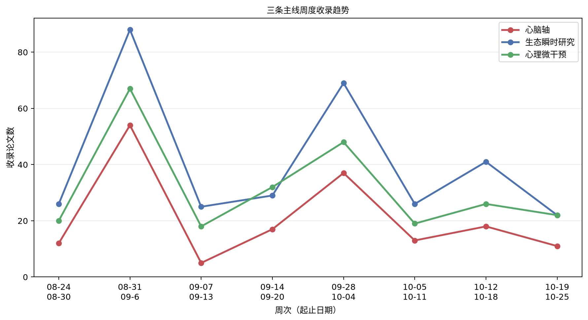

# 心脑、生态瞬时研究与心理微干预文献周报（2026-10-19 至 2026-10-25）

本期收录 45 篇文献。

## 重点推荐
收录 7 篇文献。

### 1. 心率变异性生物反馈训练对老年人的影响：一项随机预试验

- 原文标题：Effects of heart rate variability biofeedback training in older adults: a randomized pilot trial
- 作者：Perciliany Martins de Souza, Maria Emília Fonseca Oliveira, Tiago Arruda Sanchez, Carlos Eduardo Nórte, Izabela Mocaiber, Eduardo Bearzoti, Gabriela Guerra Leal Souza
- 期刊：Geriatrics Gerontology and Aging，JCR 待 JCR 数据核验，IF 待 JCR 数据核验
- 发表时间：2026-10-19
- 主题标签：心脑轴；心理微干预
- 关键词：心率变异性生物反馈；老年人；正性情绪；心肺耦合；随机预试验

**摘要**：目的：利用心率变异性（HRV）的生物反馈训练是改善情绪与生理状态的一种创新方法。本随机预试验考察与安慰剂训练相比，HRV生物反馈训练能否提升老年人的HRV、心肺耦合以及正负性情绪。方法：共收集16名老年人的数据，参与者接受14次每次15分钟的训练，每周3次。其中一半参与者（n=8）接受HRV生物反馈训练，另一半接受安慰剂训练。在第1、7、14次训练前及训练过程中评估正负性情绪、HRV各成分及心肺耦合。结果：结果显示，与第1次训练相比，生物反馈组在第7次和第14次训练时正性情绪呈上升趋势（p=0.08），HRV各成分有潜在改善（p<0.05）。对于心肺耦合，事后分析提示仅在第14次训练时较第1次训练有所增加（p=0.02）。此外，生物反馈组中正性情绪与HRV各成分之间存在显著关系（p<0.05）。结论：这些初步发现提示，HRV生物反馈训练可能有助于改善老年人的正性情绪、HRV和心肺耦合。然而，仍需更大规模的随机临床试验来证实这些发现并确立其临床适用性。

**原文链接**：[Crossref](https://doi.org/10.53886/gga.e0000484_en)

### 2. 中年心肌梗死幸存者的真实生活心理体验与心脏自主神经生理

- 原文标题：Real-Life Psychological Experiences and Cardiac Autonomic Physiology Among Survivors of a Myocardial Infarction in Midlife.
- 作者：Viola Vaccarino, Hua She, Lisa Elon, Tené T Lewis, Yi-An Ko, Gari Clifford, Quiao Li, Nancy Murrah, Lucy H Shallenberger, Tatum Roberts, Lewam Stefanos, Eric Fan-Lou, J Douglas Bremner, Paolo Raggi, Arshed Quyyumi, Amit J Shah
- 期刊：Journal of the American Heart Association，JCR Q1，IF 6.0（2025）
- 发表时间：2026-10-16
- 主题标签：心脑轴；生态瞬时研究
- 关键词：心脑轴；生态瞬时评估；心率变异性；副交感神经活动；负面情绪

**摘要**：背景：患有缺血性心脏病的年轻和中年女性与男性相比，心理社会因素负担更重。尽管动脉粥样硬化负担较轻，她们的发病率和死亡率却更差。关于日常生活压力和自主神经生理的数据有助于指导针对性干预。方法：我们研究了302名因心肌梗死近期住院的61岁及以下个体。所有人均接受了为期7天的家庭情绪和压力监测，使用生态瞬时评估，同时进行动态心电图监测以评估自主神经生理。减速容量作为副交感神经活动的预后标志物是主要自主神经结局；心率变异性也被检验。结果：样本中43%为女性，平均年龄51岁（标准差7岁）。在监测的一周内，女性报告的负面情绪和压力水平高于男性。女性的副交感神经活动（减速容量的日平均值）也显著低于男性；心率变异性也较低。在女性中，每日负面情绪与较低的减速容量呈负相关：每日负面情绪评分每增加1个对数单位，女性的减速容量下降4.5%，而男性差异接近于零：0.5%（交互作用P=0.02）。对其他风险因素的调整并未实质性影响这些关联。心率变异性指标也观察到类似的结果模式。结论：近期从心肌梗死中存活的年轻和中年女性在日常生活中比男性有更多的副交感神经撤退，尤其是在负面情绪时刻。这些结果强调需要更加关注女性心肌梗死后的心理社会管理。

**原文链接**：[PubMed + Crossref](https://doi.org/10.1161/jaha.126.052187)

### 3. 超慢脑—心—肠电生理交互揭示人类多系统协调生理网络

- 原文标题：Infra-slow brain-heart-gut electrophysiological interactions reveal a co-ordinated multisystem physiological network in humans.
- 作者：Giovanni Sitti, Laura Pitti, Diego Candia-Rivera
- 期刊：The Journal of physiology，JCR Q1，IF 4.6（2025）
- 发表时间：2026-10-22
- 主题标签：心脑轴
- 关键词：脑—心—肠交互；超慢电生理；脑电；心电；胃电

**摘要**：越来越多证据表明，大脑通过神经与非神经通路持续与其他生理系统交互。脑—心轴与脑—肠轴在稳态、适应负荷与行为中发挥核心作用，也参与情绪与决策等认知过程；这些轴的紊乱与多种心血管、神经及精神疾病相关。然而，脑、心、肠三者之间的交互仍鲜有探索。静息状态下，脑活动、心脏自主波动与胃节律均具有慢时间成分，提示脑—心—肠电生理交互可能发生在超慢（0.01–0.1 Hz）生理范围内。本研究利用28名健康被试的开放获取静息电生理记录，提取描述三个器官活动的时间变化功率动态：脑α功率、心脏交感与副交感指标以及胃节律功率，并在扩展时间延迟范围内采用最大信息系数量化器官间统计关联，通过替代数据检验确认生理交互，进而构建三器官交互的网络拓扑。结果显示，静息状态下脑—心—肠三元交互主要在超慢时间尺度上形成多向网络。该研究为脑—心—肠交互生理学提供了首批洞见之一，并为开发基于网络动态、能够将病理状态与多器官系统失调联系起来的更全面生物标志物提供了方法学基线。要点：首次在清醒健康人类被试中开展无创平行脑—心—肠电生理交互研究；分析同步脑电、心电与胃电记录，量化衍生时间序列关联的强度与时间尺度，构建大规模交互网络；发现脑—心—肠交互延伸至超慢范围（0.01–0.1 Hz），表明静息时一个器官电生理活动的自发波动通常伴随另外两个器官的相应变化；跨被试一致发现稳健的脑—心—肠网络拓扑，具有多向交互，且身体动态汇聚于中线中央—后部脑电区域；这些发现为表征脑—心—肠交互生理学提供了首批尝试之一，并提供了具有强大生物标志物开发潜力的方法。

**原文链接**：[PubMed + Crossref](https://doi.org/10.1113/jp291568)

### 4. 面向自闭症成人的生态瞬时干预的可行性、可接受性与初步疗效

- 原文标题：Feasibility, Acceptability, and Efficacy of an Ecological Momentary Intervention for Autistic Adults.
- 作者：China I Parenteau, Allison S Nahmias, Matthew D Lerner
- 期刊：Journal of autism and developmental disorders，JCR Q2，IF 2.6（2025）
- 发表时间：2026-10-22
- 主题标签：生态瞬时研究；心理微干预
- 关键词：生态瞬时干预；自闭症成人；可行性；社会情绪功能；数字干预

**摘要**：目的：许多自闭症成人获得可扩展的社会情绪支持的机会有限，凸显了需要可融入日常生活的低强度干预。本研究评估了一项为期一周的生态瞬时干预（EMI）的可行性、可接受性与初步疗效，该干预通过实时报告社交互动来增强社会注意与社会情绪功能。方法：31名自闭症成人被随机分配到三种条件之一（面部表情、发色或被动对照），完成EMI方案及干预前后测量。结果：可行性结果不一：保留率高，但自我报告依从性低于预设的80%基准，使用情况差异较大。等效性检验表明各条件在使用、依从性或可接受性上无差异。净可接受性未达到预设阈值（超过50%参与者报告中性或积极净可接受性）。回归分析未发现条件对行为、自我报告或神经结局的影响。结论：总体而言，结果表明该EMI实现了高保留率，但未达到依从性和可接受性的预设充分性阈值，也未在社会情绪功能上产生可检测的变化。可能需要改进EMI设计与剂量，以提升简短EMI对自闭症成人的潜在效果。

**原文链接**：[PubMed + Crossref](https://doi.org/10.1007/s10803-026-07574-z)

### 5. 利用活动追踪与即时消息改善适应性节奏：一项实用性随机对照试验——COV-LT2-0010

- 原文标题：Using activity tracking and just-In-time messaging to improve adaptive pacing: A pragmatic randomised control trial – COV-LT2-0010
- 作者：Nicholas Sculthorpe, Lawrence Hayes, Jacqueline Mair, David Carless, Nilihan Sanal-Hayes, Rachel Meach, Marie McLaughlin, Natalie Hilliard, Jane Ormerod
- 期刊：未提供，JCR 待 JCR 数据核验，IF 待 JCR 数据核验
- 发表时间：2026-10-22
- 主题标签：生态瞬时研究；心理微干预
- 关键词：长新冠；即时适应性干预；适应性节奏；可穿戴活动追踪；数字健康干预

**摘要**：本研究针对长新冠患者开发了一套名为PaceMe的移动支持平台，将可穿戴活动追踪器、手机应用与即时支持消息相结合，帮助患者实施适应性节奏管理以减少劳力后不适。研究包含三个工作流：与患者及公众共同设计应用与约150条行为改变信息图；通过叙事访谈了解患者使用体验；开展实用性随机等待名单对照试验评估效果。干预组获得个性化活动上限及全天实时接近上限的提醒通知，并可记录劳力后不适事件以调整活动上限；对照组使用仅可记录症状和填写量表的简化版应用。六个月结果显示两组在症状管理上无显著差异，但两组均出现康复趋势，心理健康、日常活动能力、焦虑抑郁、呼吸困难及疾病管理信心均有改善。质性分析提炼出识别与管理触发因素、支持、认可与能动性四个主题，参与者普遍对平台持积极评价。研究认为这是首个利用移动技术与可穿戴设备减轻长新冠患者节奏管理负担的尝试，未来需进一步优化平台并拓展至其他疲劳性疾病。

**原文链接**：[Crossref](https://doi.org/10.3310/nihropenres.1115364.1)

### 6. 基于智能手机的降低神经质干预：CHILL研究方案

- 原文标题：A Smartphone-Based Intervention to Decrease Neuroticism: Protocol of the CHILL Study
- 作者：Peter Haehner, Amanda Jo Wright, Rosalie Andrae, Till Lubczyk, Leyla Anina Rosero Betancourt§, Christopher James Hopwood, Wiebke Bleidorn
- 期刊：未提供，JCR 待 JCR 数据核验，IF 待 JCR 数据核验
- 发表时间：2026-10-23
- 主题标签：生态瞬时研究；心理微干预
- 关键词：神经质；智能手机干预；经验取样；人格改变；随机对照试验

**摘要**：全球有许多人希望降低自己的神经质水平。由于较低水平的神经质可预测一系列积极生活结果，包括健康、工作成功和关系质量，帮助人们降低神经质的干预措施可能产生广泛影响。本研究方案描述了CHILL研究（Changing How I Live Life）的原理与设计，旨在评估基于智能手机的干预措施在普通公众中降低神经质的效果。CHILL研究包括5个月内四次问卷调查评估、为期6周的干预阶段，以及两个为期1周的无干预经验取样阶段。在干预阶段，希望降低神经质的参与者被随机分配到四种不同的治疗组，这些治疗组采用不同的干预策略，针对神经质的不同方面和层面。CHILL研究超越了现有的意志性人格改变研究，通过同伴报告、内隐人格评估和7周随访期，检验哪些策略最有效地降低神经质，并评估干预诱导的神经质变化的持久性和可推广性。CHILL研究的目标是生成一种有效降低神经质的方法，并促进神经质改变综合理论的发展。

**原文链接**：[Crossref](https://doi.org/10.31234/osf.io/nz74u_v3)

### 7. 重性抑郁障碍中情绪心理意象期间脑-体活动的改变

- 原文标题：Altered brain-body activity during emotional mental imagery in major depressive disorder
- 作者：Alna Reem Al Latheef, Vera Flasbeck, Georg Juckel
- 期刊：Scientific Reports，JCR Q1，IF 4.9（2025）
- 发表时间：2026-10-24
- 主题标签：心脑轴
- 关键词：重性抑郁障碍；脑-体交互；心率变异性；脑电；情绪心理意象

**摘要**：重性抑郁障碍（MDD）与情绪加工、脑活动及自主神经调节的异常有关，可能反映神经与自主神经系统之间协调受损。本研究考察在情绪心理意象期间，这些异常是否更清晰地体现在不同的脑活动指标或自主神经系统指标（HRV）中，并探究其与心境和认知功能的关联。为此，37名健康对照和35名MDD患者在脑电与心电记录下完成了一项听觉引导意象范式，包含正性、负性、中性和抽象条件。脑电数据采用事件相关电位（ERP）、频谱功率和事件相关同步/去同步（ERS/ERD）进行分析，同时从心电中提取心率变异性（HRV）指标。所有参与者完成了心境问卷和认知评估。患者表现出更高的抑郁症状严重程度、更负性的当前心境以及执行功能下降。组间差异还出现在alpha、gamma和delta频段，而ERP波幅在组间无差异。神经振荡的改变与认知效率降低和抑郁症状严重程度增加相关。HRV指标显示患者交感神经系统和应激指数升高，提示自主神经调节改变。重要的是，delta ERS/ERD活动与HRV指标之间的相关仅在健康对照中观察到，而在MDD患者中不存在。这些发现表明，抑郁相关改变在神经振荡和自主神经调节上的反映比基本情绪反应模式更为明显。因此，神经与自主神经标志物可能为MDD中的认知困难、应激调节以及脑-体交互受损提供具有临床意义的信息。

**原文链接**：[Crossref](https://doi.org/10.1038/s41598-026-75968-1)

## 心脑轴
收录 7 篇文献。

### 1. 具身音乐干预对儿童执行功能、情绪调节与心理生理健康的影响：动作—节奏同步与自我调节的作用

- 原文标题：Effects of an embodied music intervention on executive function, emotion regulation and psychophysiological well-being in children: the role of movement-rhythm synchronization and self-regulation
- 作者：Qian Shu
- 期刊：Frontiers in Psychology，JCR Q1，IF 3.8（2025）
- 发表时间：2026-10-20
- 主题标签：心脑轴；心理微干预
- 关键词：具身音乐干预；执行功能；情绪调节；心率变异性；动作节奏同步

**摘要**：本研究为随机对照试验，考察12周具身音乐干预相较于非具身音乐参与和常规活动，是否在8至11岁儿童的执行功能、情绪调节、动作—节奏同步及心理生理健康方面产生更大改善。180名儿童随机分配至具身音乐组、非具身音乐组或常规活动对照组，两组音乐条件在时长、音乐暴露、教师接触和课程频率上匹配，具身条件额外加入全身节奏协调、动作抑制、规则切换、空间运动与合作同步。评估在基线、第6周、第12周干预后及3个月随访进行，主要结局为执行功能和情绪调节，次要结局包括动作—节奏同步、心理幸福感、以RMSSD为指标的静息心率变异性及睡眠问题。线性混合效应模型显示执行功能、情绪调节和动作—节奏同步均存在显著组别×时间交互；干预后具身音乐组在上述三项上的模型估计改善均大于非具身音乐组，且效果在随访时基本维持。心理幸福感和RMSSD的变化较为温和，睡眠效应较小。探索性间接效应分析与假设路径在统计上一致，但由于中介变量未在时间上完全分离，尚不能确立时间或因果中介。总体而言，随机比较支持具身音乐对若干近端结局的益处，所提出的机制仍需进一步验证。

**原文链接**：[Crossref](https://doi.org/10.3389/fpsyg.2026.1988460)

### 2. 七日多成分曼陀罗认知干预后各睡眠阶段心率变异性模式的探索性研究：一项随机前后对照预试验

- 原文标题：Exploratory heart rate variability patterns across sleep stages following a 7-day multicomponent mantra-based cognitive intervention: A pilot randomized pre-post controlled study.
- 作者：Ankita Garg, Varun Dutt, Laxmidhar Behera
- 期刊：Acta psychologica，JCR Q1，IF 3.8（2025）
- 发表时间：2026-10-21
- 主题标签：心脑轴；心理微干预
- 关键词：心率变异性；睡眠阶段；曼陀罗认知干预；自主神经功能；随机对照试验

**摘要**：背景：认知-沉思练习可能影响自主神经功能，但现有研究主要集中于清醒状态下的心率变异性（HRV）测量。短暂干预相关的变化是否在不同睡眠阶段存在差异尚不清楚。目的：探讨接受为期7天、多成分、基于Hare Krishna曼陀罗的认知疗法（HMBCT）干预的组别与进行日常常规活动的组别之间，按睡眠阶段划分的HRV差异是否不同。方法：34名18-30岁健康男性被随机分配至HMBCT组（n=17）或常规对照条件（n=17）。在基线和7天干预期后分别进行整夜多导睡眠监测并持续记录心电图。HRV变量采用时域和Poincaré/几何HRV指标，分别针对REM、N2和N3睡眠阶段计算。采用重复测量方差分析检验组×时间交互作用，随后对30项主要检验进行Benjamini-Hochberg错误发现率（FDR）校正。结果：九项交互作用达到名义未校正阈值（p<.05）：四项在REM期（SDNN、RMSSD、SD1、SD2），五项在N2期（SDNN、RMSSD、pNN50、SD1、CVI），而N3期无一项达到。REM/N2交互作用的效应量估计为偏η2p=0.120-0.173。然而，经FDR校正后无一项保持统计学显著（最小q=0.148）。结论：名义交互作用在REM和N2睡眠阶段更为明显，但主要交互作用均未通过多重检验校正。因此结果具有探索性，需在其他研究中加以验证。

**原文链接**：[PubMed](https://doi.org/10.1016/j.actpsy.2026.107984)

### 3. Martin Busch方法：一种与催眠和恍惚相关的身心干预——首次科学研究

- 原文标题：Der Ansatz von Martin Busch. Eine Mind-Body-Intervention mit Bezug zu Hypnose und Drance.
- 作者：Ernil Hansen, Veronika Jaeger, Nina Zech
- 期刊：Hypnose – Zeitschrift für Hypnose und Hypnotherapie (Hypnose-ZHH)，JCR 待 JCR 数据核验，IF 待 JCR 数据核验
- 发表时间：2026-10-21
- 主题标签：心脑轴；心理微干预
- 关键词：身心干预；恍惚；EEG变化；双谱指数；日间时间依赖性；昼夜类型；学习效应；个体内变异性

**摘要**：引言：Martin Busch从费登奎斯身心干预出发，发展出一种原创方法：在聚焦身体与位置感知后，随呼吸节律激发运动意图，随后以不同变式观察身体感觉的变化，并在规律间歇中将新信息整合进中枢神经系统储备。其中催眠过程的成分在客观与主观层面均显而易见。方法：由Martin Busch开发并录制了一套该方法典型的30分钟指导语。在应用过程中，通过BIS监测记录EEG变化作为恍惚状态的替代标记，一方面对54名单次应用被试进行记录，另一方面对6名重复应用10次的被试进行记录。结果：双谱指数（BIS）在应用过程中持续下降，其幅度与标准化催眠诱导相当。更明显的下降出现在间歇期间，尤其是在悖论性指令时。重复应用时学习效应并非线性。结论：结果支持如下假设：当清醒意识退居背景时，储存在无意识中的生理与心理模式可被修改。效应的日间时间依赖性与重复应用时的可重复性值得进一步关注。关键词：身心干预；恍惚；EEG变化；双谱指数；日间时间依赖性；昼夜类型；学习效应；个体内变异性

**原文链接**：[Crossref](https://doi.org/10.67383/hypnose-zhh-2026-12)

### 4. 无聊倾向中的内感受加工：能感知却无法解读

- 原文标题：Interoceptive Processing in Boredom Proneness: Sensing Without Making Sense
- 作者：Chantal Trudel, James Danckert
- 期刊：未提供，JCR 待 JCR 数据核验，IF 待 JCR 数据核验
- 发表时间：2026-10-22
- 主题标签：心脑轴
- 关键词：无聊倾向；内感受；心跳计数；预测加工；心脑轴

**摘要**：无聊倾向被认为与个体对自身内部状态的关系失调有关，但其机制尚不清楚。一种可能是，这种失调反映的是将内感受信号转化为对内部状态的有意义预测的困难，而非基本的检测失败。本研究通过两项研究检验这种失调关系反映的是解读困难、心脏内感受准确性缺陷，还是两者兼有。研究一（N=124）为直接重复验证，确认高无聊倾向个体报告强烈关注身体感觉却难以解读这些感觉，该模式在合并350名成人样本中保持稳定，并与自我聚焦注意和内感受感觉混淆的成熟测量呈中至强相关。研究二（N=121）采用心跳计数任务，以确定这种失调关系源于内感受加工缺陷还是解读失败。无聊倾向与客观心跳计数准确性无关，但仍与自我报告的内感受感觉混淆相关。两项研究结果一致表明，无聊倾向的最佳特征是对内部信号的解读困难，而非基本的内感受知觉缺陷。这些发现与无聊倾向的预测加工理论相一致，即高特质无聊者难以从内感受线索中生成有意义的预测。自我报告与客观心脏内感受之间的这种分离是否在不同测量方法和人群中具有普遍性，仍有待未来研究采用更敏感的内感受任务和试次水平预测误差指标加以检验。

**原文链接**：[Crossref](https://doi.org/10.31234/osf.io/8fprj_v1)

### 5. 同伴主导的考试模拟重塑基于问题的医学学习中的心理生理与情绪状态特征

- 原文标题：Peer-led examination simulation reshapes psychophysiological and emotional state profiles during problem-based medical learning.
- 作者：Morris Gellisch, Thorsten Schäfer
- 期刊：NPJ science of learning，JCR Q1，IF 4.3（2025）
- 发表时间：2026-10-24
- 主题标签：心脑轴
- 关键词：心率变异性；基于问题的学习；考试模拟；心理生理；成就情绪

**摘要**：重复的基于问题的学习（PBL）课程旨在维持主动、协作和自主学习，但已有证据对于熟悉的PBL流程能否随时间持续维持适当的学习者激活水平并不一致。本重复测量研究考察在常规PBL中嵌入同伴主导的考试模拟是否会重塑心理生理与成就情绪状态特征。42名医学生在静息参照、常规PBL以及含同伴主导考试模拟的PBL三种条件下接受评估。心率变异性（HRV）采用RMSSD、SDNN、pNN50和LF/HF量化，同时测量焦虑、感知压力、成就情绪、动机、自评表现及课后评价。两种PBL形式相对静息均降低HRV，表明常规PBL本身即伴随自主神经激活。与常规PBL相比，考试模拟引起额外的HRV withdrawal、更高的焦虑与感知压力以及更低的无聊感。基线校正混合模型支持RMSSD和SDNN的效应；pNN50未通过错误发现率校正，LF/HF无稳健效应。愉悦感、动机和自评表现无显著差异。学生报告从模拟形式中获得更大感知收益并更偏好该形式。因此，同伴主导的考试模拟使PBL转向一种更显著、类似评估的心理生理与情绪状态特征。

**原文链接**：[PubMed](https://doi.org/10.1038/s41539-026-00459-x)

### 6. 常见心理健康障碍中的心脏感知与自我报告内感受：系统综述与元分析

- 原文标题：Cardiac perception and self-reported interoception in common mental health disorders: A systematic review and meta-analysis.
- 作者：Rachael Lester, Andrew Jones, Steven M Gillespie
- 期刊：Neuroscience and biobehavioral reviews，JCR Q1，IF 8.5（2025）
- 发表时间：2026-10-25
- 主题标签：心脑轴
- 关键词：内感受；心脏感知；心理健康障碍；跨诊断标志物；元分析

**摘要**：内感受异常可能是心理健康问题的跨诊断标志物。既往探讨内感受与心理健康关系的综述结果不一，且多局限于心脏内感受测量。本研究对测量心脏感知与自我报告内感受同常见心理健康障碍（包括焦虑、抑郁、精神分裂症、双相障碍和强迫症）关联的研究进行了系统综述与元分析，样本为临床与非临床成人。共纳入57篇文章（总N=6652）的206个效应量进行随机效应元分析。总体合并关联显示，心理健康问题与心跳计数任务表现无显著关联（r=-.042），但与心率辨别任务表现呈显著负相关（r=-.137）。适应性内感受注意问题（r=-.183）而非感受（r=.136）或解释（r=-.117）与更差的心理健康症状相关，适应不良性内感受注意（r=.381）亦然。调节分析显示效应量常因不同心理健康障碍而异，并存在过度影响效应量及较宽95%预测区间的证据。研究结果凸显了方法学选择的重要性，以及不同心脏内感受表现任务与不同自我报告内感受维度之间可能存在的差异，为内感受作为心理健康困难跨诊断标志物提供了一定支持，可助力循证干预的开发。

**原文链接**：[PubMed](https://doi.org/10.1016/j.neubiorev.2026.107061)

### 7. 压力相关耗竭中急性低强度与中等强度运动的HRV与皮质醇反应

- 原文标题：Heart rate variability and cortisol responses to acute low- and moderate-intensity exercise in stress-related exhaustion.
- 作者：Jenny Kling, Örjan Ekblom, Robert Persson Asplund, David M Hallman, Yiwen Jiang, Victoria Blom
- 期刊：European journal of applied physiology，JCR Q2，IF 2.9（2025）
- 发表时间：2026-10-25
- 主题标签：心脑轴
- 关键词：心率变异性；压力相关耗竭；自主神经系统；皮质醇；运动强度

**摘要**：目的：运动常被推荐用于支持压力调节与心理健康，但这些益处是否适用于以长期压力和疲劳为特征的状况仍不清楚。本研究旨在考察单次运动后自主神经系统和下丘脑-垂体-肾上腺（HPA）轴反应在压力相关耗竭个体与健康对照之间是否存在差异，以及这些反应是否随运动强度变化。方法：采用随机、平衡交叉设计，30名压力相关耗竭个体（93.3%为女性；年龄46.3±5.89岁）和29名年龄与性别分布相当的的健康对照（93.1%为女性；年龄45.5±5.47岁）分别在不同时间完成两次22分钟骑行，强度对应估计最大摄氧量的40%（低强度）和55%（中等强度）。在运动前、运动后及运动后30分钟评估心率变异性（HRV；RMSSD、SD2/SD1、LF/HF）和唾液皮质醇，运动期间也评估HRV。结果：与对照相比，压力相关耗竭个体总体RMSSD较低，组间差异在运动后时段最为明显。在耗竭组内，中等强度较低强度运动与更低的RMSSD及更高的SD2/SD1和LF/HF相关，而对照组未观察到强度效应。运动期间HRV未见组间差异。皮质醇分析提示总体组间差异，但各时间点之间无明确差异。结论：这些发现提示压力相关耗竭中存在生理应激系统调节的改变，并强调运动后时段和运动强度是为该人群制定运动建议时的重要考虑因素。本研究于2024年5月30日在ClinicalTrials.gov回顾性注册，注册号NCT06429423。

**原文链接**：[PubMed + Crossref](https://doi.org/10.1007/s00421-026-06467-4)

## 生态瞬时研究
收录 18 篇文献。

### 1. 青少年晚间手机使用与睡眠结局

- 原文标题：Evening Phone Use and Sleep Outcomes Among Youth.
- 作者：Yihong Zhao, Lauren Hale, Dimitri A Christakis
- 期刊：JAMA pediatrics，JCR Q1，IF 17.1（2025）
- 发表时间：2026-10-19
- 主题标签：生态瞬时研究
- 关键词：被动感知；密集纵向；睡眠结局

**摘要**：本研究基于青少年大脑认知发展研究中Android用户的被动感知数据与Fitbit客观睡眠测量，采用密集纵向队列设计，考察青少年晚间智能手机使用与睡眠结局的个体内与个体间关联。研究纳入425名参与者共7591人夜数据，使用多层模型的个体内-个体间分解方法，量化晚8点至午夜各整点截止后的累积手机使用及入睡前5至30分钟的近端使用。结果显示，个体内分析中晚10点后每增加一分钟手机使用，入睡时间延后0.87分钟，睡眠结束时间延后0.37分钟，总睡眠时间减少0.43分钟；近端使用与入睡后觉醒增加相关，以入睡前最后5分钟最为显著。结论提示减少晚间手机使用，尤其晚10点后及临睡前使用，可能有助于改善青少年睡眠健康。

**原文链接**：[PubMed](https://doi.org/10.1001/jamapediatrics.2026.4902)

### 2. 利用生态瞬时评估与动态结构方程模型识别儿童易怒与违抗的个体特异性前因

- 原文标题：Leveraging ecological momentary assessment and dynamic structural equation modeling to identify idiographic antecedents of child irritability and defiance
- 作者：Shannon Shaughnessy, Spencer C. Evans
- 期刊：未提供，JCR 待 JCR 数据核验，IF 待 JCR 数据核验
- 发表时间：2026-10-20
- 主题标签：生态瞬时研究
- 关键词：生态瞬时评估；动态结构方程模型；个体特异性预测；儿童易怒；密集纵向测量

**摘要**：易怒与违抗是常见的青少年心理健康问题，与终生负面结果相关。个体特异性评估能够识别精神病理的独特预测因子，尤其在与定量方法和实时评估结合时。本研究将单案例动态结构方程模型应用于家长报告的生态瞬时评估数据，识别易怒与违抗的个体特异性预测因子。选取两名案例进行分析：凯文，一名有注意力问题的6岁男孩；莫莉，一名多动水平升高的7岁女孩。家长每天3次、持续30天报告儿童的情绪、行为与活动，依从性超过90%。动态结构方程模型分析检验每名儿童当前活动类型如何同时及跨时间预测其易怒与违抗。对凯文而言，媒体使用预测同时段更高的易怒，并呈趋势水平预测违抗；而主动游戏预测同时段更低的易怒，并呈趋势水平预测违抗。相反，对莫莉而言，进食显著预测同时段更低的易怒但随后更高的易怒；睡眠也预测莫莉随后更低的易怒。在这项概念验证分析中，结果显示凯文与莫莉各自具有 underlying 其易怒与违抗的独特近端预测因子。这些丰富的个体特异性发现为传统方法所遗漏，提示对个性化治疗的意义（如对凯文调节屏幕时间并鼓励户外游戏；对莫莉保持一致的进食与睡眠作息）。将实时评估与先进定量方法结合，可为凯文、莫莉以及广大儿童与家庭带来更有效的干预。

**原文链接**：[Crossref](https://doi.org/10.31234/osf.io/z67t9_v1)

### 3. 护理场景下基于多模态数据和可解释人工智能的产后抑郁风险预测与干预研究

- 原文标题：Study on Multimodal Data- and Explainable AI-Based Risk Prediction and Intervention for Postpartum Depression in Nursing Care Settings
- 作者：Yangyang Lin
- 期刊：Asia Pacific Journal of Clinical Medical Research，JCR 待 JCR 数据核验，IF 待 JCR 数据核验
- 发表时间：2026-10-20
- 主题标签：生态瞬时研究；心理微干预
- 关键词：产后抑郁；多模态纵向数据；可解释人工智能；风险分层干预；生态瞬时评估

**摘要**：目的：评估一个以护理为中心、利用多模态纵向数据和可解释人工智能（AI）的产后抑郁（PPD）动态预测与风险分层干预系统。方法：采用准实验对照研究，纳入300名产后6小时内入组的产妇，按入院顺序分配至AI辅助分层护理组（n=150）或常规护理组（n=150）。收集生理、行为、心理和社会支持指标，并在产后第7、14、28和42天进行EPDS评估。混合模型结合了时间卷积、长短期记忆、文本和语音表征以及多层融合；SHAP和注意力机制支持个案级解释。结局包括风险识别时间、EPDS轨迹、高危女性缓解率、护理工作量和内部验证的模型性能。结果：干预组风险识别早于对照组（1.21±0.68天 vs. 4.73±1.92天，P<0.05）。第42天EPDS平均降幅更大（-5.62±3.14 vs. -2.13±2.87，P<0.05），缓解率更高（78.3% vs. 42.6%；卡方=36.41，P<0.05）。高危识别率为92.0% vs. 64.0%。每次随访时间减少34.7%，护士报告需每日随访的产妇更少且工作相关压力更低。模型AUC为0.864，准确率0.82，召回率0.77，F1分数0.79。结论：整合风险分层护理的多模态可解释AI系统与更早的风险识别、改善的抑郁症状轨迹和更低的护理工作量相关。在广泛实施前仍需外部验证和完全随机化的多中心评估。

**原文链接**：[Crossref](https://doi.org/10.62177/apjcmr.v2i5.1788)

### 4. 意大利精神卫生支持性住房中精神分裂症谱系障碍患者对护理的感知满意度、服务氛围与情绪波动：一项多中心研究

- 原文标题：Perceived satisfaction with care, service atmosphere and mood fluctuations among patients with schizophrenia spectrum disorder in Italian mental health supported accommodations: a multicenter study.
- 作者：Alessandra Martinelli, Elena Toffol, Donato Martella, Martina Carnevale, Stefano Calza, Giovanni de Girolamo
- 期刊：BMC psychiatry，JCR Q1，IF 4.6（2025）
- 发表时间：2026-10-21
- 主题标签：生态瞬时研究
- 关键词：经验取样法；精神分裂症谱系障碍；支持性住房；情绪波动；护理满意度

**摘要**：背景：支持性住房是意大利社区精神卫生照护的核心组成部分，为精神分裂症谱系障碍患者提供结构化、以康复为导向的环境。尽管症状严重程度仍然重要，但照护环境和满意度对幸福感有强烈影响。情绪波动是日常功能的关键方面，但在支持性住房中尚未得到充分探讨。本研究采用经验取样法，旨在考察支持性住房中精神分裂症谱系障碍居民感知病房氛围、护理满意度与瞬时情绪之间的关联。方法：作为DiAPAson项目的一部分，68名精神分裂症谱系障碍居民还接受了经验取样法评估。其他测量包括精神病理学、功能、感知病房氛围和服务满意度。进行描述性分析，并用结构方程模型考察情绪与临床、人口学及环境因素的关系。结果：结构方程模型拟合优良。结合服务满意度和感知病房氛围的潜变量Env-Perc是瞬时情绪的唯一显著预测因子。结论：支持性住房中对护理的感知满意度和服务氛围有助于促进精神分裂症谱系障碍患者的积极情绪。

**原文链接**：[PubMed](https://doi.org/10.1186/s12888-026-08365-7)

### 5. 父母智能手机使用与儿童日常家庭生活中的情绪幸福感：经验取样研究

- 原文标题：Parental Smartphone Use and Children's Emotional Well-Being in Everyday Family Life: Experience Sampling Study.
- 作者：Eva Katharina Matthias, Krisna Adiasto, Katharina Ida Salo, Lisanne S Pauw, Anne Milek
- 期刊：JMIR pediatrics and parenting，JCR Q2，IF 2.3（2025）
- 发表时间：2026-10-21
- 主题标签：生态瞬时研究
- 关键词：父母智能手机使用；经验取样；日常日记；儿童情绪幸福感；数字表型

**摘要**：背景：过去十年间，智能手机已成为家庭生活的重要组成部分，塑造着日常作息与亲子互动。尽管父母在儿童面前使用智能手机常被以phubbing和技术干扰等概念框定为有害，但这些构念强调破坏性智能手机使用，可能使解释偏向负面效应。此外，以往研究多依赖横断面自我报告数据，限制了对父母智能手机使用与儿童日常幸福感关系的认识。目的：本研究考察父母在儿童面前使用智能手机与儿童情感幸福感及儿童基本心理需求受威胁感知之间的关联，同时采用自我报告与设备记录两种智能手机使用测量。方法：131名个体父母参与为期10天的每日日记研究。父母每晚报告其在选定目标儿童面前使用智能手机的情况、儿童的正负情感以及儿童基本心理需求受威胁的感知。此外，知情同意的安卓用户安装移动感知应用，在研究期间持续记录客观智能手机使用。采用多层模型分别检验母亲与父亲的个体内（日间波动）与个体间关联，并控制研究日、工作日与周末及每日工作时长。结果：父母智能手机使用较高与儿童情感幸福感基本无关。然而，平均自我报告总体使用较多的母亲感知到儿童基本需求受更大威胁。类似地，父亲在报告使用多于平常的日子里也感知到儿童基本需求受更大威胁。关于正性情感，未发现父母感知的儿童正性情感显著关联，表明平均在儿童周围更频繁使用智能手机的父母并未报告儿童正性情感较低。关于负性情感，总体使用较高的父亲报告儿童负性情感较高。此外，母亲在使用多于平常的日子里感知到儿童表现出更多负性情感。当使用设备记录数据评估父母智能手机使用時，上述关联均未出现。结论：总体而言，这些发现提示儿童需求受威胁感知可能与父母对自身智能手机使用的主观感知与解释有关，而非与其数字追踪的智能手机行为有关。这一差异凸显了区分父母智能手机使用主观与客观评估的重要性，并强调未来研究需整合儿童视角与互动情境，以厘清父母智能手机使用何时及如何影响儿童幸福感。

**原文链接**：[PubMed + Crossref](https://doi.org/10.2196/95447)

### 6. 面向抑郁症的在线行为数字表型：行为特征范围综述及研究领域标准构念相关性的探索性评估

- 原文标题：Online Behavioral Digital Phenotyping for Depression: Scoping Review of Behavioral Features and Exploratory Assessment of Research Domain Criteria Construct Relevance.
- 作者：Qiuyan Ren, Jing Chi, Yuman Li, Ping Zhao, Meiqin Luo, Jiale Sun, Yan He, Jianhong Liu, Lin Luo, Yanni Wu
- 期刊：Journal of medical Internet research，JCR Q1，IF 8.2（2025）
- 发表时间：2026-10-21
- 主题标签：生态瞬时研究
- 关键词：数字表型；抑郁症；在线行为；范围综述；研究领域标准

**摘要**：背景：抑郁症具有异质性和动态性，可观察行为的变化可能伴随其部分临床表现。数字设备为在自然情境中持续捕捉此类行为提供了新机会。然而，通过设备交互所捕捉的具体数字特征及其与抑郁相关结局的关系尚未被系统综合，其与功能性构念的潜在相关性亦不明确。研究领域标准（RDoC）可为探索数字行为与功能构念之间的潜在联系提供概念框架。目的：本范围综述旨在（1）识别并总结用于抑郁监测与评估的关键在线行为模态及其具体特征；（2）总结特定行为特征与抑郁相关结局之间关联的现有证据；（3）探索数字测量所捕捉的行为内容是否与RDoC构念存在潜在概念联系。方法：检索5个数据库（PubMed、Scopus、Web of Science、Embase和PsycINFO）自建库至2026年1月，并辅以引文追踪和灰色文献检索。纳入聚焦抑郁症在线行为数字表型并报告具体行为特征的研究。两名评审者独立筛选文献并提取数据，分歧通过讨论或咨询第三名评审者解决。结果以描述性方式综合。两名评审者依据官方RDoC构念定义独立评估各行为模态与RDoC构念之间的潜在概念联系。结果：共纳入74项研究。识别出五种主要行为模态：通话行为（n=31）、短信（n=21）、屏幕使用（n=41）、应用使用（n=26）和击键动态（n=14），涵盖36个核心特征。共31项（41.9%）研究报告了可归因于个别特征的结果，但没有任何单一特征在不同研究中显示出一致方向的抑郁相关结局关联。探索性RDoC评估提示，候选构念相关性主要涉及社会过程、感觉运动系统、认知系统以及唤醒与调节系统。结论：在线行为数字表型可捕捉一系列可观察行为，但当前证据尚不支持将个别数字行为特征解释为抑郁的稳定标志物或特定RDoC构念的直接代理。未来研究应提高特征定义的透明度与报告质量，加强特征层面结果的报告，并采用独立验证和构念导向的研究设计以提升可解释性。

**原文链接**：[PubMed](https://doi.org/10.2196/101329)

### 7. 通过可变样本量EWMA降低基于ESM的情绪障碍发作监测的参与者负担

- 原文标题：Reducing participant burden of ESM-based monitoring of mood disorder onset through variable sample size EWMA.
- 作者：Fien De Pauw, Evelien Schat, Francis Tuerlinckx, Eva Ceulemans
- 期刊：Behavior research methods，JCR Q1，IF 5.0（2025）
- 发表时间：2026-10-22
- 主题标签：生态瞬时研究
- 关键词：经验取样法；可变样本量EWMA；参与者负担；抑郁发作监测；统计过程控制

**摘要**：指数加权移动平均（EWMA）程序是一种有前景的统计过程控制技术，用于监测经验取样法（ESM）数据以实时检测即将发生的抑郁发作，从而实现及时干预。然而，要求参与者每天完成多份ESM问卷——相关研究采用每日五份或十份问卷的样本量——并持续较长时间，负担较重。我们提出一种可变样本量（VSS）EWMA方法，其中每日样本量取决于参与者前几日ESM分数的极端程度。VSS EWMA使个体状况良好时能够保持较低的每日样本量和参与者负担。我们通过模拟研究和对实证ESM数据的应用评估了VSS EWMA的性能。研究结果表明，VSS EWMA改善了检测速度与参与者负担之间的平衡。基于这些结果，我们提供了如何根据不同的优先事项调整VSS EWMA的建议，并概述了未来研究方向。

**原文链接**：[PubMed](https://doi.org/10.3758/s13428-026-03183-x)

### 8. 日常生活中的情绪调节困难：评估、动态变化及其与压力-情感状态和特质的关联

- 原文标题：Emotion regulation difficulties in daily life: Assessment, dynamics, and links to stress-affective states and traits.
- 作者：Maurizio Sicorello, Wiebke Heyse, Luise Pruessner, Moritz Elsaesser, David R Kolar
- 期刊：Psychological assessment，JCR Q1，IF 3.1（2025）
- 发表时间：2026-10-22
- 主题标签：生态瞬时研究
- 关键词：情绪调节困难；生态瞬时评估；压力-情感动态；状态量表；日常波动

**摘要**：情绪调节困难在总体幸福感和大多数精神病理中起重要作用，但其日常动态仍不清楚。本研究将状态版情绪调节困难量表改编用于生态瞬时评估，考察此类困难在日常生活中如何展开，包括如何评估、如何随时间波动以及如何嵌入动态的压力-情感情境。在一项预注册研究中（N=227；每天6次调查，持续10天；数据收集于2023-2024年），德国成年被试报告了压力源、情感以及状态版情绪调节困难量表。验证性分析支持该量表的四因子结构，并有证据反对存在一个通用的共享困难因子。我们提供了经心理测量学评估的德语4题、8题和18题版本用于生态瞬时评估，并附实践建议。尽管与特质评估存在相当程度的收敛，情绪调节困难既表现出稳定性也表现出有意义的波动。它们在压力源之后升高，与负性情感共现，并预测情感恢复受损。压力源效应在特质情绪调节困难和神经质较高的个体中更强。这些发现支持将情绪调节困难的多个维度作为日常生活中动态、情境敏感的过程进行评估，并为进一步的常模和临床研究提供了基础。

**原文链接**：[PubMed](https://doi.org/10.1037/pas0001511)

### 9. 边缘型人格障碍个体日常生活中的绝望感与自杀冲动：一项动态评估研究

- 原文标题：Hopelessness and suicidal urges in daily life: An ambulatory assessment study in individuals with borderline personality disorder.
- 作者：Carola Claus, Büsra Senyüz, Nikolaus Kleindienst, Tobias Teismann, Ulrich W Ebner-Priemer, Tali Boritz, Shelley McMain, Stefanie Lis, Martin Bohus, Philip Santangelo, Ruben Vonderlin
- 期刊：Personality disorders，JCR Q1，IF 3.6（2025）
- 发表时间：2026-10-22
- 主题标签：生态瞬时研究
- 关键词：边缘型人格障碍；自杀冲动；认知绝望感；动态评估；智能手机评估

**摘要**：自杀危机在边缘型人格障碍（BPD）个体中较为常见，但其短期动态变化仍未得到充分理解。绝望感是自杀意念与行为的近端风险因素，但瞬间认知绝望感如何与日常生活中急性自杀冲动相联系，以及这种关联是否受到快速发作性自杀危机（急性自杀情感障碍）终生严重程度的调节，目前尚不清楚。为回答这些问题，231名寻求治疗的BPD个体在连续4天内每天完成最多13次基于智能手机的评估，测量瞬间自杀冲动、认知绝望感和负性情绪。结果显示，自杀冲动虽不频繁，但在个体间和个体内均存在显著变异。在控制先前自杀冲动、负性情绪、年龄和性别后，个体内瞬间认知绝望感的升高与更高的自杀冲动强度显著相关。滞后认知绝望感未显示稳健的预测效应，快速发作性自杀危机的终生严重程度也未调节瞬间认知绝望感与自杀冲动之间的关联。总体而言，瞬间认知绝望感是BPD个体自杀冲动的一个动态近端相关因素。这些发现支持以实时、以人为中心的途径开展自杀预防。

**原文链接**：[PubMed](https://doi.org/10.1037/per0000783)

### 10. 当青少年的消极未来思维不由自主地持续时会发生什么：与日常生活中自杀意念的关联

- 原文标题：What happens when teens' negative future thoughts involuntarily persist: Associations with suicidal ideation in daily life.
- 作者：Nicola Hohensee, Ki Eun Shin, Olivia C Lawrence, Marianne Bassing, Jiawen Long, Christine B Cha
- 期刊：Journal of psychopathology and clinical science，JCR Q1，IF 4.6（2025）
- 发表时间：2026-10-22
- 主题标签：生态瞬时研究
- 关键词：生态瞬时评估；密集纵向测量；自杀意念；未来生活取向；青少年

**摘要**：青少年一旦经历过自杀意念（SI），往往会反复出现。新兴研究强调考虑未来生活取向（FLO）心理过程领域的重要性，以更好地理解SI并可能发现减少和阻止自杀性的关键可干预靶点。近期研究不仅关注这些FLO过程涉及什么，还强调这些FLO过程如何运作——以下称为形式FLO特征。尽管首批研究已确立适应不良的形式FLO特征（如整体消极效价、重复性、不可控性）与青少年SI之间的联系，但仍需采用生态效度高的密集纵向评估研究。因此，本研究旨在检验青少年的FLO是否与SI史以及当这些思维具有（a）重复性、（b）消极效价和（c）不可控性时的实时SI体验相关。样本为121名青少年（15-17岁，平均年龄15.88岁，标准差0.77，其中56名有SI史），每天最多报告5次，持续14天，报告其最近一次FLO思维及相关特征（如重复性、效价、不可控性）以及SI。有SI史与无SI史的青少年在形式FLO特征上无显著差异。在有SI史的青少年中，消极效价与同时及后续SI复发显著相关。同时SI的主效应进一步被交互作用所细化，即更高的不可控性增强了与SI关联的强度。这些发现强调了在应对青少年自杀性时关注FLO特定形式特征的潜在价值。

**原文链接**：[PubMed](https://doi.org/10.1037/abn0001188)

### 11. 偏头痛先兆的数字表型

- 原文标题：Digital phenotyping of migraine aura
- 作者：Parisa Gazerani, Igor Petrušić, Marcos Fabio DosSantos
- 期刊：Frontiers in Neurology，JCR Q2，IF 3.3（2025）
- 发表时间：2026-10-22
- 主题标签：生态瞬时研究
- 关键词：偏头痛先兆；数字表型；真实世界连续数据

**摘要**：偏头痛先兆是一种短暂的局灶性神经现象，表现为不断演变的视觉、躯体感觉、语言以及程度较轻的运动障碍等症状，反映大脑功能的动态改变，涉及皮层及皮层下结构。尽管对其神经生物学理解有所进展，包括皮层扩散性去极化的作用，偏头痛先兆仍未被充分刻画，主要原因在于其发作不可预测、持续时间短暂、个体与症状变异大，且依赖回顾性临床评估。因此，其时间演变与生物学异质性仍待阐明。数字表型已作为一种通过个人数字技术采集连续真实世界数据来刻画健康与疾病的框架而出现。本文探讨将数字表型应用于偏头痛先兆的潜在理由。我们认为先兆独特的生物学与时间特征使其适合进行连续多维评估。将患者报告症状与生理、行为及环境数据整合可能提高表型分辨率，从而有助于推进机制理解并捕捉个体内变异。因此，我们提出一个概念框架，并讨论数字表型的方法学与转化挑战，包括实施相关挑战。数字表型并非取代既有临床与神经生物学方法，而是作为一种补充框架，若经严格验证，可能推进我们对先兆及偏头痛先兆研究的理解，支持精准头痛医学的建立与巩固，并促进患者照护。

**原文链接**：[Crossref](https://doi.org/10.3389/fneur.2026.1967778)

### 12. 社会互动的多样性与老年人更高的情绪多样性相关

- 原文标题：Diversity of social interactions is related to higher emodiversity among older adults.
- 作者：Ella Cohn-Schwartz, Deborah Finkel, Margaret Gatz
- 期刊：Aging & mental health，JCR Q2，IF 2.9（2025）
- 发表时间：2026-10-23
- 主题标签：生态瞬时研究
- 关键词：情绪多样性；社会互动；每日日记；老年人；生态瞬时评估

**摘要**：目的：人们在日常生活中所体验情绪的变异性（情绪多样性）通常与更好的身心健康相关。然而，情绪体验的多样性与老年期日常互动之间的关系尚不清楚。本研究考察了老年人情绪多样性的社会情境。方法：在瑞典衰老双生子研究中，62岁及以上的参与者（N=144）完成了为期六天的每日日记，报告其正负性情绪以及与不同亲密程度个体的社会互动。结果：跨亲密程度的社会接触多样性（社会多样性）越高，正性情绪多样性越高。社会多样性与负性情绪多样性的关联受年龄调节。在年龄较大的成年人中，社会多样性越高，负性情绪多样性越低。与中间圈层亲密关系（“亲密”但非“非常亲密”）的人会面也与更高的正性情绪多样性相关。年龄交互作用显示，年轻老年人会见亲密关系者时体验到更高的负性情绪多样性。讨论：日常互动中更高的社会多样性与更高的正性情绪多样性相关。然而，社会关系与负性情绪多样性之间的关联可能因年龄而异。

**原文链接**：[PubMed](https://doi.org/10.1080/13607863.2026.2750221)

### 13. 真实情境中的词汇提取：卒中后失语症成人及健康成人完成基于音频的生态瞬时命名方案的可行性

- 原文标题：Word Retrieval in the Wild: The Feasibility of an Audio-Based Ecological Momentary Naming Protocol Completed by Adults With and Without Poststroke Aphasia.
- 作者：Erin L Meier, Jack Hester, Ha Le, Veronica Fletcher, Hai-Dinh Phan, Leanna Ugent, Stephen S Intille
- 期刊：American journal of speech-language pathology，JCR Q1，IF 2.5（2025）
- 发表时间：2026-10-23
- 主题标签：生态瞬时研究
- 关键词：生态瞬时评估；失语症；命名；可行性；移动健康

**摘要**：目的：生态瞬时评估（EMA）通过在个体自然环境中反复采集行为或状态数据，通常借助智能设备完成。针对失语症患者（PWA）的EMA方案可行性尚缺乏探索，尤其是对语言能力的客观评估。本研究评估了一种新型的、由智能手表递送的、基于音频的生态瞬时命名方案的可行性。方法：14名失语症患者和13名健康对照完成为期3周的EMA方案，在日常活动中尝试对通过智能手表提示递送的图片物体进行命名。参与者被伪随机分配至单项条件（每天36次提示，每次一张图片）或九项条件（每天4次提示，每次九张图片）。可行性指标包括依从性（命名尝试次数/计划提示次数）、完成率（命名尝试次数/递送提示次数）以及完成EMA的感知容易度与负担（通过每周调查采集）。结果：失语症患者和对照组的平均依从性均为77%，对照组和失语症患者的完成率分别为83%和84%。单项条件参与者的依从性（83.3%）高于九项条件（71.9%），呈趋势性差异。对EMA容易度和负担的感知未随时间变化，也未因组别或EMA条件而异。较高的依从性与时间变量（方案天数、一天中的时段、星期几）、较大年龄及较好的抑制控制相关。较高的完成率与失业状态及较高的感知负担相关。退出访谈的定性分析表明，89%的参与者对该方案总体持积极印象。结论：该新型EMA对失语症及非失语症成人均可行。尽管针对失语症患者的EMA研究仍处于起步阶段，移动健康方法学为改善失语症症状的长期原位监测准确性提供了若干有前景的途径。

**原文链接**：[PubMed + Crossref](https://doi.org/10.1044/2026_ajslp-25-00580)

### 14. 日常生活中的情绪惯性：情绪调节策略使用作用的动态结构方程模型分析

- 原文标题：Emotional inertia in daily life: a dynamic structural equation modelling analysis of the role of emotion regulation strategy use.
- 作者：Aja Louise Murray, Xinxin Zhu, Tong Xie, Lilly Shanahan, Denis Ribeaud, Manuel Eisner
- 期刊：Cognition & emotion，JCR Q2，IF 2.2（2025）
- 发表时间：2026-10-23
- 主题标签：生态瞬时研究
- 关键词：情绪惯性；生态瞬时评估；情绪调节；反刍；动态结构方程模型

**摘要**：高负性情绪惯性指负性情绪状态在时刻之间表现出强烈的延续性，并与适应不良和心理健康状况不佳相关。近期生态瞬时评估（EMA）研究表明，日常生活中的情绪调节策略使用可能促成情绪惯性。本研究在此基础上，在451名新兴成年人（平均年龄27岁）样本中，通过为期两周的EMA方案，考察反刍、抑制、重评和接纳在七种情绪状态的负性情绪惯性中的作用。采用带个体内交叉滞后效应的两层动态结构模型，结果显示反刍对四种负性情绪状态具有显著中介效应，提示其在维持负性情绪中的作用；但未发现其他显著中介效应。结果表明，在所考察的情绪调节策略中，反刍是减少负性情绪惯性最有前景的干预靶点，尽管效应量较小。

**原文链接**：[PubMed](https://doi.org/10.1080/02699931.2026.2751457)

### 15. 卒中后遗症患者及其伴侣的正念觉察与压力关联：一项每日日记研究

- 原文标题：Mindful Awareness and Stress Associations Among People Living With the Effects of Stroke and their Partners: Findings From a Daily Diary Study.
- 作者：Hannah Tschenett, Elizabeth Zambrano Garza, Theresa Pauly, Kenneth M Madden, Maureen C Ashe, Rachel Murphy, Denis Gerstorf, Wolfgang Linden, Urs M Nater, Christiane A Hoppmann
- 期刊：Biopsychosocial science and medicine，JCR 待 JCR 数据核验，IF matched
- 发表时间：2026-10-23
- 主题标签：生态瞬时研究
- 关键词：每日日记；正念觉察；压力；卒中；伴侣；二元关联

**摘要**：目的：卒中是全球主要致病和致死原因之一，显著影响卒中后遗症患者及其伴侣的健康。卒中后遗症患者及其伴侣均承受较高压力。因此，本每日日记研究考察了压力的逐日变化及其与正念觉察的关联，探讨正念觉察作为压力潜在保护因素在患者与伴侣内部及之间的作用。方法：加拿大86对社区居住夫妻（平均年龄67±10岁，女性占50%），其中一方为卒中后遗症患者，连续最多14天每晚报告自身压力、伴侣压力及自身正念觉察。结果：可区分二元体模型显示，个体报告伴侣感到更有压力（每日及总体）以及伴侣实际感到更有压力（每日及总体）时，自身报告更多每日压力。相反，当个体报告更高正念觉察（每日及总体）时，其报告更少每日压力。卒中后遗症患者在伴侣报告更高总体正念觉察时也报告更少每日压力。然而，该二元关联未在相反方向或每日正念觉察中显现。结论：结果提示伴侣间每日压力的二元关联，并表明正念觉察可能减少个体内部每日压力。在二元体中，卒中后遗症患者似乎受益于伴侣的正念觉察。结果凸显伴侣对卒中后遗症患者的重要作用，并强调需考虑人际动态的差异，尤其是在应对疾病的夫妻中。注册：本研究已在OSF预注册（https://doi.org/10.17605/OSF.IO/XTV2H）。

**原文链接**：[PubMed](https://doi.org/10.1097/psy.0000000000001539)

### 16. 圣诞假期中的育儿压力螺旋与性别化劳动分工

- 原文标题：Parenting stress spirals and a gendered labour division over the Christmas holidays.
- 作者：Elouise Botes, Julia Reiter, Samuel Greiff, Ziwen Teuber
- 期刊：Communications psychology，JCR Q1，IF 6.4（2025）
- 发表时间：2026-10-24
- 主题标签：生态瞬时研究
- 关键词：经验取样；育儿压力；认知劳动

**摘要**：圣诞期间育儿需求与无形劳动显著增加，但这些过程如何在日常生活中展开尚不清楚。本研究使用经验取样数据，对293名英国父母在35天假期期间进行追踪，考察认知劳动、情绪抑制与主观压力之间的时间性关联。动态结构方程模型显示，所有构念均具有强自回归稳定性，认知劳动与压力之间存在即时的相互关联，表明存在自我强化的循环。认知劳动与压力还能预测随后的情绪抑制，提示情绪抑制是对心理与压力过载的情境性应对反应。在个体间层面，社会支持降低了情绪抑制，但未能缓冲压力或认知劳动。性别差异仅出现在认知劳动上，母亲报告的水平高于父亲。研究结果凸显了无形劳动与压力之间的动态互动，并强调了父母在假期期间面临的心理压力。

**原文链接**：[PubMed](https://doi.org/10.1038/s44271-026-00535-3)

### 17. 内隐自我死亡联结与抑郁焦虑症状：一项单被试实验设计

- 原文标题：Implicit Self-Death Associations and Symptoms of Depression and Anxiety: A Single-Case Experimental Design.
- 作者：Radiah Maria Belak, Nicholas J Moberly
- 期刊：Psychological reports，JCR Q2，IF 1.9（2025）
- 发表时间：2026-10-24
- 主题标签：生态瞬时研究；心理微干预
- 关键词：内隐自我死亡联结；正念微干预；单被试实验设计

**摘要**：死亡焦虑可能作为焦虑与抑郁症状背后的跨诊断过程发挥作用。本研究使用死亡内隐联想任务（D-IAT）测量内隐自我死亡联结（ISDA），并采用同时多基线设计评估一项简短正念干预，对四名既往有焦虑/抑郁诊断的学生进行干预并追踪维持效果。在20次每日会话中，收集D-IAT的D分数以及Mini-DASS抑郁和焦虑分数。视觉分析提示若干参与者的抑郁和焦虑有所下降，较低分数常持续至维持期。个案层面的Tau-b模式存在异质性。精确随机化检验显示，焦虑从基线到干预阶段有显著下降（p = .04），而抑郁下降不显著（p = .08）。两种结局均未显示显著的基线至维持期效应，D分数也未显示显著下降。研究结果部分支持正念相关的症状改变，但未发现ISDA相应变化的证据。

**原文链接**：[PubMed](https://doi.org/10.1177/00332941261501010)

### 18. 希望在慢性疼痛患者中的作用及其与生活质量的关联——一项每日日记研究的启示

- 原文标题：The role of hope and its association with quality of life in individuals with chronic pain - insights from a daily diary study.
- 作者：Jungin Joo, Cerina Dubois, Janardan Devkota, Nicole McConico, Chung Jung Mun, Kelly E Dunn, Vadim Zipunnikov, Ryan Vandrey, Patrick H Finan, Johannes Thrul
- 期刊：Quality of life research : an international journal of quality of life aspects of treatment, care and rehabilitation，JCR Q1，IF 3.4（2025）
- 发表时间：2026-10-25
- 主题标签：生态瞬时研究
- 关键词：希望；生活质量；慢性疼痛；每日日记；生态瞬时评估

**摘要**：目的：希望已被确认为提升生活质量的有益因素，尤其对包括慢性疼痛在内的慢性疾病患者而言。然而，关于希望与生活质量如何交叉及相互关联，仍存在显著的认识空白。本研究考察了每日希望频率（即参与者每天感到充满希望的频率）能否预测使用大麻和阿片类药物管理疼痛的慢性疼痛患者次日的生活质量。方法：本研究为观察性研究，经约翰斯·霍普金斯布隆伯格公共卫生学院机构审查委员会批准（方案编号：IRB00009327）。参与者（N=132）因慢性疼痛使用阿片类药物和大麻，完成了基线调查及为期30天的每日日记，评估希望频率、生活质量和睡眠满意度。参与者平均年龄42.7岁（SD=13.9），以男性（58.3%）和非西班牙裔白人（63.6%）为主。采用线性混合效应模型检验每日希望频率（分解为个体间和个体内成分）对次日生活质量的滞后效应，控制基线变量、每日睡眠满意度和前一日生活质量，并考察了个体内变异性。结果：较高的希望频率与更高的次日生活质量显著相关，无论是个体间（即平均希望水平较高的参与者报告更高的生活质量）还是个体内（即当某天的希望高于该参与者自身平均水平时），在控制前一日生活质量和睡眠满意度后依然成立。较高的基线希望和生活质量得分与30天期间较高的平均生活质量相关，但希望的个体内变异性与生活质量无显著关联。结论：本每日日记研究发现，前一日希望频率——包括稳定的个体差异和日间波动——与同时使用大麻和阿片类药物的慢性疼痛患者次日生活质量相关。

**原文链接**：[PubMed](https://doi.org/10.1007/s11136-026-04413-7)

## 心理微干预
收录 18 篇文献。

### 1. 虚拟现实增强自我关怀并减少心理健康护理专业人员职业倦怠：一项试点可行性随机对照试验的研究方案

- 原文标题：Virtual Reality for Enhancing Self-Compassion and Reducing Burnout Among Mental Health Care Professionals: Protocol for a Pilot Feasibility Randomized Controlled Trial.
- 作者：Rawan Iriqat, Andre Faro, Stephanie Tarle, Shavon Moore, Wael Al-Delaimy
- 期刊：JMIR research protocols，JCR Q3，IF 1.6（2025）
- 发表时间：2026-10-19
- 主题标签：心理微干预
- 关键词：虚拟现实；自我关怀；职业倦怠；心理微干预；可行性随机对照试验

**摘要**：背景：在高需求临床环境中工作的心理健康护理专业人员经常接触患者的痛苦与创伤，面临职业倦怠和继发性创伤应激的风险升高。关怀聚焦认知行为疗法（CF-CBT）在减轻心理困扰和增强自我关怀方面显示出潜力，但传统实施方式可能受时间、可及性和资源限制的制约。虚拟现实（VR）可能为实施关怀聚焦干预提供一种沉浸式且可及的方法。目的：主要目标是评估自我实施的VR增强CF-CBT（VR-CF-CBT）干预对心理健康护理专业人员的可行性和可接受性。次要探索性目标是估计自我关怀、职业倦怠和继发性创伤应激（STS）的变化，以及可为未来确定性试验设计提供依据的组间差异。方法：将在心理健康护理专业人员进行一项两臂随机对照试点试验。参与者将被随机分配到VR-CF-CBT干预组或主动对照组，对照组通过数字手册提供自我引导的CF-CBT。参与者将在4至6周内完成8次简短课程（每次约10分钟）。探索性临床结局将包括使用经验证的自评工具测量的自我关怀、职业倦怠和STS的变化。主要可行性和可接受性结局将包括招募、保留、干预依从性、课程完成情况、参与者满意度，以及干预措施可接受性量表、干预措施适当性量表和干预措施可行性量表的得分。结果：该研究于2026年4月获得资助。截至2026年10月，已有38名参与者提供知情同意并入组。第二批参与者的招募正在进行中，数据收集正在进行。入组和数据收集预计将持续至2026年，数据分析和研究结果传播预计于2027年春季完成。结论：本试点研究将提供有关通过沉浸式VR向心理健康护理专业人员实施CF-CBT的可行性和可接受性的信息。研究结果将有助于确定是否需要在更大规模试验前进行修改，并为未来疗效测试的设计提供初步估计。试验注册：ClinicalTrials.gov NCT07666867；https://clinicaltrials.gov/study/NCT07666867。国际注册报告标识符（IRRID）：DERR1-10.2196/105754。

**原文链接**：[PubMed](https://doi.org/10.2196/105754)

### 2. 课程嵌入式正念干预后的心理韧性

- 原文标题：Resilience Following a Course-Embedded Mindfulness Intervention.
- 作者：Amy E Delaney, Kim Y Martineau Jackson, Jennifer A Livesley, Mary O'Keeffe, Ian A Lane
- 期刊：Nurse educator，JCR Q1，IF 2.8（2025）
- 发表时间：2026-10-20
- 主题标签：心理微干预
- 关键词：正念微练习；心理韧性；护理学生

**摘要**：背景：护理专业学生承受高水平的压力，凸显了采用创新课程方法促进心理韧性与福祉的必要性。目的：评估在执照前基础与健康评估课程中嵌入正念微练习对护理专业学生心理韧性的影响。方法：将简短正念活动整合进课程模块。采用前后测教育评估设计，使用Connor-Davidson心理韧性量表考察132名护理学士学生的反应，通过独立样本t检验和条目水平分析评估前后测反应的变化。结果：后测心理韧性得分显著高于前测（P = .042；d = 0.36），在5个心理韧性领域均有显著改善，尤其是对变化的适应性。结论：将正念微练习嵌入基础护理课程作业是一种可行、基于胜任力的策略，可培养心理韧性，同时支持美国护理学院协会要点第9和第10领域中的自我觉察、福祉、反思性实践和专业发展胜任力。

**原文链接**：[PubMed + Crossref](https://doi.org/10.1097/nne.0000000000002351)

### 3. 在线正念干预对注意缺陷/多动障碍儿童父母的效果

- 原文标题：The effects of an online mindfulness-based intervention for parents of children with attention deficit/hyperactivity disorder.
- 作者：Zoe Jiwen Zhang, Herman Hay Ming Lo, Rebecca Y M Cheung, Qirong Chen, Wing Tung Yeung, Stanley Kam Chung Chan, Alma Au, Elisabeth Wai Yin Wong, Eric Kam-Pui Lee, Doris Mei Sum Woo, Susan M Bögels, Elsa Ngar-Sze Lau, Siu-Man Ng
- 期刊：Journal of affective disorders，JCR Q1，IF 5.7（2025）
- 发表时间：2026-10-20
- 主题标签：心理微干预
- 关键词：在线正念干预；ADHD儿童父母；随机对照试验；心理教育；父母幸福感

**摘要**：正念干预已被视为注意缺陷/多动障碍（ADHD）儿童的辅助治疗手段。随着在线形式正念干预日益受到关注，其在父母群体中的应用仍主要基于健康人群。本研究采用双臂随机对照试验，考察在线正念干预（第1组）相较于在线心理教育项目（第2组）的效果，在干预前、干预后及3个月随访时测量结局。共248名6至12岁ADHD症状儿童的父母参与，其中131名分配至在线正念干预组，117名分配至心理教育组。两组在儿童ADHD症状、执行功能及父母幸福感方面均表现出显著且持久的改善；父母压力水平及表达性情绪的两个维度（批评性评论与初始陈述）在两组中均显著下降。值得注意的是，在线正念干预对失眠表现出特异性获益。作为表达性情绪维度之一的亲子关系质量在重复测量方差分析中呈现小幅度改善，但敏感性分析未能一致支持。未来研究应验证正念干预的特异性与可持续治疗效果，并加强父母参与与支持。

**原文链接**：[PubMed](https://doi.org/10.1016/j.jad.2026.122646)

### 4. AI驱动的压力、抑郁与焦虑预防与早期干预：一项随机临床试验

- 原文标题：AI-Powered Prevention and Early Intervention for Stress, Depression, and Anxiety: A Randomized Clinical Trial
- 作者：Julie Youko Anne Cachia, Xuan Zhao, Wenxi Pu, Chi Liao, merel Keijsers, Julian De Freitas, Rebecca Fortgang
- 期刊：未提供，JCR 待 JCR 数据核验，IF 待 JCR 数据核验
- 发表时间：2026-10-20
- 主题标签：心理微干预
- 关键词：生成式AI；数字干预；随机临床试验

**摘要**：针对专门构建的生成式AI心理健康支持的随机证据仍然有限。在这项预注册试验中，1137名未经过筛查的大学生被分配接受为期6周的生成式AI驱动移动干预（Flourish）或常规照护。在全样本中，Flourish在感知压力（β = −0.03，p = 0.010）、抑郁症状（β = −0.03，p = 0.006）和焦虑症状（β = −0.04，p = 0.001）方面产生了更有利的变化轨迹。在基线症状较低的参与者中，Flourish缓冲了症状恶化；在症状较高的参与者中，Flourish对抑郁（d = 1.03 vs 0.56）和焦虑（d = 0.91 vs 0.60）的改善更大，达到有意义改善的比例分别为52.3% vs 31.7%和50.6% vs 38.1%。感知压力的降低可能是症状改善的潜在路径。据我们所知，这是首个支持专门构建、安全优先的生成式AI用于未筛查人群心理健康预防与早期干预的试验。

**原文链接**：[Crossref](https://doi.org/10.31234/osf.io/nwz9q_v7)

### 5. 具身音乐干预对儿童执行功能、情绪调节与心理生理健康的影响：动作—节奏同步与自我调节的作用

- 原文标题：Effects of an embodied music intervention on executive function, emotion regulation and psychophysiological well-being in children: the role of movement-rhythm synchronization and self-regulation
- 作者：Qian Shu
- 期刊：Frontiers in Psychology，JCR Q1，IF 3.8（2025）
- 发表时间：2026-10-20
- 主题标签：心脑轴；心理微干预
- 关键词：具身音乐干预；执行功能；情绪调节；心率变异性；动作节奏同步

**摘要**：本研究为随机对照试验，考察12周具身音乐干预相较于非具身音乐参与和常规活动，是否在8至11岁儿童的执行功能、情绪调节、动作—节奏同步及心理生理健康方面产生更大改善。180名儿童随机分配至具身音乐组、非具身音乐组或常规活动对照组，两组音乐条件在时长、音乐暴露、教师接触和课程频率上匹配，具身条件额外加入全身节奏协调、动作抑制、规则切换、空间运动与合作同步。评估在基线、第6周、第12周干预后及3个月随访进行，主要结局为执行功能和情绪调节，次要结局包括动作—节奏同步、心理幸福感、以RMSSD为指标的静息心率变异性及睡眠问题。线性混合效应模型显示执行功能、情绪调节和动作—节奏同步均存在显著组别×时间交互；干预后具身音乐组在上述三项上的模型估计改善均大于非具身音乐组，且效果在随访时基本维持。心理幸福感和RMSSD的变化较为温和，睡眠效应较小。探索性间接效应分析与假设路径在统计上一致，但由于中介变量未在时间上完全分离，尚不能确立时间或因果中介。总体而言，随机比较支持具身音乐对若干近端结局的益处，所提出的机制仍需进一步验证。

**原文链接**：[Crossref](https://doi.org/10.3389/fpsyg.2026.1988460)

### 6. 护理场景下基于多模态数据和可解释人工智能的产后抑郁风险预测与干预研究

- 原文标题：Study on Multimodal Data- and Explainable AI-Based Risk Prediction and Intervention for Postpartum Depression in Nursing Care Settings
- 作者：Yangyang Lin
- 期刊：Asia Pacific Journal of Clinical Medical Research，JCR 待 JCR 数据核验，IF 待 JCR 数据核验
- 发表时间：2026-10-20
- 主题标签：生态瞬时研究；心理微干预
- 关键词：产后抑郁；多模态纵向数据；可解释人工智能；风险分层干预；生态瞬时评估

**摘要**：目的：评估一个以护理为中心、利用多模态纵向数据和可解释人工智能（AI）的产后抑郁（PPD）动态预测与风险分层干预系统。方法：采用准实验对照研究，纳入300名产后6小时内入组的产妇，按入院顺序分配至AI辅助分层护理组（n=150）或常规护理组（n=150）。收集生理、行为、心理和社会支持指标，并在产后第7、14、28和42天进行EPDS评估。混合模型结合了时间卷积、长短期记忆、文本和语音表征以及多层融合；SHAP和注意力机制支持个案级解释。结局包括风险识别时间、EPDS轨迹、高危女性缓解率、护理工作量和内部验证的模型性能。结果：干预组风险识别早于对照组（1.21±0.68天 vs. 4.73±1.92天，P<0.05）。第42天EPDS平均降幅更大（-5.62±3.14 vs. -2.13±2.87，P<0.05），缓解率更高（78.3% vs. 42.6%；卡方=36.41，P<0.05）。高危识别率为92.0% vs. 64.0%。每次随访时间减少34.7%，护士报告需每日随访的产妇更少且工作相关压力更低。模型AUC为0.864，准确率0.82，召回率0.77，F1分数0.79。结论：整合风险分层护理的多模态可解释AI系统与更早的风险识别、改善的抑郁症状轨迹和更低的护理工作量相关。在广泛实施前仍需外部验证和完全随机化的多中心评估。

**原文链接**：[Crossref](https://doi.org/10.62177/apjcmr.v2i5.1788)

### 7. 森林访问与数字森林疗法的心理健康效益：一项叙述性综述

- 原文标题：Mental health benefits of forest visits and digital forest therapy: a narrative review
- 作者：Hana Gačal, Jana Kurjakova, Jaroslav Vido, Magdalena Pichlerova, Viliam Pichler, Daniel Kurjak, Peter Petrík
- 期刊：Journal of Forestry Research，JCR Q1，IF 4.1（2025）
- 发表时间：2026-10-20
- 主题标签：心理微干预
- 关键词：森林疗法；数字干预；心理健康；压力恢复；虚拟现实

**摘要**：森林提供的生态系统服务不仅限于物质资源，还包括对人类心理健康与福祉的显著益处。越来越多的跨学科研究表明，森林暴露可产生短期的压力、焦虑和负性情绪降低，而重复或结构化的干预可能支持情绪、注意力和心理福祉的更广泛改善。本综述综合了关于森林访问心理健康效益的当前证据，特别聚焦于森林生态系统，并考察了将森林暴露与心理结局相联系的潜在机制路径。这些机制包括压力降低与注意力恢复、多感官环境效应、接触天然生物活性化合物、促进身体活动与社会互动，以及通过微生物多样性实现的免疫调节。与此同时，本综述评估了关于数字森林疗法的新兴证据，如虚拟现实、360度森林视频和移动应用程序，这些旨在为难以接触真实森林的个体提供基于自然的益处。尽管数字方法可提供情绪和压力恢复的短期改善，但当前证据仍具有异质性，且这些干预通常缺乏真实森林环境的完整感官、生物和行为复杂性。我们讨论了真实与数字森林暴露的优势与局限，并强调其互补作用。最后，我们考虑了对公共卫生、森林管理和政策的意义，强调需要将心理健康效益视为核心生态系统服务，并将基于森林的干预纳入预防性健康策略。

**原文链接**：[Crossref](https://doi.org/10.1007/s11676-026-02157-1)

### 8. 七日多成分曼陀罗认知干预后各睡眠阶段心率变异性模式的探索性研究：一项随机前后对照预试验

- 原文标题：Exploratory heart rate variability patterns across sleep stages following a 7-day multicomponent mantra-based cognitive intervention: A pilot randomized pre-post controlled study.
- 作者：Ankita Garg, Varun Dutt, Laxmidhar Behera
- 期刊：Acta psychologica，JCR Q1，IF 3.8（2025）
- 发表时间：2026-10-21
- 主题标签：心脑轴；心理微干预
- 关键词：心率变异性；睡眠阶段；曼陀罗认知干预；自主神经功能；随机对照试验

**摘要**：背景：认知-沉思练习可能影响自主神经功能，但现有研究主要集中于清醒状态下的心率变异性（HRV）测量。短暂干预相关的变化是否在不同睡眠阶段存在差异尚不清楚。目的：探讨接受为期7天、多成分、基于Hare Krishna曼陀罗的认知疗法（HMBCT）干预的组别与进行日常常规活动的组别之间，按睡眠阶段划分的HRV差异是否不同。方法：34名18-30岁健康男性被随机分配至HMBCT组（n=17）或常规对照条件（n=17）。在基线和7天干预期后分别进行整夜多导睡眠监测并持续记录心电图。HRV变量采用时域和Poincaré/几何HRV指标，分别针对REM、N2和N3睡眠阶段计算。采用重复测量方差分析检验组×时间交互作用，随后对30项主要检验进行Benjamini-Hochberg错误发现率（FDR）校正。结果：九项交互作用达到名义未校正阈值（p<.05）：四项在REM期（SDNN、RMSSD、SD1、SD2），五项在N2期（SDNN、RMSSD、pNN50、SD1、CVI），而N3期无一项达到。REM/N2交互作用的效应量估计为偏η2p=0.120-0.173。然而，经FDR校正后无一项保持统计学显著（最小q=0.148）。结论：名义交互作用在REM和N2睡眠阶段更为明显，但主要交互作用均未通过多重检验校正。因此结果具有探索性，需在其他研究中加以验证。

**原文链接**：[PubMed](https://doi.org/10.1016/j.actpsy.2026.107984)

### 9. 交互式数字认知行为疗法对重度抑郁症患者抑郁症状的疗效与安全性：一项多中心、随机、评估者盲法试验，对照主动情绪日记

- 原文标题：Efficacy and safety of interactive digital therapeutics with cognitive behavioral therapy for depressive symptoms in patients with major depressive disorder: A multicenter, randomized, assessor-blinded trial versus an active mood diary control.
- 作者：Yoo Jin Jang, Woojae Myung, C Hyung Keun Park, Hong Jin Jeon
- 期刊：Journal of affective disorders，JCR Q1，IF 5.7（2025）
- 发表时间：2026-10-21
- 主题标签：心理微干预
- 关键词：交互式数字疗法；认知行为疗法；重度抑郁症；随机对照试验；情绪日记

**摘要**：引言：数字认知行为疗法（CBT）对重度抑郁症有效，但许多干预使用静态、非交互式内容。交互式数字认知行为疗法（iDT-CBT）提供适应性、对话式干预。方法：我们开展了一项为期8周的随机、评估者盲法试验，比较iDT-CBT与主动情绪日记对照在110名重度抑郁症成人中的效果。主要结局为第8周BDI-II评分变化。次要结局包括PHQ-9、MADRS和BAI。分析纳入所有随机参与者，使用协方差分析并调整基线评分和性别。结果：iDT-CBT的BDI-II改善优于主动情绪日记（13.34对6.54分；校正p=0.0003）。PHQ-9、MADRS和BAI改善也支持iDT-CBT。第8周缓解比例在iDT-CBT组更高：BDI-II（30.4%对9.3%）、PHQ-9（62.5%对44.4%）、MADRS（23.2%对5.6%）、BAI（50.0%对20.4%）。在调整基线评分和性别的逻辑回归中，四项结局的缓解条件比值均支持iDT-CBT（p分别为0.011、0.039、0.014和0.002），尽管PHQ-9未校正风险差置信区间包含零。然而，BDI-II效应在站点校正的重复测量混合模型（MMRM）中减弱，且BDI-II和PHQ-9效应在MMRM、多重插补或观察病例分析中不显著。MADRS和BAI仍显著。无不良事件相关脱落或干预相关严重不良事件。讨论：iDT-CBT显示出有前景的短期疗效，尽管对自评抑郁症状的效应对分析方法敏感。需要更长期研究。临床试验注册：Clinical Research Information Service标识符：KCT0010758。

**原文链接**：[PubMed](https://doi.org/10.1016/j.jad.2026.122653)

### 10. 八周正念自我关怀干预促进青少年运动员的情绪调节与心理韧性

- 原文标题：An Eight-Week Mindful Self-Compassion Intervention Fosters Emotion Regulation and Resilience in Youth Athletes
- 作者：Tsz Lun (Alan) Chu, Sophia DeMan, Brian Ching-Yuan Cheng
- 期刊：未提供，JCR 待 JCR 数据核验，IF 待 JCR 数据核验
- 发表时间：2026-10-21
- 主题标签：心理微干预
- 关键词：正念；自我关怀；青少年运动员；情绪调节；心理韧性

**摘要**：自我关怀干预越来越多地用于支持青少年的福祉，但青少年运动员如何理解和学习相关概念与工具尚未得到考察。本研究探讨了青少年运动员在参加为期八周的自我关怀、正念与运动员韧性训练（SMART）项目后所感知的改变机制与心理技能。美国五个学校和俱乐部运动团体的33名13至18岁运动员在项目完成后一到两周接受了半结构化一对一访谈。基于批判实在论视角的反身性主题分析生成了四个主题：（1）觉察此前已存在之物——一种识别并命名此前未被察觉的想法和情绪的新能力；（2）将内在批评者转变为内在教练——在犯错后从自我批评转向自我友善与共同人性；（3）管理情绪并促进韧性以提升表现——运用呼吸练习、冥想和自我对话等心理技术来调节压力和挫折；（4）将其带离赛场——自我关怀概念与工具未经提示地迁移到学术和日常非运动情境中。研究结果表明，针对运动情境的结构化正念自我关怀项目可以成为技能学习的有意义切入点，这些技能超越表现情境，为区分和整合特质正念与青少年心理健康干预的持续努力提供了证据。

**原文链接**：[Crossref](https://doi.org/10.21203/rs.3.rs-11087671/v1)

### 11. Martin Busch方法：一种与催眠和恍惚相关的身心干预——首次科学研究

- 原文标题：Der Ansatz von Martin Busch. Eine Mind-Body-Intervention mit Bezug zu Hypnose und Drance.
- 作者：Ernil Hansen, Veronika Jaeger, Nina Zech
- 期刊：Hypnose – Zeitschrift für Hypnose und Hypnotherapie (Hypnose-ZHH)，JCR 待 JCR 数据核验，IF 待 JCR 数据核验
- 发表时间：2026-10-21
- 主题标签：心脑轴；心理微干预
- 关键词：身心干预；恍惚；EEG变化；双谱指数；日间时间依赖性；昼夜类型；学习效应；个体内变异性

**摘要**：引言：Martin Busch从费登奎斯身心干预出发，发展出一种原创方法：在聚焦身体与位置感知后，随呼吸节律激发运动意图，随后以不同变式观察身体感觉的变化，并在规律间歇中将新信息整合进中枢神经系统储备。其中催眠过程的成分在客观与主观层面均显而易见。方法：由Martin Busch开发并录制了一套该方法典型的30分钟指导语。在应用过程中，通过BIS监测记录EEG变化作为恍惚状态的替代标记，一方面对54名单次应用被试进行记录，另一方面对6名重复应用10次的被试进行记录。结果：双谱指数（BIS）在应用过程中持续下降，其幅度与标准化催眠诱导相当。更明显的下降出现在间歇期间，尤其是在悖论性指令时。重复应用时学习效应并非线性。结论：结果支持如下假设：当清醒意识退居背景时，储存在无意识中的生理与心理模式可被修改。效应的日间时间依赖性与重复应用时的可重复性值得进一步关注。关键词：身心干预；恍惚；EEG变化；双谱指数；日间时间依赖性；昼夜类型；学习效应；个体内变异性

**原文链接**：[Crossref](https://doi.org/10.67383/hypnose-zhh-2026-12)

### 12. 催眠结合虚拟自然暴露干预在造血细胞移植患者中的可行性与初步疗效

- 原文标题：Feasibility and preliminary efficacy of an intervention combining hypnosis and virtual nature exposure in patients following hematopoietic cell transplantation
- 作者：Audrey Laurin, Valentyn Fournier, Orly Desjardins, Jean Roy, Jean-Samuel Boudreault, Maïa Labelle, Pierre Rainville, Mathieu Landry, Karim Jerbi, Richard LeBlanc, Floriane Rousseaux, David Ogez
- 期刊：未提供，JCR 待 JCR 数据核验，IF 待 JCR 数据核验
- 发表时间：2026-10-21
- 主题标签：心理微干预
- 关键词：催眠；虚拟自然暴露；造血细胞移植；可行性试验；心理微干预

**摘要**：本研究评估了将催眠与虚拟自然暴露相结合的干预在造血细胞移植患者中的可行性与初步疗效。采用随机纵向可行性试验，实验组使用提供虚拟自然环境与催眠的应用程序为期两周。可行性结局包括招募、脱落、可用性、晕动症及定性用户体验访谈，初步疗效主要结局为生活质量，并采用视觉数字量表考察单次干预前后对疼痛、焦虑和放松的即时效应。共纳入40名参与者，两周内平均使用2.8次，晕动症轻微，定性反馈积极，首次干预后疲劳与焦虑显著降低、放松与愉悦感显著提升，但1个月和3个月随访未见显著组间效应。结论认为该干预对造血细胞移植患者可行，具有初步的即时心理效应，需优化实施并扩大样本以评估临床疗效。

**原文链接**：[Crossref](https://doi.org/10.21203/rs.3.rs-9885591/v1)

### 13. 预防性正念干预对护理专业学生首次临床实习前感知压力与预期焦虑的影响：一项预注册随机对照试验

- 原文标题：Effects of a preventive mindfulness intervention on perceived stress and anticipatory anxiety before first clinical training in nursing students: A preregistered randomized controlled trial
- 作者：Hanae Tainaka, Sachiko Nagaya, Taeko Muramatsu, Jun Inoue, Satoshi Tanaka
- 期刊：未提供，JCR 待 JCR 数据核验，IF 待 JCR 数据核验
- 发表时间：2026-10-22
- 主题标签：心理微干预
- 关键词：正念干预；预期焦虑；护理专业学生；随机对照试验；感知压力

**摘要**：背景：临床实习是护理专业学生的重大压力源，首次进入临床实习者尤为脆弱。本预注册随机对照试验评估在首次临床实习前实施的为期6周的正念项目能否预防压力与焦虑。方法：29名护理专业学生被随机分配至干预组（n=15）或对照组（n=14），27人完成研究（干预组13人，对照组14人）。干预组接受为期6周的正念冥想项目，对照组仅接受常规课程。主要结局为感知压力（PSS-10）；次要结局包括焦虑（STAI）、抑郁（BDI-II）、睡眠质量（PSQI）与正念觉知（MAAS），在基线、临床实习前、实习中期与实习后进行评估。各结局采用两因素重复测量方差分析，当组别×时间交互显著时进行Bonferroni校正的组间t检验。结果：主要结局感知压力未显示显著的干预效应（F(3,75)=0.41，p=.747）。次要结局中，状态焦虑呈现显著的组别×时间交互（F(3,75)=5.58，p=.002，ηp²=0.182）。对照组从基线到临床实习前评估状态焦虑急剧上升，表明首次临床实习前存在预期焦虑；干预组未出现此类上升，且在临床实习前评估时状态焦虑显著低于对照组（d=0.99，单尾Bonferroni校正p=.033）。特质焦虑、抑郁症状、睡眠质量与正念觉知均无显著效应。结论：本随机对照试验中，正念干预未显著降低主要结局感知压力。然而，研究结果表明护理专业学生在首次临床实习前经历显著的预期焦虑，并提示预防性正念项目可减弱这种预期状态焦虑。未来研究应在临床实习期间考察强化课程，并在更多样化人群中评估效果。试验注册：日本临床试验注册中心（jRCT），jRCT1040240204，注册日期2025年3月25日。

**原文链接**：[Crossref](https://doi.org/10.21203/rs.3.rs-11214873/v1)

### 14. 时间观与正念干预对有特殊教育需求青少年情绪调节的影响：一项现象学研究

- 原文标题：Impact of a time perspective and mindfulness-based intervention on emotional regulation in adolescents with special educational needs: A phenomenographic study
- 作者：Cristián Oyanadel, Catalina Aguayo-Velozo, Valentina Álvarez-Quiroz, Fernanda Cravero, Javiera Palma-Navarrete, Javiera Rojas-Farias, Matilde Rubilar-Chávez
- 期刊：Time &amp; Society，JCR Q2，IF 1.2（2025）
- 发表时间：2026-10-22
- 主题标签：心理微干预
- 关键词：正念；时间观；情绪调节；特殊教育需求；青少年

**摘要**：本研究探讨了结合时间观灵活性与正念练习的干预对智利比奥比奥地区学校融合项目中特殊教育需求青少年情绪调节的影响。采用现象学定性设计与反思性主题分析，参与者包括六名特殊教育需求青少年、五名家长及三所学校的18名教育专业人员，通过六次个别情景访谈和五次讨论小组收集数据。结果显示干预获得积极评价，包括呼吸技术的习得、情绪识别改善及情绪管理增强。学生表现出与调节困难相关的消极过去观和宿命现在观，与乐观未来观形成对比。教师观察到学生行为改善。总体而言，灵活时间观与正念的整合对特殊教育需求青少年似乎有效，未来干预应强调家长参与和课程整合。

**原文链接**：[Crossref](https://doi.org/10.1177/0961463x261498443)

### 15. BodyScreen：一款针对青少年及年轻女性社交媒体使用与进食障碍风险的移动应用干预的试点评估

- 原文标题：BodyScreen: A pilot evaluation of a mobile app intervention targeting social media engagement and eating disorder risk in adolescent and young adult women.
- 作者：Louise Mason, Victoria Yarmey, Shuya Li, Mohamed Muzamil, Sumit Kumar, Jake Linardon, Simon B Sherry, Emilie Lacroix, Jennifer S Mills, Aaron Keshen, Sandra M Meier
- 期刊：Body image，JCR Q1，IF 6.0（2025）
- 发表时间：2026-10-23
- 主题标签：心理微干预
- 关键词：移动应用干预；进食障碍风险；社交媒体使用；身体不满；数字干预

**摘要**：以外貌为中心的社交媒体使用会导致青少年和年轻成人的身体不满和进食障碍风险升高。可扩展的、以数字方式递送的、同时针对社交媒体行为和心理风险因素的干预仍然有限。本试点试验评估了BodyScreen，一款为期4周的移动应用，旨在减少适应不良的社交媒体参与，同时提升自尊和身体欣赏。80名年龄15至29岁、进食障碍风险升高的加拿大青少年及年轻女性参与了单臂试点试验。评估在干预前后进行。主要结局为进食障碍症状学。次要结局包括身体不满、自尊、完美主义、社交媒体使用、心理适应和生活质量。采用线性混合效应模型检验前后变化，并通过半结构化访谈评估用户体验。68名参与者（85%）完成了干预后评估。进食障碍症状显著下降（d = -1.12）。次要结局也观察到改善：身体不满（d = -1.30）、自尊（d = 0.84）、完美主义（d = -0.85）、社交媒体使用（d = -0.46）、心理适应和生活质量（d = 0.50）。参与度高（73%完成至少70%的练习），报告的负面影响很少，可用性为中等。定性反馈强调结构化日常流程和技能获得为促进因素，重复性自我监测和轻微的界面问题为障碍。BodyScreen是一种可行、安全且有前景的早期干预，适用于进食障碍风险升高的年轻女性，尤其是那些具有外貌动机社交媒体使用的人群。未来试验应包括对照组、招募更多样化的样本、评估长期结局，并结合定性反馈以提升可用性和参与度。

**原文链接**：[PubMed](https://doi.org/10.1016/j.bodyim.2026.102211)

### 16. 虚拟现实干预在司法精神卫生服务中的应用：实施可行性、可接受性与临床结局的可行性研究

- 原文标题：Virtual reality-based intervention in forensic mental health services: a feasibility study of implementation, acceptability, and clinical outcomes
- 作者：Gemma Escuder-Romeva, Ellen Vorstenbosch, Aitor-Eneko Olivé-Albitzur, Verónica Tre-Ortega, Raquel Sanz-Heras, Eduardo Luna-Rodríguez, Mónica Civit-Ramírez, María-Cristina Brophy-Palma, Ezequiel-Jesús Pérez-Sánchez, Noemí Del Prado-Sánchez, María Ribas-Siñol
- 期刊：Frontiers in Psychology，JCR Q1，IF 3.8（2025）
- 发表时间：2026-10-23
- 主题标签：心理微干预
- 关键词：虚拟现实；放松干预；司法精神卫生；可行性研究；状态焦虑

**摘要**：目的：本研究评估沉浸式虚拟现实放松项目在成人及青少年司法精神卫生机构常规照护中实施的可行性、可接受性及初步临床结局。方法：在两家司法精神卫生服务机构开展可行性研究：成人监狱康复单元（UHRPI，n=21）与青少年司法治疗单元（UTJJ，n=8）。研究为期12周，包括4周干预前阶段、4周干预阶段（含8次VR会话）及4周干预后阶段。主要结局为可行性，包括服务使用者可接受性与专业人员可用性。次要探索性结局包括生理指标（血压与心率）、状态焦虑（STAI-State）及每次VR会话前后即刻评估的主观情绪状态（视觉模拟量表）。结果：两种环境中可接受性与可用性均较高，干预总体耐受良好。UHRPI中收缩压、心率及状态焦虑显著下降；UTJJ中未观察到显著生理或焦虑变化。两种环境中VR会话后压力与焦虑均下降，放松感与感知自然连接感均上升。结论：该VR放松项目可行、可接受，并良好融入司法精神卫生常规照护，与即时情绪反应改善相关，成人中伴有有利生理变化，值得进一步开展更大规模对照研究。

**原文链接**：[Crossref](https://doi.org/10.3389/fpsyg.2026.1940486)

### 17. 游戏化数字心理健康干预对大学生的作用：系统综述与三水平元分析——干预包效应及成分与机制证据

- 原文标题：Gameful Digital Mental Health Interventions for University Students: Systematic Review and Three-Level Meta-Analysis of Package Effects with Component and Mechanism Evidence
- 作者：Wenxuan Lu, Shusheng Shi, Jiayu Chen
- 期刊：Behavioral Sciences，JCR Q1，IF 3.2（2025）
- 发表时间：2026-10-23
- 主题标签：心理微干预
- 关键词：游戏化数字干预；大学生心理健康；元分析

**摘要**：游戏化数字心理健康干预正日益用于支持大学生，但完整干预包的有效性证据应与特定游戏机制独立改善心理健康结局的证据相区分。本系统综述与元分析评估了游戏化数字心理健康干预对大学生抑郁、焦虑和压力/痛苦的短期干预包效应，同时分别考察主动对照、成分层面和机制导向的证据，以区分干预包效应与游戏化特征及其他干预过程的增量效应。检索PubMed、Web of Science核心合集、Scopus、CINAHL、CNKI、Embase和APA PsycINFO（EBSCOhost），自建库至2026年9月3日。两名评审独立筛选标题/摘要和全文，分歧由第三名评审裁定。采用RoB 2评估偏倚风险，采用GRADE评价结局确定性。随机化干预包效应试验采用结局特异性随机效应模型合成，整合性三水平模型保留研究内的多个症状效应。通过研究聚类稳健推断及跨合理研究内抽样相关性的敏感性分析检验依赖性。成分与机制导向研究单独合成。数据库检索识别4267条记录，经数据库途径保留23篇报告，后向引文追踪新增1篇，共保留24篇报告，3篇未能获取。与 inactive 对照相比，游戏化干预对抑郁（4项研究；Hedges‘ g = 0.52，95% CI 0.32–0.72）和焦虑（3项研究；g = 0.51，95% CI 0.22–0.80）显示中等短期效应，而压力/痛苦高度不精确（2项研究；g = 0.19，95% CI −1.68至2.06）。整合合成纳入来自5项独立研究的9个症状效应，得g = 0.410（95% CI 0.245–0.575；研究聚类稳健95% CI 0.182–0.638），95%预测区间为−0.013至0.834，包含无获益及未来情境下的小幅有害效应。主动对照效应在全调节模型中较小，但留一研究法不稳定。扩展的成分与机制导向证据未显示游戏化特征带来一致的独立症状获益，尽管部分研究报告了参与度、依从性、愉悦感或相关干预过程的差异。游戏化数字心理健康干预包可能减轻大学生的短期抑郁和焦虑症状，但抑郁和焦虑的确定性低，压力/痛苦极低；仅5项独立研究支持整合模型。跨干预和情境的普适性仍不确定。针对主动对照的证据稀少且不稳定。成分与机制导向证据表明游戏化或情境设计选择可能影响参与度、依从性、愉悦感或训练过程，但不支持添加游戏机制带来一致的独立症状获益。未来研究应采用有意义的主动对照及析因或拆解设计，以识别哪些游戏化特征支持治疗机制、参与度，或可能干扰治疗过程。

**原文链接**：[Crossref](https://doi.org/10.3390/bs16111989)

### 18. 内隐自我死亡联结与抑郁焦虑症状：一项单被试实验设计

- 原文标题：Implicit Self-Death Associations and Symptoms of Depression and Anxiety: A Single-Case Experimental Design.
- 作者：Radiah Maria Belak, Nicholas J Moberly
- 期刊：Psychological reports，JCR Q2，IF 1.9（2025）
- 发表时间：2026-10-24
- 主题标签：生态瞬时研究；心理微干预
- 关键词：内隐自我死亡联结；正念微干预；单被试实验设计

**摘要**：死亡焦虑可能作为焦虑与抑郁症状背后的跨诊断过程发挥作用。本研究使用死亡内隐联想任务（D-IAT）测量内隐自我死亡联结（ISDA），并采用同时多基线设计评估一项简短正念干预，对四名既往有焦虑/抑郁诊断的学生进行干预并追踪维持效果。在20次每日会话中，收集D-IAT的D分数以及Mini-DASS抑郁和焦虑分数。视觉分析提示若干参与者的抑郁和焦虑有所下降，较低分数常持续至维持期。个案层面的Tau-b模式存在异质性。精确随机化检验显示，焦虑从基线到干预阶段有显著下降（p = .04），而抑郁下降不显著（p = .08）。两种结局均未显示显著的基线至维持期效应，D分数也未显示显著下降。研究结果部分支持正念相关的症状改变，但未发现ISDA相应变化的证据。

**原文链接**：[PubMed](https://doi.org/10.1177/00332941261501010)

## 数据分析

- 本周唯一收录：45 篇。
- 三条主线：心脑轴 11 篇；生态瞬时研究 22 篇；心理微干预 22 篇。
- 较上一统计周 减少 21 篇。
- 提示：交叉研究可同时计入多条主线，因此三条主线之和可能高于唯一论文数。

### 热门主题

生态瞬时评估（9）；心率变异性（6）；随机对照试验（5）；数字干预（4）；情绪调节（4）；虚拟现实（3）；经验取样（3）；数字表型（3）；每日日记（3）；自我关怀（2）；心理微干预（2）；老年人（2）

### 关键词云图

### 三主线周度趋势

